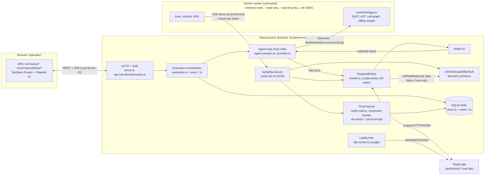
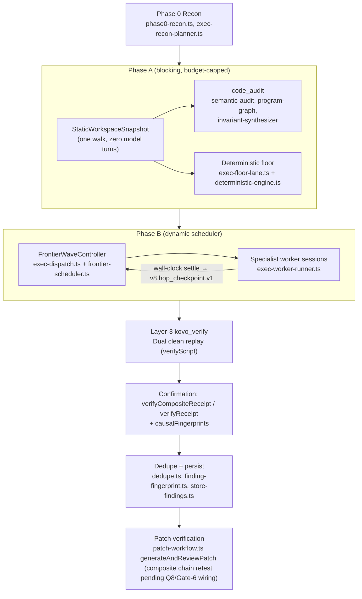
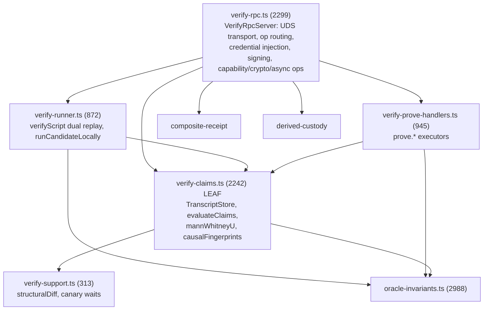
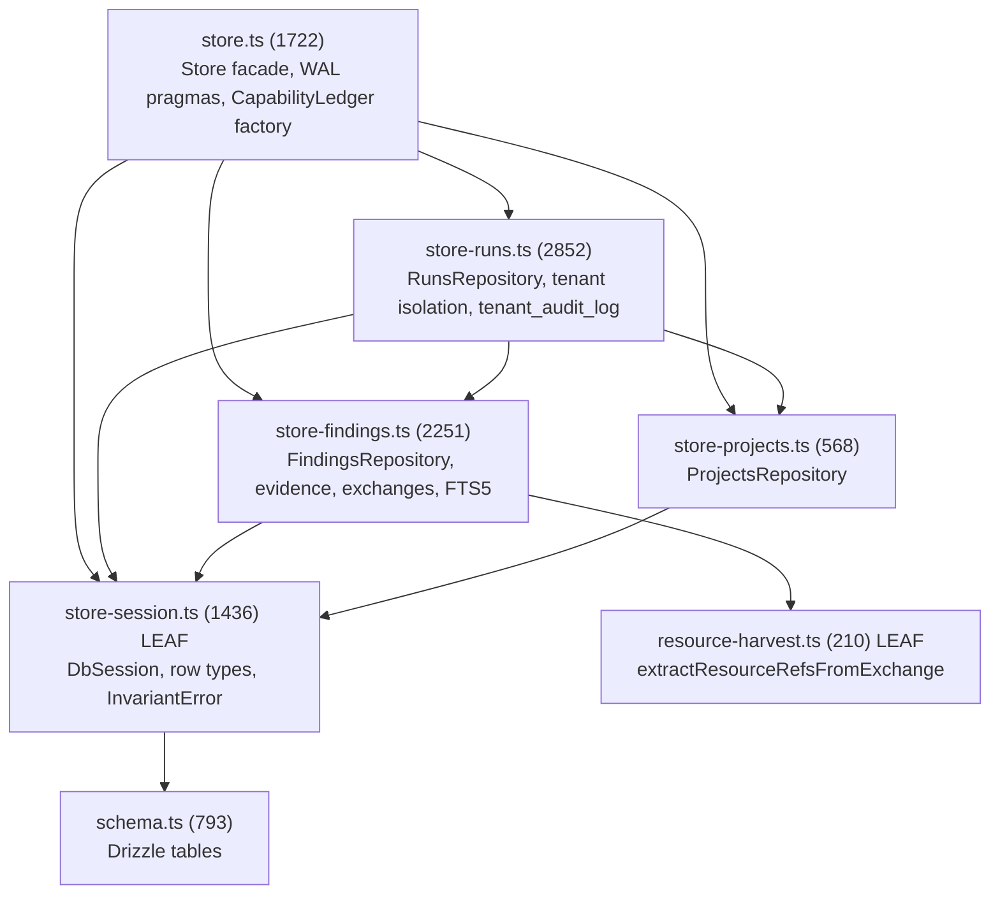

# Kovo — Architecture

> Principal-to-principal guide. Real paths, real symbols, real invariants, honest debt.
> Interactive companion: [`docs/architecture-walkthrough.html`](docs/architecture-walkthrough.html) (standalone, open locally).
>
> LOC figures are `wc -l` at `main @ 3aee419` and are meant for orientation, not as a spec.
> Planning context lives in [`plans/v8.md`](plans/v8.md) and [`plans/ROADMAP-v5.md`](plans/ROADMAP-v5.md).

---

## 1. Executive architecture & design thesis

Kovo is a defensive web-application security verifier. It finds vulnerabilities in
authorized targets, **proves** them with host-verified evidence, and re-tests patches. v8's scope
is deep multi-hop causal chains (3–6 hops) across multi-service SaaS apps, where each endpoint
looks fine on its own and the impact only shows up when identities, state transitions and
surfaces are combined.

The whole design rests on one asymmetry:

> **The LLM is a cheap, creative, untrusted hypothesis generator. The host is an expensive,
> boring, trusted proof kernel. Nothing the model says counts as evidence.**

Everything below follows from taking that seriously:

| Concern | Lives on the **host** (trusted) | Lives in the **worker container** (untrusted) |
|---|---|---|
| Model API keys, persona credentials, derived tokens | `provider.ts`, `persona-vault.ts`, `DerivedCapabilityVault` | never: the worker only sees opaque handles `cap:hop_<id>:<slot>` |
| Network egress to target | `RequestBroker` (`broker.ts`) + `scope-policy.ts` + `kill-switch.ts` | `--network none`; the only channel out is a UDS RPC |
| Transcript of what actually happened | HMAC-signed `HostSignedTranscript` (`composite-receipt.ts`, `verify-claims.ts`) | sees exchange IDs (`gx-…`) and redacted views only |
| Deciding "confirmed" | `verifyScript` dual replay, `verifyCompositeReceipt`, `verifyReceipt`, `oracle-invariants` | may only submit *claims* that point at host exchange IDs |
| Persistence | SQLite WAL via `store-*.ts`, append-only `tenant_audit_log` | ephemeral tmpfs, read-only rootfs, discarded after the assignment |

**Why this shape?**

1. **Prompt injection is assumed, not prevented.** Target responses are attacker-controlled
   text that goes straight into the model's context. We don't try to make the model
   un-injectable. We make injection harmless: a compromised model can't exfiltrate a
   credential it never held, can't reach a host outside the grant, and can't forge a receipt
   the host will accept.
2. **Fabricated confirmation is the expensive failure.** A security product's value depends on
   worst-run precision (the release gate is 100%). A script that prints `passed: true`, a
   model-written summary, or a declarative spec is never evidence. Confirmation is re-derived
   from the host transcript, twice, with fresh nonces.
3. **Ephemeral workers make recovery cheap.** Containers are disposable (`WarmWorkerPool` reuses
   them but never trusts state across assignments). The causal attack graph (`CapabilityLedger`)
   and the hop checkpoints live on the host, so a worker that times out loses its turns, not its
   progress.

Three layers (unchanged since v6; v8 deepens them and does not add a fourth):

- **Layer 1: Safety / session / transcript boundary.** Broker, redaction, custody, signing. Can't be bypassed.
- **Layer 2: Always-on code-first + deterministic floor.** Phase A static audit and the
  `--no-llm` floor run without a model and set the deterministic baseline.
- **Layer 3: Agentic verification.** Model-driven exploration and `kovo_verify` scripts,
  whose results only count after Layer-1 replay.

---

## 2. System topology & trust boundaries



### Boundary contracts

| Boundary | Transport | What crosses | What never crosses |
|---|---|---|---|
| SPA ↔ host | HTTP + SSE (`src/routes/api.runs.$runId.events.ts`, cursor via `last-event-id` / `?since=`) | run/project state, redacted events | secrets, raw bodies |
| Host agent loop ↔ model | `provider.ts` / `provider-stream.ts` | prompts, redacted tool output (`truncateUtf8Head`, spill files) | persona creds, vault contents |
| Host ↔ worker (tools) | `WorkerSession.exec` / `runScript` (`worker-backend.ts`) via bind-mounted repos and IPC dir | repo snapshot (read-only), scripts, result files | network, credentials |
| Worker ↔ host (verification) | HTTP over Unix socket `VERIFY_RPC_CONTAINER_DIR=/kovo-rpc`, `verify.sock`, token file + `x-kovo-rpc-token`, nonce in `x-kovo-verify-nonce` | `VerifyExchangeOp` requests, handles, exchange IDs, redacted responses | raw bytes, cookies, bearer tokens, HMAC keys |
| Host ↔ target | `RequestBroker.executeHttp` + `transport.ts` | scoped requests with host-injected credentials | anything outside `Grant.canRead`, anything after kill-switch |

The worker container flags come from a **single** builder,
`workerContainerCreateArgs()` in `worker-backend.ts`, which is shared by cold and warm-pool containers so the
security flags can't drift between the two paths: `--network none --user 10001:10001 --read-only
--cap-drop ALL --security-opt no-new-privileges`, PID/CPU/memory caps, and a `noexec` tmpfs.

---

## 3. End-to-end scan lifecycle



**Phase 0: Recon.** `phase0-recon.ts` (5.8k LOC) crawls and extracts routes from static framework
patterns, JS request shapes, tRPC procedures, OpenAPI/GraphQL specs and manifests
(`extractStaticFrameworkRoutes`, `harvestJsRequestParams`, `rankAndClusterAstRoutes`).
`exec-recon-planner.ts` turns the result into lanes and ready steps. Checkpoint: `ExecutionCheckpoint = 'phase0'`.

**Phase A: code-first + floor.** It runs before any agent dispatch, with its own wall-clock share
(`PHASE_A_FLOOR_WALL_CLOCK_SHARE`, `SOURCE_AUDIT_WALL_CLOCK_SHARE`) and a split request budget
(`resolvePhaseRequestBudgets`; Phase A can't borrow from Phase B).
- `buildStaticWorkspaceSnapshot()` / `getOrBuildStaticWorkspaceSnapshotInWorker()` does one bounded,
  symlink-safe and secret-path-excluding walk, then builds `ProgramGraph` once and shares that
  immutable snapshot with `phase0-recon`, `program-graph`, `invariant-synthesizer` and `semantic-audit`.
  The model spends zero turns on enumerating files.
- `code_audit` produces suspects. `settleCodeAuditSuspects` / `promoteSemanticAuditSuspects` in
  `execution.ts` turn them into dispatchable leads (`prioritizeCodeLeadTargets` in `exec-dispatch.ts`).
- `ExecFloorLane` runs the deterministic floor (`deterministic-engine.ts`, `floor-recipe-engine.ts`)
  with no model. This is the `Execution --no-llm` product floor, and every agentic claim is
  reported as an increment over it.

**Phase B: dynamic multi-hop scheduler.** `FrontierWaveController` (`exec-dispatch.ts`) drives the
pure primitives in `frontier-scheduler.ts`:
- a bounded beam (depth 1..6, width 8..16) ranked by `EVI = P(next_hop) × TerminalImpactWeight × SurfaceNovelty / (1 + attempts)`;
- wave quotas that keep depth ≥2 partial chains from being starved by flat route sweeps, plus a reserved discovery slice;
- progress-aware termination (`evaluateWaveProgress`) instead of a flat dry-round limit;
- 2-strike dead-end pruning and negative-edge memoization (target: ≤5% re-probe waste).

Chain hypotheses and route sweeps run **interleaved** within the same wave
(`chainHypothesisDispatchSteps`, `plannerWaveDispatchCap`). When a specialist reaches its wall-clock
settlement (`wallClockSettlementMs`, `settlementDue` in `agent-prompts.ts`), the host exports a
canonical **`v8.hop_checkpoint.v1`** brief (`CapabilityLedger` → `finalizeHopCheckpointBrief`,
≤2 KB, opaque handles only, `nextGoal`, `targetHop`). The next assignment is seeded with
`formatHopCheckpointForAssignment`. Rotation costs a container, never the chain.

**Layer-3 verification: dual clean replay.** The worker writes a `kovo_verify.ts` script
(`defineVerification` / `runVerification`). `verifyScript()` in `verify-runner.ts` runs it **twice
from scratch** in fresh `VerifyRpcServer` sessions with fresh nonces. Confirmation requires all of:
(1) both runs returned claims; (2) both transcript oracles passed, and stdout never counts as evidence;
(3) both transcript signatures verify; (4) `causalFingerprints` agree across runs; (5) the nonces
differ and each proof document echoes its own nonce. Failures return a **repair contract**
(`rejectedBy`, `missingEvidence`, a role-labelled `transcriptSummary`) so the agent can fix the script in one turn.

**Confirmation & dedupe.** Multi-hop chains go through `verifyCompositeReceipt()` (§5). Single findings go through
`verifyReceipt()` (`proof-receipt.ts`). `evaluateSubmissionDedupe()` (`dedupe.ts`) combines the structural
`computeFindingFingerprint()` (pure leaf `finding-fingerprint.ts`) with an LLM semantic judge, but only for
*duplicate* suppression; that judge never confirms anything. The store refuses to persist a confirmed finding unless its
own evidence confirms (`invariant.confirmation_evidence` gate + DB trigger, pinned by `worker-gate.sh`).

**Patch verification.** `generateAndReviewPatch()` (author + reviewer + static AST post-check,
wired from `execution.ts`) replays patched findings against the local lab (`LabRunner`,
`applyUnifiedDiffToDirectory`). Multi-hop composite chain patch retest (`retestCompositeChainPatch`,
`CompositeBrokeCausalEdge`, `computeCompositeRetestProofDigest` in `patch-workflow.ts`) is
implemented and unit-tested (`tests/v8-patch-retest.test.ts`), and is currently **pending production
Gate-6 wiring** (tracked for Q8 — not yet invoked from `execution.ts`).

---

## 4. Core module deep-dive

Dependency arrows below come from actual `import … from './x.ts'` edges. Type-only imports (e.g.
`import type { Store }` in `persona-vault.ts` / `canary-broker.ts`) are erased at runtime and left out.
The decomposed clusters (`exec-*`, `verify-*`, `store-*`) are strictly acyclic. One known runtime cycle remains:
`oracle-invariants.ts` re-exports `evaluateV8OracleFamily` from `v8-oracle-families.ts`, which in turn imports
`ROLE_RANK` / `normalizeRole` from `oracle-invariants.ts` (see §6).
Read `surface-engine.ts`, `replay-verifier.ts`, `agent-session.ts` and `src/skills/*.md` by targeted
slices only (see `AGENTS.md`).

### 4.1 Orchestration & scheduling

| File | LOC | Role | Key symbols |
|---|---:|---|---|
| `src/server/execution.ts` | 4363 | Run lifecycle, phase sequencing, budgets, finalize | `Execution`, `execution`, `ExecutionCheckpoint`, `resolvePhaseAFloorWallClockMs`, `settleCodeAuditSuspects`, `promoteSemanticAuditSuspects` |
| `src/server/exec-dispatch.ts` | 3596 | Scheduling policy, probe selection, frontier wave control | `FrontierWaveController`, `evaluateDispatchStop`, `planMultiTrialExpansion`, `coordinatorSchedulerDecision`, `selectProbeCandidates`, `resolvePhaseRequestBudgets`, `formatHopCheckpointForAssignment`, `chainHypothesisDispatchSteps` |
| `src/server/exec-floor-lane.ts` | 1383 | Phase A deterministic floor lane | `ExecFloorLane`, `ExecFloorLaneHost` |
| `src/server/exec-worker-runner.ts` | 1834 | One specialist assignment: container, tools, brokered transport | `ExecWorkerRunner`, `ExecWorkerHost`, `ExecBrokeredTransportContext` |
| `src/server/exec-verify.ts` | 2769 | Bridges agent submissions to the proof kernel | `ExecVerifier`, `runAgentScriptProof`, `syncVerifyArtifactsToLedger`, `extractAgentProofTarget` |
| `src/server/exec-recon-planner.ts` | 3730 | Phase 0 → lane/step planning, hop-checkpoint parsing | — |
| `src/server/frontier-scheduler.ts` | 725 | Pure beam/EVI/quotas/termination | `selectNextWaveAssignments`, `evaluateWaveProgress`, `DEAD_END_STRIKE_LIMIT` |
| `src/server/graph-coordinator.ts` | 2087 | Coordinator query surface + chain primitives | `queryEndpoints`, `queryFindings`, `queryProgramGraph`, `ChainHop` |
| `src/server/agent-session.ts` | 3766 | Host-side model loop + worker tool surface | `runAgentSession`, `buildWorkerTools`, `SpecSubmissionTracker`, `PARALLEL_READ_ONLY_TOOLS` |
| `src/server/agent-prompts.ts` | 3075 | Turn/wall-clock budgets, settlement, proof-gap vocabulary | `wallClockSettlementMs`, `SPEC_PROOF_GAP_CODES`, `NEGATIVE_EDGE_PROOF_GAP_CODES` |

```mermaid
flowchart TD
  execution --> exec-worker-runner
  execution --> exec-floor-lane
  execution --> exec-verify
  execution --> exec-dispatch
  execution --> exec-recon-planner
  exec-worker-runner --> exec-floor-lane
  exec-worker-runner --> exec-verify
  exec-worker-runner --> exec-dispatch
  exec-worker-runner --> agent-session
  exec-floor-lane --> exec-dispatch
  exec-dispatch --> agent-session
  exec-dispatch --> frontier-scheduler
  exec-dispatch --> graph-coordinator
  graph-coordinator --> frontier-scheduler
  graph-coordinator --> capability-ledger
  frontier-scheduler --> capability-ledger
  agent-session --> agent-prompts
  exec-verify --> verify-rpc
  exec-verify --> composite-receipt
```

**Opinion.** `execution.ts` should own *sequencing and budgets* only. The `exec-*` split exists so that
policy (`exec-dispatch`), lanes (`exec-floor-lane`), worker plumbing (`exec-worker-runner`) and the proof bridge
(`exec-verify`) can be tested and owned separately. `frontier-scheduler.ts` is deliberately pure
(it imports only `capability-ledger` types), so the scheduling math can be unit-tested deterministically.

### 4.2 Host verification kernel

The `verify-*` split (target architecture, in place) is a strict 4-module DAG with a shared leaf helper:



`VerifyRpcServer` op table (`verify-rpc.ts` ~L544–560):

| Op | Purpose |
|---|---|
| `http` / `http.send`, `http2`, `browser`, `race` | Brokered exchanges; host injects credentials; response redacted; entry signed |
| `oob` | Out-of-band canary subscribe/await (`canary-broker.ts`) |
| `capability.seal` | Seal a value from a **host-held raw response** into the vault; worker gets `cap:hop_<id>:<slot>` |
| `crypto.hmacSign`, `crypto.jwtSign` | Host-side derivation from a sealed handle (`hostHmacSign`, `hostJwtSign`); emits derivation attestation |
| `async.awaitResult` | Bounded poll convergence (`ASYNC_CONVERGENCE_PROFILES`) |
| `composite.verify` | Host-side `verifyCompositeReceipt` against the session's signed transcript |
| `prove.accessBoundary` / `persistedMutation` / `differential` / `oob` / `race` / `injection` | Authoritative proof executors in `verify-prove-handlers.ts` via the narrow `ProveHandlerHost` seam |
| `transcript` | Read-back of exchange summaries for the script |

| File | LOC | Key symbols |
|---|---:|---|
| `src/server/composite-receipt.ts` | 748 | `compositeProofReceiptSchema`, `hopReceiptSchema`, 4 edge schemas, `verifyCompositeReceipt`, `signHostRecord`, `verifyHostRecordSignature`, `singleReceiptToComposite`, `CompositeFailureStage` |
| `src/server/derived-custody.ts` | 617 | `DerivedCapabilityVault` (`seal`, `getMeta`), `formatDerivedHandle`, `scrubDerivedSecrets`, `injectCapabilityIntoRequest`, `hostHmacSign`, `hostJwtSign`, `ASYNC_CONVERGENCE_PROFILES` |
| `src/server/v8-oracle-families.ts` | 745 | `V8OracleFamily` (6), `evaluateV8OracleFamily`, `evaluateDualTenantAbac`, `evaluateTemporalRevocation`, `evaluateEconomicConservation`, `evaluateCryptographicScopeReplay`, `evaluateParserCacheDifferential`, `evaluateCrossSurfacePivot` |
| `src/server/v8-oracle-hydrate.ts` | 393 | `hydrateV8OracleInput`, `selectStateTransitionPair`, `extractCanonicalEntityTokens` (fail-closed: never forges missing records) |
| `src/server/finding-fingerprint.ts` | 246 | `computeFindingFingerprint`, `normalizeEndpointTemplate`, `ORIGIN_WIDE_CWES` (zero `src/server` deps, which breaks the `dedupe → model-settings → store` cycle) |
| `src/server/proof-receipt.ts` | 1759 | `verifyReceipt`, `buildProofReceipt`, `buildAgentScriptReceipt`, `buildOobReceipt` (single-finding path) |
| `src/server/capability-ledger.ts` | 893 | `CapabilityLedger`, `CAUSAL_EDGE_BINDING_KINDS`, `ALWAYS_QUARANTINED_KINDS`, `finalizeHopCheckpointBrief` |

`verifyCompositeReceipt` fails closed at a named stage, in this order: `schema → dag_topology →
transcript_integrity → edge_binding → attacker_provenance → replay_mode → terminal_impact`. Every
rejection carries `failedStage`, `rejectedBy` and `missingEvidence`, which feed the same repair contract as `verifyScript`.

### 4.3 Network, redaction & custody

| File | LOC | Role | Key symbols |
|---|---:|---|---|
| `src/server/broker.ts` | 4030 | The only path to the target. Scope, approval, circuit breakers, cookie jars, race bursts, WS | `RequestBroker.executeHttp`, `Grant`, `BrokerHttpRequest.onRawResponse`, `BrokerDenied`, `BrokerApprovalRequired`, `BrokerCircuitOpen`, `isLoopbackOrigin` |
| `src/server/redact.ts` | 500 | Pure leaf: secret/PII/ZDR redaction | `redact`, `redactHeaders`, `redactJsonValue`, `scanSecrets`, `redactZdr` |
| `src/server/worker-backend.ts` | 1837 | Docker lifecycle, warm pool, typed job schemas | `WorkerBackend`, `WorkerSession` (`exec`, `runScript`), `WarmWorkerPool`, `workerContainerCreateArgs`, `installLiveExitHooks` |
| `src/server/lab-runner.ts` | 1726 | Local lab target lifecycle and patching | `LabRunner`, `assertLocalLabAllowed`, `applyUnifiedDiffToDirectory`, `bindLabSignalHooks` |
| `worker/bridge.ts` | 1772 | In-container tool bridge: SAST/SCA/secret scan, AST verify, call graph, offline scripts | `runSastScan`, `runOfflineScript`, `runVerifyScript`, `maskSecretValue` |
| `worker/kovo_verify/kovo_verify.ts` | 882 | Zero-dep TS verification SDK (Node builtins only) | `defineVerification`, `runVerification`, `sealCapability`, claim types (`StatusClaim` … `CompositeReceiptClaim`) |

**Custody flow (the core v8 trick).** `RequestBroker.executeHttp` calls `req.onRawResponse({ body, headers })`
*inside the host* before redaction (`broker.ts` ~L3464; wrapped in `try` so a host hook can't abort
the exchange). `VerifyRpcServer` captures that raw response into a per-exchange box. When the script calls
`capability.seal`, the vault extracts the value from the **raw** bytes (which the worker never saw) and returns an
opaque handle plus a `scrubbedPreview`. A later hop names the handle. `injectCapabilityIntoRequest` substitutes
the real value host-side and records a `CapabilityConsumptionAttestation`. The transcript entry is stamped
with `consumedCapabilityId` / `derivedFromCapabilityId`, so the composite verifier can check the
`value_binding` / `derived_crypto_binding` edges cryptographically.

Vault hardening (`derived-custody.ts`): handle regex validation, run-ID binding (`RUN_MISMATCH`), expiry
(`EXPIRED_HANDLE`), and an owner-only `0600` file / `0700` directory that is re-checked on load.

**Single `LabRunner`.** `Execution` takes `options.labRunner ?? new LabRunner()`. One process-level owner of lab
containers means signal hooks, reclaim and run records (`writeLabRunRecord`) never race each other.

**`kovo_verify` SDK.** It is TypeScript-only (`kovo_verify.ts`). `kovo_verify.py` is still in the tree
but is being retired. Both SDKs are thin clients, and the authoritative semantics live in `verify-prove-handlers.ts`,
so retiring the Python SDK removes code without changing behavior.

### 4.4 Persistence & safety

`store.ts` is a facade over strictly acyclic domain repositories:



- WAL mode: `PRAGMA journal_mode = WAL; synchronous = NORMAL; busy_timeout = 5000; foreign_keys = ON` (`store.ts` ~L195).
  Readers stay non-blocking under the batched writer, and WAL still keeps the DB consistent across crashes.
- `store-session.ts` is the leaf. It never imports `store.ts` or a domain repo. `store-findings.ts` depends only on
  `store-session` + `resource-harvest`. `store-projects.ts` depends only on `store-session`.
- `tenant_audit_log` (`schema.ts` ~L777): append-only and **hash-chained**. Each entry stores `prev_hash` and
  `entry_hash`, and the detail is PII/secret-scrubbed (`store-runs.ts` ~L2736).
- Confirmation integrity: `assertConfirmedVerificationClass`, `replayVerdictConfirmsRuntime`, `InvariantError`.
- `CapabilityLedger` is created by `Store` on the same WAL connection (`store.ts` ~L1239). The causal graph is
  persisted alongside findings, so hop checkpoints survive worker rotation and process restarts.

### 4.5 Web UI

| File | LOC | Role |
|---|---:|---|
| `scripts/serve.ts` | 535 | Production server: static assets, health, kill-switch endpoint, pairing link, session rotation, read-only mode |
| `src/routes/__root.tsx` | 60 | Shell |
| `src/routes/index.tsx` | 490 | Workspace / projects |
| `src/routes/projects.$projectId.tsx` | 375 | Project detail, runs |
| `src/routes/runs.$runId.tsx` | 32 | Run view entry |
| `src/routes/settings.tsx` | 1012 | Model profiles, credentials (write-only), settings |
| `src/routes/api.runs.$runId.events.ts` | 85 | **SSE** event stream with resumable cursor (`last-event-id` / `?since=`), backpressure-aware flush |
| `src/components/ui/*` | ~430 | shadcn-style primitives (`button`, `card`, `dialog`, `disclosure`, `dropdown-menu`, …), Tailwind v4 |

The UI is a read-mostly projection of the store. It has no authority: the kill switch is enforced in
`kill-switch.ts` / broker, not in the browser.

### 4.6 Evaluation & certification

| File | LOC | Role |
|---|---:|---|
| `scripts/benchmark-multihop.ts` | 3789 | Drives the **real** `Execution` against `benchmarks/multihop-saas/` and computes the Two-Side Confirmation, hop-depth funnel, TP/$ and TP/10m, and hardened-twin FPs |
| `scripts/certify-v8.ts` | 3062 | Pure M2/M3/M4 scorecard aggregation |
| `scripts/check-v8-contamination.ts` | 267 | Anti-contamination lint over `src/server/**` and `src/skills/**` |
| `scripts/worker-gate.sh` | — | Pre-handoff gate: typecheck, contamination lint, dispatch-funnel invariant, confirmation-consistency invariant, … |

- **Two-Side grader.** A TP requires **both** sides: *ChainOracle v2* (the benchmark's own observation of the full
  ordered causal DAG from an attacker-eligible persona, with zero shortcut personas) **and** a host-verified
  `CompositeProofReceipt` (Mode A, fresh clean replay). Neither side alone counts.
- **Hardened twins.** Every planted chain has a decoy twin with the defect fixed. Any twin confirmation is an FP
  and fails the universal precision gate (100% worst-run precision).
- **Gates** (`plans/v8.md` §Milestones). M0 (causal ledger, derived custody, `CompositeProofReceipt`, benchmark
  runtime + inert-run fail-fast), M1 (extended `oracle-invariants` + complete 3-archetype dev suite), M2 (general
  invariant synthesizer; scored at `$5/30m`: GB ≥33%, WB ≥50%, WB−GB ≥ +15 pp, 0 twin FPs), M3 (frontier/beam
  orchestrator + hop checkpoints; scaling matrix `$2/10m < $5/30m < $15/60m` strictly monotonic, ≥ +20 pp lift,
  dead-end waste ≤5%), M4 (full certification: dev, salted held-out `seed ≥ 1_000_000`, sealed blind archetype,
  OSS corpus, efficiency floor, v7 regression floor). Anti-heuristic gate: `multihop-saas --no-llm ≤ 5%`.
- **Sealing.** One archetype is sealed for the blind first run. Engineers and agents don't read its source.

---

## 5. Load-bearing invariants & failure modes

Each row: the invariant, where it is enforced, and the failure it prevents.

| # | Invariant | Enforced in | Prevents |
|---|---|---|---|
| I1 | **Dual clean replay + causal agreement.** Two fresh sessions, fresh nonces, both oracles pass, both signatures verify, `causalFingerprints` equal | `verifyScript` (`verify-runner.ts` ~L567), `causalFingerprints` (`verify-claims.ts` ~L2005) | Flaky or one-off observations, stale state, scripts that hard-code a lucky run, replayed transcripts |
| I2 | **Stdout is never evidence.** Claims reference host exchange IDs. The oracle re-evaluates them against the signed transcript | `evaluateClaims`, `parseVerifyScriptResult` | Fabricated `passed: true`, model-written summaries |
| I3 | **Raw bytes are host-only.** `onRawResponse` → `DerivedCapabilityVault`. The worker sees redacted views + `cap:hop_<id>:<slot>` | `broker.ts`, `verify-rpc.ts`, `derived-custody.ts`, `redact.ts` | Credential/token exfiltration through prompt injection. Model context poisoning with secrets |
| I4 | **Monotonic causal DAG.** Hops are topologically ordered with monotonic timestamps. Cycles are rejected. Every edge has one of 4 binding kinds | `CapabilityLedger`, `verifyCompositeReceipt` (`dag_topology`, `edge_binding`) | "Chains" that are really a set of independent findings stitched together after the fact |
| I5 | **Edge binding semantics.** `value_binding` (hop j consumed a handle sealed from hop i), `derived_crypto_binding` (host HMAC/JWT derivation attested), `state_transition_binding` (same entity on both hops **plus a clean-session ablation control that is denied**: `ablationExchangeIds`, `replayAttempt: "ablation_control"`), `async_pivot_binding` (bounded poll convergence on a host-recorded async job) | `composite-receipt.ts` edge schemas, `v8-oracle-hydrate.selectStateTransitionPair` | Correlation passed off as causation. The ablation shows that the effect disappears without the precondition |
| I6 | **Attacker provenance.** The chain must trace back to an attacker-eligible persona, with no privileged shortcuts | `traceProvenanceToAttacker` (ledger), `attacker_provenance` stage | Chains that "work" only because an admin persona was used mid-chain |
| I7 | **Six terminal oracle families.** `dual_tenant_abac`, `temporal_revocation`, `economic_conservation`, `cryptographic_scope_replay`, `parser_cache_differential`, `cross_surface_pivot` | `v8-oracle-families.ts` `evaluateV8OracleFamily` | Terminal impact claimed by assertion instead of by a typed oracle over host records |
| I8 | **Capability quarantine.** `opaque_object_ref`, `policy_asymmetry`, `write_sink_handle` and intermediate nodes can't be promoted to findings on their own | `ALWAYS_QUARANTINED_KINDS`, `assertPromotable` | Intermediate hops reported as vulns, which inflates counts and hurts precision |
| I9 | **Append-only, hash-chained `tenant_audit_log`** | `store-runs.ts`, `schema.ts` | Silent history rewrites. Cross-tenant audit confusion |
| I10 | **Confirmed ⇒ own evidence confirms** | Store gate `invariant.confirmation_evidence` + DB trigger + demotion path | An inconclusive replay persisted as confirmed |
| I11 | **One container-arg builder, one `LabRunner`** | `workerContainerCreateArgs`, `Execution` ctor | Security-flag drift between warm and cold paths. Racing lab lifecycle owners |
| I12 | **Anti-contamination.** No benchmark archetype names, chain IDs, lab hostnames or canary prefixes in engine/skill source | `check-v8-contamination.ts` (in `worker-gate.sh`) | Goodharting: capability that only exists for the benchmark |
| I13 | **Fail-fast on inert runs.** A model profile + `local-jq` verifier refuses to run | `benchmark-multihop.ts` preflight (exit 2) | Burning budget on a run that can't execute worker sessions |
| I14 | **Hop checkpoints are bounded and opaque.** `v8.hop_checkpoint.v1` ≤2 KB, handles only, text sanitized | `finalizeHopCheckpointBrief`, `sanitizeCheckpointText` | Secret leakage through continuation briefs. Prompt bloat across rotations |

---

## 6. Honest debt ledger & what's next

| Debt | Current state | Why it matters | Direction |
|---|---|---|---|
| **Dual receipt primitives** | `proof-receipt.ts` (1759 LOC, single-finding `ProofReceipt`) sits next to `composite-receipt.ts` (748 LOC). `singleReceiptToComposite` bridges them, and `composite-receipt` imports `proof-receipt` | Two confirmation vocabularies, and two places to get a rule subtly wrong | Make `CompositeProofReceipt` (hop count 1) the only primitive. Keep `verifyReceipt` as a thin adapter, then delete it |
| **Legacy `DeclarativeReplaySpec` / `proof-tools.ts`** | `src/replay-spec.ts` (900) + `proof-tools.ts` (1319) are still referenced across `exec-*`, `agent-*` and `deterministic-engine.ts`. `assertNotRecipeWiredLegacyCall` guards recipe-wired classes | A second, less expressive proof path the model can fall back to | Route all agentic proofs through `kovo_verify` scripts. Keep declarative specs only as a floor-internal format, then retire |
| **Python SDK** | `kovo_verify.py` (796) still in tree, and the `verify-prove-handlers.ts` header still names it | Parity tax on every new op | Delete it once the TS-only migration lands. No host change is needed |
| **`verify-rpc.ts` size** | Still 2299 LOC after the 4-way split. It owns transport, injection, capability/crypto/async ops and composite verify | The trust boundary is the code we most want to be small and auditable | Extract capability/crypto/async handlers behind a `ProveHandlerHost`-style seam |
| **`oracle-invariants` ↔ `v8-oracle-families` cycle** | A barrel re-export at the bottom of `oracle-invariants.ts` (~L2950) plus a value import back from `v8-oracle-families.ts` | ESM tolerates it, but load order becomes significant, and it is the one runtime cycle in the kernel | Move `ROLE_RANK` / `normalizeRole` into a pure `oracle-roles` leaf, or drop the barrel re-export |
| **Static concurrency** | Worker concurrency is configured, not adaptive. The model gate in `benchmark-agentic-matrix.ts` has 429 AIMD, but the product scheduler doesn't | Under-uses headroom on fast providers, thrashes on slow ones | Dynamic AIMD on provider stall/429 signals inside `exec-dispatch` |
| **`WarmWorkerPool` reuse** | Exists (`worker-backend.ts` ~L998). Reuse hit rate is reported in Phase B telemetry | Container cold-start is a large share of short assignments | Raise the hit rate (pre-warm per wave width) without sharing state across assignments |
| **Phase A / Phase B overlap** | Phase A is blocking by design, to protect the floor and budget accounting | Wall-clock is idle for agents during the floor | Start Wave 1 on Phase-A-independent leads while keeping split request budgets |
| **God-modules** | `execution.ts` 4.4k, `phase0-recon.ts` 5.8k, `deterministic-engine.ts` 5.6k, `broker.ts` 4.0k | Review cost. Merge conflicts across streams | Continue the `exec-*` / `store-*` / `verify-*` decomposition pattern: leaf-first, acyclic, one owner per file |

**Rule of thumb for new work.** New capability lands in `src/server/` and is scored through the real `Execution` path
(`--no-llm` floor *and* agentic, dev *and* salted held-out). It confirms only through the host kernel.
It must not add a new path to the target or a new place where secrets live.
