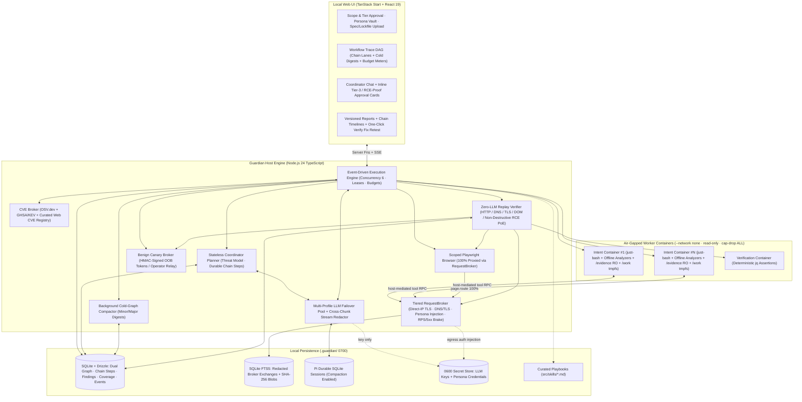

# Guardian v2 — World-Class Defensive Autonomous Pentester

**Status:** Draft Design Specification  
**Base Version:** Guardian v1 ([SPEC.md](SPEC.md), Apache-2.0)  
**Design Goal:** Upgrade Guardian from a single-pass, 10-check defensive header/policy reviewer into a **world-class, long-running, multi-step defensive pentester** capable of finding and deterministically verifying real-world High/Critical vulnerabilities (including recently disclosed framework/dependency CVEs and non-destructive Proof-of-Execution for RCE/SSTI/injection) while preserving Guardian v1's zero-trust execution boundaries, hard scope enforcement, credential isolation, and zero-hallucination reporting.

---

## 1. Motivation & Defensive Design Principles

Guardian v1 proved that deterministic verification, air-gapped `just-bash` workers, and a DNS-rebinding-safe request broker can achieve 100% precision and zero coverage overclaims against ARTEX on scoped response and access-policy reviews ([VERIFICATION.md](VERIFICATION.md)). However, real High/Critical vulnerabilities in modern production applications (Next.js/React SPAs, GraphQL/REST APIs, OAuth/Clerk/Supabase auth flows, presigned upload pipelines, LLM gateways, and multi-subdomain SaaS) require capabilities v1 did not have:

- **Deep Modern Surface Harvesting:** Extracting hidden API routes, GraphQL schemas, OpenAPI specs, client-side secrets, source maps, `postMessage` handlers, and Next.js build manifests from JS bundles and rendered SPAs.
- **Scoped Headless Browser Inspection:** Running Chromium/Playwright strictly proxied through Guardian's `RequestBroker` (zero direct network egress) to inspect live XHR flows, OAuth redirects, DOM XSS sinks, and `postMessage` origin-check flaws.
- **Runtime Tech Fingerprinting & Recent CVE Correlation (`cve-broker`):** Fusing runtime signals (headers, Next.js build/chunk signatures, error templates, JS SDK markers) with optional uploaded lockfiles/SBOMs (`package-lock.json`, `pnpm-lock.yaml`, `go.sum`, `uv.lock`), querying live structured feeds (**OSV.dev**, **GHSA**, **CISA KEV**) + a curated high-impact web CVE registry, and turning version matches into low-confidence `cve_hypothesis` facts for live differential reachability testing.
- **Safe Non-Destructive RCE / Execution Verification (`rce_proof`):** Verifying RCE, SSTI, command injection, and deserialization with **near-zero false positives** via (1) **fresh per-replay cryptographic arithmetic or split-concatenation echo nonces** (so raw payload reflection can mathematically never trigger confirmation), (2) **HMAC-signed single-use Guardian Canary OOB callbacks** for blind execution, and (3) **strict Tier 3 HITL approval + destructive-payload denylist**.
- **Curated Vulnerability Playbooks (`src/skills/*.md`):** Loading targeted defensive methodologies on demand once recon fingerprints a stack (OAuth/OIDC, JWT, BOLA/BFLA, CORS/CSRF, CVE reachability, non-destructive injection proofs, dangling-CNAME subdomain takeover, TLS audit, upload pipelines, race conditions, LLM gateways).
- **Threat-Model Prioritization & Chaining Escalation:** Ranking approved hosts by attack-surface richness in Round 0, maintaining an OWASP/API Top 10 coverage ledger, and automatically scheduling chain-escalation steps when low/medium primitives are discovered.
- **Safe Canary (OAST) & Synchronized Race-Batch Primitives:** Proving blind reflections/callbacks via Guardian-owned signed benign canaries (`mint_canary`/`check_canary`) and TOCTOU/rate-limit gaps via bounded `request_http_batch` bursts.
- **Adversarial Counterevidence & SPA-Catchall Immunity:** Requiring mandatory control steps, SPA `200 index.html` catch-all differential checks, and Zero-LLM Declarative Replay Verification before any finding is confirmed.

Guardian v2 adopts the **orchestration and long-horizon memory patterns** that make ARTEX and Strix effective at deep multi-step chains (dual graph, prerequisite-ordered chain planner, multi-turn workers, peer trace search, FTS5 traffic search, cold-graph compaction, multi-profile LLM failover), while strictly preserving **six non-negotiable defensive invariants**:

1. **Zero-Network Workers:** Worker containers remain `--network none` with dropped capabilities and no host mounts. All target traffic is mediated exclusively by Guardian's host-side `RequestBroker`.
2. **Opaque Credential Isolation:** Operator test-account credentials (cookies, Bearer tokens, API keys) live in Guardian's `0600` local vault. Workers reference opaque persona handles (e.g., `persona: "tenant_a"`); credentials are injected at broker egress and scrubbed before entering containers, LLM prompts, transcripts, or reports.
3. **Strict Non-Destructive Proof Standard:** Destructive payloads, webshells, reverse shells, target disk writes, data exfiltration, DoS floods, and autonomous out-of-scope pivoting remain strictly prohibited. Active non-destructive Proof-of-Execution (dynamic nonce computation, split-echo, or benign canary callback) requires explicit **Tier 3 HITL approval** (or explicit `local-lab` staging opt-in).
4. **Zero-LLM Finding Confirmation:** Model prose and CVE version fingerprints can only hypothesize and propose candidate findings. **Only** a deterministic Zero-LLM Replay Verification Worker executing a validated Declarative Replay Spec (with mandatory negative control and SPA-catchall defense) can promote a finding to `confirmed`.
5. **Hard Technical Scope & Live Revocation:** Every request hop, redirect, browser subresource, newly discovered candidate host, and downstream dependent fact is bound to an immutable `scopeRevision`. Narrowing scope immediately aborts in-flight requests/containers and transitively taints dependent chain steps.
6. **Crash-Safe Explicit Resumability:** Every graph mutation, broker exchange, and Pi Durable turn is persisted with idempotent keys. Unexpected crashes recover into `paused` and wait for explicit operator **Resume** without duplicating work.

---

## 2. Comprehensive Limit Audit & Scale-Up Plan (v1 → v2)

Guardian v1's limits were sized for 1-turn, 1-request header checks. Supporting multi-hour, 150–300 turn defensive chains requires raising ceilings coherently across **every layer**—otherwise raising `maxTurns` alone immediately hits hard walls in `provider.ts`, `provider-stream.ts`, `worker-backend.ts`, `broker.ts`, and `domain.ts`.

| Subsystem & File | Parameter | Guardian v1 Cap | Why v1 Breaks Long Chains | Guardian v2 Default | v2 Configurable Ceiling |
| :--- | :--- | :--- | :--- | :--- | :--- |
| **Agent Turns** (`src/server/agent-session.ts`) | `maxTurns` per worker intent | `1` (Responses) / `3` (Messages) | Impossible to iterate across multi-step hypotheses, inspect responses, and craft replay specs. | **150 turns / intent** (20 turns / planner wake) | **300 turns / intent**, **2,000 turns / run** |
| **LLM Call Cap** (`src/server/provider.ts`) | HTTP model calls per operation | Hardcoded `3` | Aborts any multi-turn worker on turn 4. | Bound to `maxTurns + settlement + retries` (e.g. **180 / intent**) | Governed by **per-run USD & token budget** |
| **Output Tokens** (`src/server/provider.ts`) | `maxTokens` per LLM reply | `768` | Reasoning models burn >768 tokens before emitting a single complex tool call or replay spec. | **16,384** (profile-configurable; respects OpenAI 16k vs. Anthropic 32k+) | **65,536** |
| **Reasoning Mode** (`src/server/agent-session.ts`) | `thinkingLevel` | Hardcoded `'off'` | Multi-step chain synthesis and CVE reachability reasoning benefit heavily from adaptive thinking. | `'medium'` (planner & chain worker); `'low'` (summarizer) | `'off' \| 'low' \| 'medium' \| 'high'` |
| **Context Window** (`src/server/provider.ts`) | `contextWindow` | Hardcoded `24_000` | Artificially starves modern 128k–1M models; prevents deep chain correlation. | Profile-declared (default **131,072–200,000**) | **1,000,000** (clamped `[32k, 1M]`) |
| **Conversation Compaction** (`src/server/agent-session.ts`) | Pi Durable `compaction` | `{ enabled: false }` | 150–300 turn workers overflow context without tool-safe compaction. | **Enabled** at 75% window (keeps last 20k tokens verbatim) | Configurable per profile |
| **Model Request Size** (`src/server/provider.ts`) | Max JSON POST bytes | `80 KiB` | A 128k–200k token multi-turn history easily reaches 600 KiB–2 MiB of JSON. | **4 MiB** | **12 MiB** |
| **Model Stream Size** (`src/server/provider-stream.ts`) | `responseLimit` (SSE bytes) | `768 KiB` | A single 16k–32k token SSE stream with per-token JSON envelopes exceeds 1–2 MiB. | **16 MiB** | **32 MiB** |
| **Model Timeouts** (`src/server/provider.ts`, `agent-session.ts`) | Request / stream timeout | `35s` total | Reasoning models routinely pause 45–120s before first output token or during long tool-arg streams. | **120s first-event / 180s idle / 600s total** | Configurable per profile |
| **Tool Output Inline Cap** (`src/server/agent-session.ts`, `execution.ts`) | Inline tool result size | `2,048` bytes / `1,200` chars | Truncates multi-endpoint responses, JS harvest output, and CVE advisories. | **24 KiB inline** + auto-spill to `/evidence/tool-output/<id>.txt` | **64 KiB inline**; **4 MiB** spilled file |
| **Worker Container Lifecycle** (`src/server/worker-backend.ts`) | Container per tool call vs. per intent | Cold-start container per call; `15s` hard kill | 150 turns × container startup loses `/work` scratch state and adds heavy churn. | **1 air-gapped container per intent** (60s per command, 30 min intent wall-clock) | **2 hr intent lease**, **120s per command** |
| **Container Resources** (`src/server/worker-backend.ts`, `worker/bridge.ts`) | RAM / CPU / PIDs / `/tmp` / FS | `256m`, `0.5` CPU, `48` PIDs, `8m` `/tmp`, `512 KiB` scratch, `16×64 KiB` files | Cannot parse real OpenAPI specs, JS bundles, lockfiles, or 50+ correlated HTTP exchanges. | **512m RAM**, **1.0 CPU**, **96 PIDs**, **64m `/tmp`**, **16 MiB scratch**, **128 files × 2 MiB** | **2 GiB RAM**, **2.0 CPU**, **64 MiB scratch** |
| **Broker HTTP Capabilities** (`src/server/broker.ts`) | URL, redirects, body, timeout, volume | `GET /` only, 512B path, 3 hops, body destroyed, `12s` | Cannot traverse paths, APIs, query params, multi-step redirects, or inspect bodies. | Paths+query **8 KiB**, **8 redirects**, **1 MiB** body cap, **30s** timeout, **2,500 reqs/run**, **5 RPS/origin** | **2 MiB** body, **10,000 reqs/run**, **20 RPS/origin** (operator-approved) |
| **Worker Concurrency** (`src/server/execution.ts`) | Active workers | Hardcoded `2` | Starves multi-host engagements and slows parallel recon + validation. | **6 concurrent workers** (max 2 active requests/origin) | **16 concurrent workers** |
| **Scope & Inputs** (`src/domain.ts`, `access-policy.ts`) | Hosts, seeds, goal, DNS, specs, policy cases | 48 hosts, 24 seeds, 1,500-char goal, 128 KiB DNS, 64 cases | Blocks medium/large enterprise scopes and detailed engagement rules. | **500 hosts**, **100 seeds**, **8,000-char goal**, **4 MiB DNS**, **2 MiB specs/lockfiles**, **512 policy cases** | **1,000 hosts**, **2,048 policy cases** |
| **Run Wall-Clock & Events** (`src/server/execution.ts`, `store.ts`) | Dispatch loop & event catchup | 300ms/350ms polling; 250 events/poll | High latency & DB load on 200-turn concurrent runs. | **In-process EventEmitter wake** + 1,000 events/page; **4 hr default run timeout** | **24 hr / budget-bounded** w/ periodic partial-report checkpoints |

> **Why high limits remain safe in Guardian v2:** Raising turn, token, and request ceilings does **not** weaken blast-radius control because safety is enforced by **structural invariants** (zero-network containers, broker scope/tier/RPS/5xx gates, opaque personas, destructive-payload denylist, and deterministic replay), not by starving the agent of turns.

---

## 3. System Architecture

### Key Architectural Shifts from v1
1. **Host-Mediated Tool Loop (`Execution` ↔ `RequestBroker` / `ScopedBrowser` / `CVEBroker` ↔ Intent Container):** Workers never hold sockets or secrets. When a worker calls `request_http` or `browser_visit`, the host mediates every byte through `RequestBroker`, persists redacted exchanges to `broker_exchanges` + FTS5, and stages files into the intent's read-only `/evidence` overlay. Offline computation (`just-bash` + built-in JS/JWT/GraphQL/OpenAPI/tech-fingerprint/DNS-takeover/diff analyzers) runs inside the intent's persistent `--network none` container.
2. **Dual-Graph Separation in SQLite:** Mirroring ARTEX's separation of *target truth* vs. *exploration progress*, Guardian separates `project_assets` / `project_specs` (target layer) from `threat_models` / `facts` / `chain_steps` / `assignments` / `graph_digests` / `coverage_entries` (per-run exploration layer), joined by `scopeRevision` and `sourceOrigins[]`.
3. **Deterministic Verification Boundary Preserved:** Investigation workers call `propose_chain_finding(replaySpec)` to record a `pending` finding + `replay_specs` row. Only the **Zero-LLM Replay Verifier** replays the spec cleanly from scratch (generating fresh nonces/canaries for RCE proofs and running control/SPA-catchall checks) and writes `confirmed | dismissed | inconclusive`.

---

## 4. Clean-Slate v2 Data Model & Drizzle Schema

Guardian v2 uses a **clean-slate schema** (no backward-compatibility migrations for v1 SQLite databases or v1 run formats—existing local `.guardian/` data and legacy v1 migrations in `drizzle/` are replaced by a fresh v2 initial migration). This eliminates dual-mode branching across `store.ts`, `execution.ts`, `report-export.ts`, and the UI.

### Core Tables (`src/server/schema.ts`)
- **`model_profiles`**: Ordered failover LLM profiles (`id`, `workspaceId`, `name`, `endpoint`, `model`, `protocol`, `credentialId`, `priority`, `enabled`, `contextWindow`, `maxTokens`, `thinkingLevel`, `inputCostPerMtok`, `outputCostPerMtok`, `healthState`, `cooldownUntil`, `lastError`).
- **`project_specs`**: Optional operator-supplied white-box/grey-box context (`id`, `projectId`, `name`, `kind`: `'openapi' | 'graphql' | 'lockfile' | 'routes' | 'notes'`, `origin`, `content`, `createdAt`).
- **`personas`**: Project-scoped test identities (`id`, `projectId`, `workspaceId`, `handle`, `roleLabel`, `originAllowlist`, `authKind`: `'cookie' | 'bearer' | 'header'`, `headerName`, `credentialId` pointing to `0600` file, `canaryMarkers`, `createdAt`).
- **`threat_models`**: Round-0 attack-surface risk ranking per run (`id`, `runId`, `scopeRevision`, `goalRevision`, `entries`: `ThreatModelSummary[]`, `summary`, `createdAt`).
- **`chain_steps`**: Durable cross-wake Planner Todolist (`id`, `runId`, `goalRevision`, `scopeRevision`, `seq`, `title`, `hypothesis`, `category`, `priority`, `targetAssetIds`, `skills`, `dependsOnFactIds`, `dependsOnStepIds`, `status`: `'pending' | 'ready' | 'running' | 'complete' | 'blocked' | 'tainted' | 'canceled'`, `assignedWorkerId`, `sourceOrigins`, `createdAt`, `updatedAt`).
- **`facts`**: Typed shared discoveries across workers (`id`, `runId`, `assignmentId`, `scopeRevision`, `goalRevision`, `kind`: `'endpoint' | 'auth' | 'header' | 'cors' | 'cookie' | 'object_ref' | 'redirect' | 'policy_gap' | 'config' | 'dns' | 'tls' | 'secret' | 'dom' | 'tech_fingerprint' | 'cve_hypothesis' | 'note'`, `origin`, `summary`, `data`, `sourceOrigins`, `evidenceIds`, `exchangeIds`, `tainted`, `coldSinceRound`, `digestId`, `createdAt`).
- **`graph_edges`**: Causal provenance edges (`fromKind`, `fromId`, `toKind`, `toId`, `edgeKind`: `'spawns' | 'depends_on' | 'yields' | 'proves' | 'covers' | 'derived_from'`).
- **`graph_digests`**: Background LSM-style cold-branch compaction digests (`id`, `runId`, `roundNo`, `level`: `'minor' | 'major'`, `signatureHash`, `summary`, `coveredFactIds`, `coveredAssignmentIds`, `active`).
- **`broker_exchanges`** + **`broker_exchanges_fts` (SQLite FTS5 trigram virtual table)**: Redacted request/response headers, status, media type, `redirectOrigins`, `personaHandle`, `bodyPreview` (`<= 8 KiB`), `bodyArtifactId` (content-addressed SHA-256 blob up to `2 MiB`), `durationMs`.
- **`approval_requests`**: Tier 3 HITL gate records (`origin`, `method`, `pathAndQuery`, `personaHandle`, `rationale`, `requestPreview`, `proofKind`: `'state_probe' | 'rce_proof'`, `status`: `'pending' | 'approved' | 'denied' | 'expired' | 'canceled'`, `decidedBy`, `decidedAt`, `expiresAt`).
- **`replay_specs`** & **`retest_runs`**: Validated `DeclarativeReplaySpec` JSON + `specSha256` + `sourceOrigins`, and deterministic one-click **Verify Fix** retest verdicts (`'reproduced' | 'fixed' | 'inconclusive'`).
- **`coverage_entries`**: Per-host OWASP / API Top 10 coverage ledger (`origin`, `category`, `status`: `'reported' | 'no_issue_found' | 'ruled_out' | 'not_applicable' | 'needs_follow_up'`, `summary`).
- **`canaries`**: Signed per-run benign canary tokens (`token`, `purpose`, `triggered`, `triggerDetail`, `triggeredAt`).

### Core `runs`, `assignments`, and `findings` Fields
- **`runs`**: `capabilityTier` (`0 | 1 | 2 | 3`), `approvedPersonaIds`, `roundNo`, `budgetUsd` (default `25.0`), `budgetRequests` (default `2500`), `spentUsd`, `spentTokens`, `spentRequests`, `turnsUsed`, `maxRpsPerOrigin` (default `5`), `workerConcurrency` (default `6`), `workerMaxTurns` (default `150`), `phase` (`'consent' | 'discovery' | 'review' | 'threat_model' | 'investigation' | 'verification' | 'complete'`), `status` (`'waiting' | 'running' | 'paused' | 'budget_paused' | 'stopped' | 'failed' | 'complete'`).
- **`assignments`**: `stepId`, `maxTurns` (default `150`), `turnsUsed`, `requestsUsed`, `leaseExpiresAt`, `parentFactIds`, `sourceOrigins`.
- **`findings`**: `findingKind` (`'baseline_check' | 'multi_step_chain'`), `replaySpecId`, `sourceOrigins`, plus `chainFactIds` and `exchangeIds` inside the structured finding JSON.

---

## 5. Engagement Capability Tiers & Broker Security Model

### Tiered Consent Matrix
Operators explicitly choose the **Capability Tier** during Scope Approval. Raising the tier mid-run requires fresh electronic consent; lowering the tier takes effect immediately and aborts incompatible in-flight work.

| Tier | Name | Allowed Broker & Verification Operations | Default Rate / Cap | HITL Approval Required? |
| :--- | :--- | :--- | :--- | :--- |
| **Tier 0** | Offline Prepared | Zero live network traffic; prepared JSON, DNS zone files, lockfiles/specs, and access-policy records only. | 0 reqs | Discovery + Scope consent |
| **Tier 1** | Deep Read-Only + Safe Benign Probes | `GET`, `HEAD`, `OPTIONS` on approved HTTPS origins; JS/bundle/source-map/OpenAPI/GraphQL harvesting; scoped Playwright DOM inspection; live DNS/TLS & dangling-CNAME checks; runtime tech fingerprinting + CVE hypothesis correlation; benign read-only differential probes (CORS, open-redirect, read-only auth-header/middleware bypass like `CVE-2025-29927`, non-mutating reflection checks). Zero state mutations; zero RCE payloads. | 5 RPS/origin, 2,500 reqs/run | Discovery + Scope consent |
| **Tier 2** | Multi-Persona Safe Validation | Tier 1 + opaque `persona` header/cookie injection on `GET`/`HEAD`/`OPTIONS` (plus operator-allowlisted idempotent GraphQL/search `POST` queries) and bounded synchronized `request_http_batch` (`2..10`) for BOLA/IDOR, RBAC, CORS, session/OAuth, and read-race flows. | 5 RPS/origin, 3,500 reqs/run | Scope + explicit Persona binding consent |
| **Tier 3** | Approval-Gated State & Execution Validation | Tier 2 + non-idempotent `POST`/`PUT`/`PATCH` validation probes AND **strictly non-destructive `rce_proof` verification** (dynamic nonce math/split-echo or signed Guardian canary OOB). Never destructive commands, webshells, or reverse shells. | 3 RPS/origin, per-template approval | **Blocking HITL Approval Card showing exact target, CVE/rationale, and exact benign payload template** |

### Broker Hardening Invariants (`src/server/broker.ts`)
1. **DNS-Rebinding & SSRF Defense (Preserved from v1):** Resolve via `dns.lookup(..., { all: true })`, verify every returned IP is global unicast via `ipaddr.js`, dial the validated IP directly with `servername: url.hostname` and `rejectUnauthorized: true`.
   - *Opt-in Private Staging Mode:* Only when a project is explicitly created with `environment: 'local-lab'` AND `GUARDIAN_ALLOW_LOCAL_LAB=1` is set on the server CLI may loopback/RFC1918 destinations be approved—never silently enabled on public projects.
2. **Per-Origin Persona Isolation:** A persona's secret credential is *only* injected if `url.origin` is in both `run.approved` AND `persona.originAllowlist`, and **never** forwarded across cross-origin redirects.
3. **Production-Safety Circuit Breaker (Defensive Inverse of WAF Evasion):**
   - Per-origin token-bucket rate limiter (`maxRpsPerOrigin`) + max 2 concurrent in-flight requests per origin.
   - Sliding-window health monitor per origin: if `>= 5` `5xx` responses OR `>= 8` `429`/WAF-challenge responses occur within 30 seconds, the broker opens an origin circuit breaker, pauses assignments targeting that origin, emits `broker.circuit_open`, and notifies the operator—protecting target availability instead of hammering or bypassing defenses.
4. **Scoped Headless Browser (`src/server/scoped-browser.ts`):** Chromium/Playwright intercepts **100% of network traffic via `page.route('**/*', ...)`** and forwards every approved document, script, XHR, fetch, and redirect through `RequestBroker.executeHttp(...)`. Unapproved third-party origins are aborted (`blockedbyclient`), zero direct browser sockets leave the host, and every approved XHR lands in `broker_exchanges`.
5. **Input & Output Redaction at Broker Boundary:** Before storing into `broker_exchanges`, strip `Authorization`, `Cookie`, `Set-Cookie`, CSRF secrets, and registered persona secrets (replacing with deterministic per-run placeholders like `[persona:tenant_a:secret]` so agents can tell *whether* a secret changed or reflected without seeing its raw value).

---

## 6. Agent Loop, Multi-Turn Workers & Long-Horizon Memory

### A. Worker Execution Architecture (Intent-Scoped Air-Gapped Container)
To support **150–300 turns** without 150× Docker cold-start overhead or losing intermediate analysis files:
- When `Execution` starts an investigation assignment, `LinuxWorkerBackend` launches **one long-lived `--network none` container** for that intent (`--user 10001:10001`, `--read-only`, `--cap-drop ALL`, `--security-opt no-new-privileges`, `--pids-limit 96`, `--cpus 1.0`, `--memory 512m`, `--tmpfs /tmp:rw,nosuid,nodev,noexec,size=64m`, `--tmpfs /work:rw,nosuid,nodev,noexec,size=16m`).
- The host communicates with `worker/bridge.ts --session` over framed NDJSON stdin/stdout:
  - `stage { name, content }` — pushes redacted broker exchanges, lockfiles, or facts into the read-only `/evidence` overlay.
  - `exec { command, outputs, timeoutMs: 60_000 }` — runs `just-bash` (`jq`, `rg`, `diff`, `sed`, `awk`, `base64`) inside `/work`.
  - `analyze { tool, args }` — runs built-in offline Node analyzers (`worker/analyzers.ts`) directly inside the air-gapped container.
- **Instant Kill:** Scope revocation, pause, stop, or intent lease expiry calls `docker container rm --force <name>` immediately. Startup sweeps orphaned workspace-labeled containers.

### B. Worker Toolset Contract

| Tool | Purpose | Safety Boundary |
| :--- | :--- | :--- |
| `request_http` | Send a scoped HTTP request (`origin`, `method`, `path`, `query`, `headers`, `persona?`, `body?`). | Enforced by `RequestBroker` (tier, scope, persona allowlist, RPS, 5xx brake, Tier 3 HITL card). Auto-stages redacted response into `/evidence/exchanges/<id>.json`. |
| `request_http_batch` | Send a bounded synchronized parallel burst (`2..10` requests) for TOCTOU / race / rate-limit verification. | Tier 2/3 only; enforces per-origin caps and circuit breakers. |
| `inspect_dns` / `inspect_tls` | Read-only DNS (`A`/`AAAA`/`CNAME`/`TXT`/`NS`) + direct-IP TLS handshake/cert/SAN/cipher inspection on an approved host. | Scope-checked against `run.approved`; checks dangling-CNAME takeover fingerprints and TLS hygiene. |
| `browser_visit` | Load an approved URL in Chromium/Playwright with **100% of requests proxied through `RequestBroker`**. Captures rendered DOM, live XHR/fetch routes, console logs, `postMessage` listeners, and safe cookie/storage metadata. | Zero direct browser network egress; unapproved third-party subresources aborted; `30s` timeout. |
| `derive_evidence` | Run a `just-bash` script in the intent's air-gapped container over `/evidence/*` and `/work/*`. | `--network none`, `60s` timeout, `24 KiB` inline output + automatic spill to `/evidence/tool-output/`. |
| `analyze_artifact` | Run built-in air-gapped analyzers (`js-harvest`, `tech-fingerprint`, `jwt-inspect`, `graphql-parse`, `openapi-parse`, `diff-response`, `dns-takeover`, `secret-scan`) inside the intent container over staged artifacts. | Pure offline computation inside `--network none` container. |
| `query_cves` | Query live OSV.dev / GHSA / KEV + curated web CVE registry for a fingerprinted `(ecosystem, package, version?)`, returning advisories, affected ranges, and safe verification hints. | Read-only advisory lookup; never contacts targets; outputs `cve_hypothesis` facts only (never confirmed findings). |
| `load_skill` | Load a curated defensive vulnerability playbook (`src/skills/*.md`) on demand for the fingerprinted stack/attack class. | Read-only built-in markdown playbooks. |
| `mint_canary` / `check_canary` | Mint a signed run-scoped benign canary token/URL and check whether it triggered a callback or reflection. | Guardian-owned benign markers only; never touches third-party OAST or cloud metadata. |
| `search_exchanges` / `get_exchange` | Full-text trigram search & retrieval over `broker_exchanges` in this run. | Filtered strictly to exchanges whose `redirectOrigins` are all in current `run.approved`. |
| `search_facts` / `read_peer_trace` | Inspect structured `facts` and other workers' recent steps/artifacts (ARTEX peer-trace pattern). | Filtered by current `scopeRevision` and non-tainted facts only. |
| `expand_digest` | Drill into a cold-compacted `graph_digests` node on demand. | Read-only, scope-filtered. |
| `record_fact` / `record_coverage` | Persist a typed discovery linked to `exchangeIds`/`evidenceIds` and update the per-host OWASP/API coverage ledger. | Validated by Zod; triggers debounced Coordinator Planner wake. |
| `propose_chain_finding` | Submit a `pending` finding with a `DeclarativeReplaySpec` (`http_chain`, `dns_takeover`, `tls_audit`, `browser_dom`, or Tier-3 `rce_proof`) + mandatory control / SPA-catchall check. | Cannot set `status: 'confirmed'`; queues Zero-LLM Replay Verification. |
| `suggest_candidate_host` | Record a newly observed hostname/subdomain with provenance. | Added to `candidates` as **unapproved**; stays out of scope until operator approves. |
| `complete_intent` | Explicitly finish the intent with structured status (`proved | ruled_out | blocked | partial`) and summary. | Plain text never terminates an active intent; 2 empty-turn nudges before parking. |

### C. Three-Tier Context & Memory Management (Built for 150–300 Turns)
1. **Layer 1 — Tool Output Spilling:** Any `request_http` body or `derive_evidence` output exceeding `24 KiB` is automatically written to `/evidence/tool-output/<id>.txt`, returning a structured head+tail preview + file path so the worker can `rg`/`jq` it without inflating context.
2. **Layer 2 — Pi Durable Conversation Compaction:** Enabled on worker sessions at **75% of the profile's `contextWindow`**. Compaction walks newest→oldest keeping the last **20,000 tokens** verbatim, snaps cleanly to a turn boundary with **zero open tool calls**, summarizes the earlier transcript preserving exact `exchangeIds`, `factIds`, hypotheses, dead ends, and remaining plan, and rewrites the session atomically.
3. **Layer 3 — LSM-Style Cold-Graph Digest Compaction (for the Coordinator Planner):**
   - On every planner wake, `runs.roundNo` increments and inactive branches (no new edges for 4 rounds) receive `coldSinceRound`.
   - Background compactor triggers **minor compaction** at `>= 25` uncompressed cold facts/assignments and **major compaction** at `>= 10` active digests (60s cooldown), summarizing connected cold blocks into `graph_digests` rows (`covers` edges) with commit-time liveness checks so revived branches are never hidden.

### D. Graceful Settlement & Budget Governor
- **Per-Intent Settlement Wrap-Up:** At **85% of `maxTurns`** (e.g., turn 128 of 150) or **85% of intent wall-clock / request cap**, Guardian injects a settlement system notice and **disables `request_http` and `browser_visit`**. The worker gets the remaining turns strictly to run `derive_evidence`/`analyze_artifact`, commit unrecorded `facts`, submit `propose_chain_finding` specs, and call `complete_intent`.
- **Per-Run Budget Pause (`budget_paused`):** Tracks exact `spentUsd`, `spentTokens`, and `spentRequests` across planner, workers, and compactor. Reaching 100% cleanly parks all workers before their next LLM call, writes a versioned **Partial Report** (marking remaining `chain_steps` as `untested`), and lets the operator raise the budget and click **Resume**.

---

## 7. Runtime Tech Fingerprinting & Recent CVE Correlation Pipeline

Real-world High/Critical findings frequently come from recently disclosed framework/middleware/library CVEs rather than custom code flaws alone. Guardian v2 correlates runtime and dependency signals with live CVE feeds **without falling into version-scanner false positives**:

1. **Dual-Stream Fingerprinting (`tech-fingerprint` analyzer):**
   - **Black-box runtime signals:** Extracts framework/runtime markers from HTTP headers (`X-Powered-By`, `Server`, `X-Nextjs-Cache`, `X-Nextjs-Prerender`, `X-Vercel-Id`, `CF-Ray`, `X-Clerk-Auth-Status`, `X-Supabase-Api-Version`), HTML/JS bundle markers (`/_next/static/chunks/*`, `__NEXT_DATA__`, `/@vite/client`, `react-dom`, GraphQL error shapes, source maps), and `/.well-known/*` metadata.
   - **Optional grey-box lockfile/SBOM context (`project_specs`):** When the operator supplies `package.json`, `package-lock.json`, `pnpm-lock.yaml`, `go.sum`, or an SBOM, Guardian resolves exact `package@version` pairs alongside runtime signals.
2. **Live Advisory Lookup (`src/server/cve-broker.ts`):**
   - Queries **OSV.dev** (`POST https://api.osv.dev/v1/query` — free, daily-updated across npm/PyPI/Go/Cargo/Maven/GHSA/NVD) with local caching + offline fixture support (`GUARDIAN_OFFLINE=1`), merged with a curated registry of recent high-impact web CVEs carrying structured safe verification guidance (e.g., Next.js middleware auth bypass `CVE-2025-29927`, Next.js Server Actions SSRF `CVE-2024-34351`, Next.js Pages cache poisoning `CVE-2024-46982`, Vite `@fs` raw read `CVE-2025-30208`, RSC Flight deserialization checks).
   - Where available, surfaces advisory summaries, affected ranges, and linked public patch/endpoint cues so the investigation worker understands the exact vulnerable route/header/parameter rather than blindly guessing.
3. **Hypothesis → Targeted Differential Validation (Never Version-Only Confirmation):**
   - A version or stack match **never** creates a confirmed finding. It records a `cve_hypothesis` fact (`confidence: low`) and wakes the Planner to dispatch a targeted validation step.
   - **Read-only/safe CVEs (Tier 1/2):** Verified directly with control-vs-probe HTTP chains (e.g., `CVE-2025-29927`: clean `control` GET to a gated route returns `302/401/403` vs. `probe` GET with `x-middleware-subrequest` returning `200` with protected content distinct from SPA catch-all).
   - **State-changing or execution CVEs (Tier 3):** Require explicit operator HITL approval via an inline Approval Card before running a non-destructive `rce_proof` replay.
   - **Honest Defense-in-Depth Reporting:** If a runtime/lockfile version falls inside a vulnerable range *but* live verification shows the vulnerable feature is unused or blocked by an edge WAF (e.g., Cloudflare/Vercel stripping `x-middleware-subrequest`), Guardian records `coverage_entries` as `ruled_out` and notes the version gap as an informational upgrade recommendation rather than a false Critical.

---

## 8. Declarative Replay Spec & Zero-LLM Verification (Including Safe RCE Proof-of-Execution)

To preserve Guardian's **100% precision / zero-hallucination** bar across multi-step chains and CVE/RCE proofs, confirmation is strictly decoupled from LLM reasoning via a Zod-validated **Declarative Replay Spec** (`src/replay-spec.ts`).

### Supported Replay Spec Kinds (`declarativeReplaySpecSchema`)
1. **`http_chain`**: 2–12 ordered brokered HTTP steps (`setup`, `control`, `probe`, `cleanup`), variable extraction (`header | json | status | regex`), opaque `persona` handles (raw `Authorization`/`Cookie` headers forbidden), optional synchronized `batchCount` (`2..10`), and optional **`spaCatchallControl: true`** (automatically probes a random `/.guardian-nonexistent-<uuid>` path on the same origin and feeds structural similarity into `/evidence/replay-results.json` so `200 index.html` SPA catch-alls can never pass as real endpoints or auth bypasses).
2. **`dns_takeover`**: Replays live DNS (`A`/`AAAA`/`CNAME`/`TXT`) + HTTP probe against `targetOrigin` and runs deterministic cloud-provider dangling-CNAME fingerprint assertions.
3. **`tls_audit`**: Replays a direct-IP TLS handshake to `targetOrigin` and asserts protocol version, certificate validity, expiry, or SAN mismatch deterministically.
4. **`browser_dom`**: Loads `controlPath` and `probePath` in Guardian's broker-proxied Playwright browser and evaluates deterministic DOM/console/`postMessage`/storage/XHR assertions.
5. **`rce_proof` (Safe Non-Destructive Proof-of-Execution — Zero False Positives):**
   - **Hard Tier 3 Gate:** Blocked at Tier 0–2 on public targets; requires an approved `approval_requests` card showing the exact target URL, CVE/hypothesis, and exact benign payload template (or explicit `local-lab` opt-in).
   - **Hard Destructive-Payload Denylist:** Schema validation and the broker both reject destructive commands (`rm`, `dd`, `mkfs`, `shred`, `shutdown`, `reboot`, `DROP TABLE`, `TRUNCATE`), file-write redirects (`>`), reverse shells (`/dev/tcp`, `bash -i`, `nc -e`, socket one-liners), and sensitive host reads (`/etc/shadow`, cloud metadata `169.254.169.254`).
   - **Three Cryptographically Unforgeable Proof Modes** (values generated **fresh by the Zero-LLM Verifier** at replay time—never visible to the LLM during proposing):
     - **`dynamic_math` (In-Band Eval / SSTI / Shell Arithmetic):** Verifier picks two random 5-digit primes `{{nonce_a}}`, `{{nonce_b}}` and injects them into the probe expression. Confirmed **only** if the computed product `{{nonce_product}}` appears in the probe response, does **not** appear in the clean `controlStep` response, and the literal unevaluated expression does not merely reflect.
     - **`split_echo` (In-Band Command Execution):** Verifier generates random `{{nonce_part1}}`, `{{nonce_part2}}` substituted into a split concatenation command (e.g., `echo "guard""ian_{{nonce_part1}}{{nonce_part2}}"` or `printf '%s%s' {{nonce_part1}} {{nonce_part2}}`). Because the assembled string `guardian_{{nonce_part1}}{{nonce_part2}}` **never appears in the HTTP request**, mere input reflection can mathematically never trigger a false positive.
     - **`oob_canary` (Blind RCE / Deserialization / Async Worker):** Verifier mints two fresh 128-bit HMAC-signed Guardian Canary tokens—one for `controlStep` and one for `probeStep`—using a benign read-only lookup (`{{canary_url}}` or DNS query against an **operator-configured reachable canary relay** `GUARDIAN_CANARY_BASE_URL`, or local loopback listener in `local-lab`/tests). Confirmed **only** if the probe canary callback arrives within the replay window while the control canary stays silent.
   - *(Secondary fallback for egress-blocked blind targets: repeated interleaved `(control, sleep 2, sleep 5)` trials verifying strict linear latency scaling across `>= 3` pairs; capped at `medium` confidence unless corroborated.)*

### Zero-LLM Verification Pipeline (`src/server/replay-verifier.ts`)
1. **Structural & Policy Validation:** Reject any spec missing a `control` step, referencing an unapproved origin or persona, exceeding the run's `capabilityTier` (or missing Tier 3 approval for `rce_proof`/stateful probes), or matching the destructive-payload denylist.
2. **Fresh Replay Execution:** Executes all steps cleanly from scratch through `RequestBroker` / `ScopedBrowser` / `CanaryBroker`, injecting freshly minted `rce_proof` nonces and enforcing live `scopeRevision` + DNS/redirect checks on every hop.
3. **Air-Gapped Assertion Evaluation:** Stages `/evidence/replay-results.json` into a fresh one-shot `--network none` `just-bash` verification container and runs `assertionsJq`, which must emit `{ "confirmed": boolean, "controlPassed": boolean, "observed": string, "expected": string }`.
4. **Verdict Promotion:**
   - `controlPassed && confirmed` → **`confirmed`** (linked to exact replay `exchangeIds` + SHA-256 verification artifact).
   - `controlPassed && !confirmed` → **`dismissed`** (hypothesis did not reproduce cleanly).
   - `!controlPassed`, SPA catch-all match, `5xx`/network failure, or revoked redirect → **`inconclusive`** (never falsely promoted to confirmed or pass!).
5. **One-Click "Verify Fix" Retest:** From any confirmed finding in the Report UI, the operator clicks **Verify Fix**. Guardian re-runs the saved `replay_specs` record (with fresh nonces/canaries for `rce_proof`) under the current scope approval and records a `retest_runs` verdict (`reproduced | fixed | inconclusive`)—giving deterministic, zero-token regression verification.

---

## 9. Multi-Profile LLM Failover Pool & Stream Redaction

Long-running multi-hour engagements cannot depend on a single fragile API endpoint. Upgrade [provider.ts](file:///home/exedev/guardian/src/server/provider.ts) with an ARTEX-inspired failover pool while keeping Guardian's stream redaction intact:

- **Ordered Profile Chain (`model_profiles`):** Profiles sorted by `priority DESC`, with round-robin load-spreading across equal-priority keys and context-window filtering (skip profiles whose `contextWindow` cannot hold the current request).
- **Safe-Window-Only Failover:** A failed profile (`401`/`402`/`403`/`404`/`429`/`5xx`/transport error) fails over to the next profile **only before any stream event has been committed to Pi Durable**—preventing duplicate or corrupted turns.
- **Quota-Aware `429 → 402` Classification:** Billing/quota exhaustion opens the profile's circuit breaker immediately; transient RPM rate limits apply exponential backoff before tripping.
- **End-to-End Redaction Preserved:** Every profile in the pool wraps its HTTP response in `sanitizeProviderStream()` ([provider-stream.ts](file:///home/exedev/guardian/src/server/provider-stream.ts)), scrubbing API keys, persona secrets, cookies, and tokens across SSE chunk boundaries before Pi Durable persistence or fixture recording.

---

## 10. Transitive Scope Revocation & Updated Threat Model

### Transitive Chain Tainting
In v1, scope revocation checks `brokerOrigins(assignment)` for a single host's redirect chain. In v2, chains span multiple steps and hosts:
- Every `fact`, `chain_step`, `assignment`, and `replay_spec` carries the union of its `sourceOrigins` (all origins touched by itself and its upstream `dependsOnFactIds` / `exchangeIds`).
- When an operator removes origin $X$ (incrementing `scopeRevision`):
  1. All active workers whose `origins` or `sourceOrigins` include $X$ are aborted via `AbortController` and their containers/browser contexts force-closed.
  2. All `facts` and `chain_steps` transitively referencing $X$ along `graph_edges` are marked `tainted = true` / `canceled`.
  3. Subsequent reports omit tainted facts/findings (marking affected chain goals `inconclusive` or `untested`), while earlier saved report versions keep their immutable snapshots and SHA-256 digests intact for audit.

### v2 Threat Model Additions (Extending [SPEC.md#Threat-model](SPEC.md#L124-L133))

| Priority | New v2 Risk | Hard Technical Control |
| :--- | :--- | :--- |
| **Critical** | Prompt injection in a fetched web page, JS bundle, or CVE advisory steers a 150-turn worker to attack out-of-scope hosts or exfiltrate persona credentials. | Workers have `--network none`; `RequestBroker` and `ScopedBrowser` (`page.route`) enforce `run.approved` + `persona.originAllowlist` + DNS public-IP checks on every hop; persona secrets never enter container or LLM context; cross-origin redirects strip persona headers. |
| **Critical** | An RCE/CVE verification probe damages production state, drops a payload, or runs without human authorization. | Active `rce_proof` specs are blocked at Tier 0–2 and require explicit Tier 3 HITL approval showing the exact target and benign template; Zod + broker enforce a hard destructive/reverse-shell/file-write denylist; proof uses stateless dynamic math, split-echo, or benign canary lookup only. |
| **Critical** | A long-running worker causes target instability or unintended state mutation on a production system. | Tier 0–2 restrict methods to read-only/allowlisted safe queries; Tier 3 blocks on explicit operator HITL approval; per-origin RPS caps and sliding-window `5xx`/`429` circuit breakers auto-pause the run. |
| **High** | A worker hallucinates an RCE or CVE exploit from payload reflection, a `200 index.html` SPA catch-all, or a version-only banner match. | Version matches create `cve_hypothesis` only; Zero-LLM Replay Verifier requires passing `control` + `spaCatchallControl` checks and injects fresh unseen cryptographic nonces (`dynamic_math` / `split_echo` / signed `oob_canary`) so reflection can mathematically never pass. |
| **High** | Multi-hour runs exhaust API spend or lose progress on server crash. | Per-run USD/token/request budgets trigger `budget_paused` + partial report; per-intent 85% settlement commits facts before turn exhaustion; Pi Durable + SQLite transactions recover cleanly into `paused`. |
| **Medium** | A long-lived intent container accumulates unbounded disk/memory or escapes cleanup on crash. | Read-only rootfs, 16 MiB `noexec` `/work` tmpfs, 512m RAM, 96 PIDs, 60s per-command timeout, hard intent lease, and workspace-labeled orphan container sweep on startup. |

---

## 11. UI/UX, Steering & Testing Strategy

### UI Upgrades
- **Model Profiles, Persona Vault & Spec/Lockfile Upload:** Multi-profile failover settings page (`priority`, `contextWindow`, `maxTokens`, `thinkingLevel`, cost rates), Project Persona Vault (`handle`, `originAllowlist`, `authKind`, `0600` secret), and OpenAPI/GraphQL/lockfile import.
- **Chain Lanes in Workflow Trace DAG ([workflow-trace.tsx](file:///home/exedev/guardian/src/components/workflow-trace.tsx)):** Render Threat Model → causal multi-step chain lanes (`Step 1 Fact → Step 2 Chained Intent → Replay Verifier → Report`), collapsible `graph_digests` nodes, live turn/request meters (`42 / 150 turns`), and budget bar (`$1.40 / $25.00`).
- **Inline Tier 3 / RCE-Proof Approval & Candidate Promotion Cards:** Surface pending `approval_requests` (showing exact benign payload template + CVE/rationale) and worker-suggested candidate hosts directly in the Coordinator pane and Workflow header with one-click **Approve** or **Deny**.
- **Chain Evidence, OWASP Coverage & One-Click Retest in Reports:** Group confirmed findings with a step-by-step chain timeline (Step 1 → Step 2 → Control → Replay Assertion), OWASP/API Top 10 coverage table, offline SHA-256 redacted exchange appendices, and a **Verify Fix** button.

### Testing & Benchmark Strategy
- **Deterministic Offline Boundary & Playwright E2E Suite:** Verify all v2 invariants offline against controlled local HTTPS/DNS/LLM fixtures:
  1. Multi-step chained SPA JS-harvest → hidden API discovery → CORS + cookie → Zero-LLM replay verification (with SPA `200 index.html` catch-all rejection test).
  2. Runtime Next.js fingerprint + lockfile CVE correlation (`CVE-2025-29927` fixture) → `cve_hypothesis` → control-vs-probe verification (confirming vulnerable fixture, ruling out edge-blocked fixture).
  3. Safe `rce_proof` verification (`dynamic_math`, `split_echo`, and local `oob_canary`) verifying that raw reflection fails confirmation, destructive payloads are rejected by schema/broker, and Tier 3 HITL approval is strictly required.
  4. Two-persona Tier 2 BOLA/IDOR chain with mandatory negative control and zero credential leakage across model requests, transcripts, artifacts, and exports.
  5. Scoped Playwright `browser_visit` verifying 100% `RequestBroker` routing, third-party subresource abort, and DOM/`postMessage` evidence capture.
  6. Mid-chain crash & explicit resume without duplicate broker requests; mid-chain scope revocation with immediate container kill and transitive fact tainting; `5xx`/`429` defensive circuit-breaker auto-pause; LLM failover + `budget_paused` → budget raise → resume; background cold-graph digest compaction.
- **Live v2 Smoke Test (`scripts/live-smoke-v2.ts` against `dyad.sh` & 30 Approved Subdomains):**
  - Runs at **Tier 1 Deep Read-Only + Safe Benign Probes** (`$25` USD / `2,500` brokered requests budget, `maxRpsPerOrigin <= 5`, defensive 5xx/429 circuit breakers active, zero state mutations, zero RCE payloads) using `~/.config/guardian-fixtures/openrouter.key`.
  - Exercises Threat Model prioritization, JS/bundle/API/GraphQL/source-map harvesting, live DNS takeover & TLS inspection, runtime tech fingerprinting + CVE hypothesis correlation, multi-turn chain investigation, Zero-LLM Declarative Replay Verification, one-click **Verify Fix** retest on a confirmed finding, and portable Markdown export with offline SHA-256 evidence verification.

---

## 12. Phased Implementation Roadmap

### Phase 1 — Clean-Slate v2 Schema, High-Limit Multi-Turn Engine & Durable Chain Graph
- Raise all limits across `provider.ts`, `provider-stream.ts`, `agent-session.ts`, `worker-backend.ts`, `bridge.ts`, and `domain.ts` (Table in §2).
- Replace legacy v1 schema/migrations with the clean-slate v2 Drizzle schema (§4).
- Replace the 300ms polling + flat 2-phase pipeline in `src/server/execution.ts` with an event-driven Round-0 Threat Model + debounced Coordinator Planner + prerequisite-gated worker dispatch (concurrency 6).
- Upgrade `LinuxWorkerBackend` to **intent-scoped air-gapped containers** with NDJSON staging, offline analyzers (`js-harvest`, `tech-fingerprint`, `jwt-inspect`, `graphql-parse`, `openapi-parse`, `diff-response`, `dns-takeover`, `secret-scan`), Pi Durable compaction, and 85% settlement wrap-up.
- **Exit Gate:** Boundary tests + offline E2E pass a multi-turn, multi-step chain with crash-resume and clean container cleanup.

### Phase 2 — Tiered Broker, Persona Vault, Scoped Browser, CVE & Canary Brokers, Playbooks
- Upgrade `RequestBroker` to Tiers 0–3, full paths/queries, 8-hop redirect checks, 1 MiB body capture, `request_http_batch`, live `inspect_dns`/`inspect_tls`, per-origin RPS caps, and `5xx`/`429` defensive circuit breakers.
- Implement `personas` vault (`0600` credential files, origin allowlist, opaque handle injection, deterministic placeholder redaction), `broker_exchanges` + SQLite FTS5 trigram index, `scoped-browser.ts` (Playwright 100% proxied through `RequestBroker`), `cve-broker.ts` (OSV.dev + curated CVEs), `canary-broker.ts`, and curated `src/skills/*.md` playbooks.
- Add `approval_requests` and inline Tier 3 / RCE-proof HITL Approval Cards in the UI.
- **Exit Gate:** Boundary tests prove persona secrets never leak, cross-origin redirects strip auth, browser never makes direct network calls, destructive payloads are blocked, and `5xx` spikes auto-pause.

### Phase 3 — Declarative Replay Verification (`http_chain`, `dns_takeover`, `tls_audit`, `browser_dom`, `rce_proof`) & Fix Retest
- Implement `DeclarativeReplaySpec` Zod schemas, `propose_chain_finding`, SPA catch-all differential controls, dynamic nonce/canary injection for `rce_proof`, and the **Zero-LLM Replay Verifier**.
- Implement transitive scope-revocation tainting along `graph_edges`, chain-level portable Markdown exports with SHA-256 redacted exchange appendices, and one-click **Verify Fix** (`retest_runs`).
- **Exit Gate:** E2E fixtures prove zero false positives on reflected-input RCE, SPA `200 index.html` catch-alls, and edge-blocked CVEs; revoking Step 1's host taints downstream steps.

### Phase 4 — Cold-Graph Compaction, Multi-Profile Failover, UI Polish & Live `dyad.sh` v2 Smoke Run
- Implement `model_profiles` priority failover pool with circuit breakers, `429→402` quota classification, and per-run USD/token/request `budget_paused` governance.
- Implement background LSM-style **Cold-Graph Digest Compaction** (`graph_digests` + `expand_digest`) and updated Workflow Trace DAG / Report UI.
- Execute `scripts/live-smoke-v2.ts` against `dyad.sh` and its 30 approved subdomains (Tier 1 Deep Read-Only + Safe Benign Probes, `$25` / `2,500` reqs budget) and record verified results in `VERIFICATION.md`.
