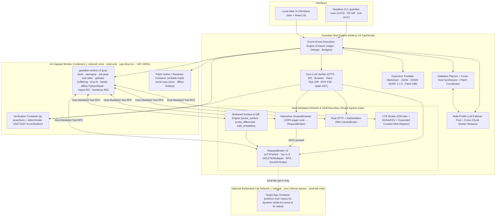

# Guardian v3 — Strix-Grade Vulnerability Discovery Inside Zero-Trust Defensive Boundaries

**Status:** Draft Design Specification  
**Base Version:** Guardian v2 ([SPEC-v2.md](SPEC-v2.md), [VERIFICATION.md](VERIFICATION.md), plus working-tree v2.5 upgrades: `/repos` mount, `code-auditor`, `cross-host-synthesizer`, `browser_chain`, `race_burst`, and HTTP `CanaryBroker`)  
**Design Goal:** Close the vulnerability-finding recall and depth gap with autonomous offensive pentesters like **Strix** (targeting **>= 90% recall on XBEN** and deep High/Critical discovery across white-box, grey-box, and black-box engagements) **without weakening a single one of Guardian's six non-negotiable defensive invariants**.

---

## 1. Executive Diagnosis: Why Strix Finds More Bugs Today (And Why Safety Isn't the Cause)

A direct codebase comparison between Strix (`usestrix/strix`) and Guardian v2/v2.5 shows a sharp asymmetry:
- **Guardian wins decisively on defensive guarantees:** air-gapped `--network none` workers, opaque `0600` Persona Vaults, DNS-rebinding/RFC1918 defense, 100%-brokered Chromium, `5xx`/`429` defensive circuit breakers, Tier 0–3 HITL approval cards, transitive scope revocation, and Zero-LLM Declarative Replay Verification.
- **Strix wins decisively on raw vulnerability discovery:** 96% (100/104) black-box XBEN solve rate, rich High/Critical recall across web/API/white-box codebases, SARIF 2.1.0 CI integration, and verified patch generation.

Crucially, **Strix's superior recall does NOT come from its unsafe operational posture** (prompt-enforced scope, internet-connected root Kali container, WAF evasion, credentials in LLM context, or LLM-only confirmation). It comes from **eight concrete discovery-layer capabilities** that Guardian v2/v2.5 lacks—**every single one of which can be engineered inside Guardian's zero-trust architecture**:

| # | Discovery Gap in Guardian v2/v2.5 | Why It Limits High/Critical Recall | Guardian v3 Zero-Trust Solution |
| :--- | :--- | :--- | :--- |
| **1** | **Minimal Offline Worker Toolchain** (`just-bash` with `python: false, javascript: false` + 8 regex analyzers in `worker/analyzers.ts`) | Workers rely on raw `grep`/`sed` over `/repos` and cannot run real SAST, AST taint queries, secret scanners, SCA, or custom offline crypto/encoding/parsing scripts. | **Hardened Air-Gapped Analysis Image (`guardian-worker:v3`):** Bake `opengrep` + offline community rules, `ast-grep` (`sg`), `tree-sitter`, `gitleaks`, `trufflehog --no-verification`, `trivy fs --offline-scan`, `bandit`, and sandboxed offline Python/Node (still `--network none`, `--read-only`, `--cap-drop ALL`, UID `10001`). |
| **2** | **1-Request-Per-Turn Network Bottleneck** (manual `request_http` calls, no wordlist/parameter/template engine) | Discovering hidden routes, query/body parameters, injection differentials, or known web CVEs one LLM turn at a time burns turns and misses non-obvious surfaces. | **Brokered Active Discovery Engines:** Host-side `probe_surface` (safe bounded path/param discovery), `probe_differential` (structured boolean/error/canary/type-confusion probes), and `run_safe_templates` (vetted non-destructive Nuclei-compatible YAML subset)—all routed **100% through `RequestBroker`** with RPS caps, SPA-catchall auto-calibration, and `5xx`/`429` circuit breakers. |
| **3** | **Protocol, Method & Browser Interaction Gaps** (no `DELETE`, no multipart uploads, no WebSockets, read-only `ScopedBrowser` with no form-fill/click flows, `assetOrigin` blocks HTTP/ports even in `local-lab`) | Cannot verify `DELETE`-based BOLA/BFLA, file-upload pipelines, CSWSH/WebSocket authz, interactive SPA CSRF/stored XSS flows, or local/Docker staging apps on `http://127.0.0.1:<port>`. | **Broker & Browser v3:** Tier-3 approval-gated `DELETE`, bounded benign `multipart/form-data` uploads, brokered `probe_websocket` + `ws_chain` replay, interactive safe `ScopedBrowser` steps (`fill`, `click`, `submit` within approved origin), and strict `local-lab` HTTP/port origin support. |
| **4** | **No Dynamic White-Box App Execution** (can read `/repos` statically, cannot run or dynamically exploit local code) | Static-only code review hits proof gaps when auth middleware, ORM filters, or framework routing only reveal exploitability at runtime. | **Isolated Lab App Runner (`local-lab` / CI opt-in):** Run target repos in a separate `--internal` (zero internet egress) Docker container reachable *only* by `RequestBroker`—matching Strix's white-box + dynamic validation loop with zero internet or host exposure. |
| **5** | **HTTP-Only OOB Canaries** (`CanaryBroker` listens on HTTP only; no DNS callback receiver) | Blind SSRF, blind XXE, and egress-filtered blind RCE often only allow outbound DNS lookups, not HTTP. | **Dual HTTP + Authoritative DNS `CanaryBroker`:** Operator-configured self-hosted DNS + HTTP callback listener (Guardian's zero-third-party equivalent of `interactsh`). |
| **6** | **Verification Expressiveness & Finding Hygiene Gaps** (duplicate findings in `dyad-v2-smoke`, `404` page confirming header retest, no SQLi boolean-diff or static-AST proof kinds, no 3-state closure discipline) | Workers drop uncertain leads without follow-up, file overlapping chain findings, or struggle to prove complex SQLi/static findings without sacrificing zero-LLM confirmation. | **Replay Verifier v3 + Closure Discipline:** Add `sql_boolean_diff`, `ws_chain`, `upload_probe`, and explicitly tiered `static_verified` (deterministic SAST/AST re-run) proofs; enforce HTTP-2xx/non-error guardrails; add submission-time semantic deduplication + `update_proposed_finding`; adopt Strix's 3-state closure (`confirmed` / `ruled_out` / `open_proof_gap`) + mandatory counterevidence. |
| **7** | **No Verified Remediation / Patch Generation** | Defenders receive prose remediation instead of tested, minimal patches they can safely merge. | **Air-Gapped Patch Author + Independent Patch Reviewer:** Runs strictly inside `--network none` containers over tmpfs `/repos` clones, enforces 6 ordered verification gates (adapted from Strix `fix_verification`), and optionally proves `reproduced → fixed` via Zero-LLM Replay against the `local-lab` runner. |
| **8** | **Web-UI-Only Workflow, No SARIF / PR-Diff CI, & No Recall Benchmark** | Cannot gate PRs in CI/CD, upload to GitHub Code Scanning, or objectively measure High/Critical recall against Strix. | **Headless `guardian scan` CLI + SARIF 2.1.0 + XBEN/Lab Recall Benchmark:** Add headless CLI (`--diff-base`, exit codes `0/1/2`), full OASIS SARIF 2.1.0 export, 40+ curated skills, and mandatory recall benchmarking on **XBEN (104 challenges)** + real-world full-stack labs. |

---

## 2. Preserved Non-Negotiable Defensive Invariants

Every v3 addition is **rejected at design and test time** if it violates any of Guardian's six invariants (extended with Invariant #7 for `local-lab` app execution):

1. **Zero-Network Workers:** Every investigation, SAST/AST, verification, and patch container runs with `--network none`, `--read-only`, `--cap-drop ALL`, `--security-opt no-new-privileges`, non-root UID `10001:10001`, and strict cgroup CPU/RAM/PID/tmpfs caps. Adding Python, `opengrep`, `ast-grep`, `gitleaks`, or `trivy` inside the worker container adds **zero network attack surface** because the container has no network namespace.
2. **Opaque Credential Isolation:** Operator secrets (LLM keys, GitHub PATs, Persona cookies/tokens/headers) live strictly in `0600` host files outside SQLite and outside containers. Personas are injected only at `RequestBroker` egress on origins present in both `run.approved` and `persona.originAllowlist`, stripped on cross-origin redirects, and scrubbed across SSE streams, FTS5, artifacts, SARIF, and Markdown exports.
3. **Strict Non-Destructive Proof Standard:** Destructive commands, webshells, reverse shells, target disk persistence, bulk data exfiltration, DoS floods, and WAF-evasion hammering remain structurally prohibited across `RequestBroker`, `probe_surface`, `probe_differential`, `run_safe_templates`, `ScopedBrowser`, and `ReplaySpec` schemas. Mutating methods (`POST`/`PUT`/`PATCH`/`DELETE`), benign multipart uploads, and non-destructive `rce_proof` probes remain strictly **Tier 3 HITL approval-gated** (or explicit `local-lab` opt-in).
4. **Zero-LLM Finding Confirmation (Strict Tier Separation):** LLM prose, version banners, and raw scanner hits can **never** set `status: 'confirmed'`. Runtime findings reach `confirmed` **only** via the deterministic Zero-LLM `ReplayVerifier` executing a validated `DeclarativeReplaySpec` from scratch with mandatory negative controls, SPA-catchall defense, and verifier-minted nonces/canaries. Static-only code findings backed by deterministic offline SAST/AST re-execution are stored in a **separate `static_verified` tier** (never conflated with runtime `confirmed`).
5. **Hard Technical Scope & Live Transitive Revocation:** Every HTTP hop, redirect, WebSocket handshake, template probe, differential probe, and Playwright subresource is bound to `scopeRevision`, DNS-rebinding checked via `ipaddr.js`, and immediately aborted + transitively tainted upon scope narrowing.
6. **Crash-Safe Explicit Resumability:** All v3 discovery batches, template runs, static scans, patch reviews, and replay verifications persist idempotent checkpoints in SQLite + Pi Durable and recover cleanly into `paused` after `SIGKILL`.
7. **Isolated White-Box Target Execution (New for v3 `local-lab`):** When Guardian starts a target application from `/repos` for dynamic white-box validation, that target container runs on a dedicated `--internal` Docker network (`--cap-drop ALL`, bounded CPU/RAM/PIDs, read-only source mount, zero internet egress, zero access to host services or other containers) and is reachable exclusively through Guardian's `RequestBroker` with `project.environment === 'local-lab'` AND `GUARDIAN_ALLOW_LOCAL_LAB=1`.

---

## 3. System Architecture (Guardian v3)



---

## 4. Deep-Dive Specifications by Subsystem

### 4.1 Hardened Air-Gapped Worker Image (`guardian-worker:v3`)

Upgrade [worker/Dockerfile](worker/Dockerfile) and [worker/bridge.ts](worker/bridge.ts) to give offline investigation and code-audit workers the same static-analysis and local-computation firepower as Strix while keeping `--network none`.

#### Baked Offline Toolchain (Pinned SHA-256 Builds)
| Tool | Purpose | Safety Constraint |
| :--- | :--- | :--- |
| **`opengrep` + offline community ruleset** | Multi-language taint & semantic SAST over `/repos` (JS/TS, Python, Go, Java, Ruby, PHP, IaC/Terraform/K8s/GitHub Actions) + custom Guardian rules in `/opt/guardian-rules/` | Runs `--offline --metrics=off` inside `--network none` container; JSON output capped and spilled to `/evidence/tool-output/`. |
| **`ast-grep` (`sg`) + `tree-sitter` parsers** | Structural AST route/middleware/sink/caller mapping (TS/TSX, JS, Python, Go, Java, YAML, JSON) | Read-only over `/repos`; eliminates fragile `grep` misses on multiline middleware/auth guards. |
| **`gitleaks` + `trufflehog` (offline mode)** | High-precision secret & credential scanning across `/repos` and staged JS bundles/source maps | `trufflehog --no-verification` strictly enforced (and `--network none` makes verification impossible); Guardian redacts raw matched secrets in bridge output before returning to the LLM (`file:line`, detector name, masked preview). |
| **`trivy` (`trivy fs --offline-scan --skip-db-update`)** | Lockfile/SBOM SCA + Dockerfile/K8s/Terraform IaC misconfiguration scan | Uses periodically refreshed offline vulnerability DB baked into `guardian-worker:v3` image; emits `cve_hypothesis` facts (never auto-confirmed). |
| **`bandit` + offline `retire.js`** | Python security linting and client-side JS library CVE fingerprinting | Pure offline execution over `/repos` and `/evidence`. |
| **Offline Python 3.12 venv + Node.js (`run_offline_script`)** | Custom offline parsing, JWT crypto/HMAC weak-secret auditing (`pyjwt`, `cryptography`), Protobuf/GraphQL/OpenAPI parsing, response diffing, encoding/decoding, payload construction | Executed **only** inside the `--network none`, `--read-only`, `--cap-drop ALL`, `no-new-privileges`, `RLIMIT_AS`/`pids-limit` worker container with `/work` tmpfs (`noexec` removed *only* for `/work/scripts` or executed via `python3 /work/script.py` / `node /work/script.mjs` keeping `noexec` on `/tmp` and `/work`!). **Zero sockets, zero secrets, 30s per-script timeout.** |

#### Container Resource & Security Limits (`src/server/worker-backend.ts`)
Raising offline SAST/AST capacity requires bounded resource bumps without relaxing isolation:
- `--network none`, `--user 10001:10001`, `--read-only`, `--cap-drop ALL`, `--security-opt no-new-privileges` (unchanged).
- RAM: `512m` → **`1024m`** (`--memory-swap 1024m`) to accommodate `opengrep`/`trivy` on medium monorepos (configurable up to `2048m`).
- CPU: `1.0` → **`2.0`** cores; PIDs: `96` → **`192`** (required by Go/Rust parallel SAST workers); `/tmp` tmpfs: `64m` → **`128m`**.
- **Secret-Masked Bridge Output:** `worker/bridge.ts` runs `secretMask()` on `gitleaks`/`trufflehog` output before streaming NDJSON back to the host, ensuring hardcoded secrets in scanned repositories are reported by `file:line`, rule ID, and masked fingerprint without flooding LLM prompts or reports with live production keys.

#### New Offline Worker Tools (`src/server/agent-session.ts`)
- **`run_sast_scan({ repo, engines: ['opengrep' | 'ast-grep' | 'gitleaks' | 'trufflehog' | 'trivy-fs' | 'bandit'], paths?, ruleFilter? })`**: Runs pinned offline static analyzers over `/repos/<repo>`, writes full JSON to `/evidence/sast/<id>.json`, and returns a deduplicated top-N summary grouped by sink/severity/file.
- **`run_offline_script({ runtime: 'python' | 'node', code, timeoutMs?: 30_000 })`**: Writes script into `/work`, executes inside the `--network none` container over `/evidence/*` and `/repos/*`, and returns bounded stdout/stderr (spilled >24 KiB).

---

### 4.2 Brokered Active Discovery Engines (`src/server/surface-engine.ts`)

Strix finds hidden endpoints, parameters, SQLi, SSTI, and CVEs quickly because it uses `ffuf`, `arjun`, `nuclei`, and Python spray loops. In Guardian v2, every single probe costs 1 full LLM turn.

Guardian v3 introduces **three host-side, broker-mediated structured discovery engines**. The worker invokes **one tool call** with a declarative plan; the host executes the bounded batch strictly through `RequestBroker` (inheriting every scope check, DNS-rebinding guard, persona allowlist, RPS token bucket, destructive denylist, and `5xx`/`429` circuit breaker) and returns only **deduplicated, baseline-calibrated anomalies**.

#### A. `probe_surface` (Defensive `ffuf` / `arjun` Equivalent)
- **Modes:**
  1. `paths`: Tests a curated built-in wordlist (e.g. `api-routes`, `nextjs-routes`, `graphql-endpoints`, `swagger-openapi`, `well-known`, `debug-actuator`, `backup-config`) or up to **120** worker-supplied candidate paths (derived from JS harvesting or `/repos`) on one approved origin.
  2. `params`: Mines hidden query or JSON-body parameters (batched `10`–`25` benign canary params per request, binary-splitting on response delta—just like `arjun`) up to **200** parameter names per call.
  3. `methods`: Checks HTTP method/verb tampering (`GET`, `HEAD`, `OPTIONS`, plus `POST`/`PUT`/`PATCH` at Tier 2/3 when allowlisted/approved) on discovered endpoints.
- **Automatic Baseline & SPA-Catchall Calibration:** Before sending probes, `probe_surface` automatically fetches 2 randomized nonexistent control paths (`/.guardian-cal-<uuid-1>`, `/.guardian-cal-<uuid-2>`) to fingerprint the origin's wildcard status, body length range, token Jaccard signature (`diffResponse`), and redirect pattern. Every probe matching the baseline signature is suppressed automatically—returning **only statistically distinct endpoints/parameters** and auto-staging their exchanges into `/evidence`.
- **Hard Guardrails:**
  - Maximum **150 requests** per `probe_surface` call (counts against `run.budgetRequests` and `maxRpsPerOrigin`).
  - Stops immediately on `BrokerCircuitOpen` (`5xx`/`429`), scope revocation, or `AbortSignal`.
  - Tier 1 allows read-only `GET`/`HEAD`/`OPTIONS` path & query-param discovery only; Tier 2 adds persona-authenticated discovery; Tier 3 (with HITL) allows mutating method/body-param discovery.

#### B. `probe_differential` (Structured Benign Injection & Logic Prober)
Replaces ad-hoc LLM payload guessing with a deterministic, host-side **control-vs-probe differential matrix** for high-impact vulnerability classes—all strictly non-destructive:

| Probe Class | Tier | Benign Non-Destructive Probes Executed via `RequestBroker` | Anomaly Signal Returned to Worker |
| :--- | :--- | :--- | :--- |
| **`sqli_boolean`** | Tier 1 (GET) / Tier 2 (auth GET / safe POST) / Tier 3 (mutating) | Sends clean baseline + randomized tautology (`' OR 137=137--`, `1 AND 137=137`) + randomized contradiction (`' AND 137=138--`, `1 AND 137=138`) + syntax-quote trigger (`'` vs `''`). | Structural similarity delta (tautology ≈ baseline ≠ contradiction) or DB error fingerprint (PostgreSQL/MySQL/SQLite/MSSQL). |
| **`ssti_math`** | Tier 1/2 (read-only) / Tier 3 (mutating) | Injects fresh random prime product expressions across Jinja2/Twig (`{{a*b}}`), ERB (`<%=a*b%>`), Freemarker (`${a*b}`), Pebble, SpEL (`#{a*b}`), Handlebars. | Computed product appears in response while literal expression does not (reflection-immune). |
| **`ssrf_canary`** | Tier 1/2 (read-only) / Tier 3 (mutating) | Mints fresh per-probe `CanaryBroker` HTTP URL + DNS hostname (`https://<canary>/...`, `<token>.<dnsDomain>`) and injects into candidate URL/webhook/redirect/Host/X-Forwarded-Host params. **Never probes `169.254.169.254` or RFC1918.** | Confirmed `CanaryBroker` HTTP or DNS callback hit correlated to exact probe token + parameter. |
| **`nosqli_type`** | Tier 1/2/3 | Tests bracket query-operator (`param[$ne]=<rand>`) and JSON operator (`{"$ne": "<rand>"}`, `{"$gt": ""}`) vs benign string baseline. | Response status/length/record-count divergence from baseline and negative control. |
| **`path_traversal_benign`** | Tier 1/2 | Tests normalized self-reference (`./` vs `../<same-dir>/`) and non-existent canonicalization differentials (`..%2f`, `..;/`) without ever requesting `/etc/shadow` or sensitive host credentials. | Normalization bypass or unexpected static-file boundary crossing. |
| **`graphql_audit`** | Tier 1/2 | Tests introspection (`__schema`), field-suggestion leakage on typoed fields, alias/batching amplification (bounded 3-alias check), and unauthenticated vs persona query diff. | Structured GraphQL surface + authz discrepancy report. |
| **`authz_matrix`** | Tier 2/3 | Takes an endpoint + resource IDs from `bolaTestQueue` and sends the complete matrix (`owner`, `other_persona`, `anonymous`, `header_bypass` like `X-Original-URL` / `X-Middleware-Subrequest`) in one bounded call. | Exact 3-way differential table ready for `http_chain` Replay Spec generation. |

#### C. `run_safe_templates` (Vetted Non-Destructive Template Engine)
- Maintains a curated, versioned, **Guardian-vetted YAML template pack** (`src/templates/**/*.yaml`) covering recent high-impact web/framework CVEs, exposed actuator/debug/metrics/Swagger/GraphQL/source-map/env endpoints, misconfigured cloud storage/CDN edges, and auth-bypass headers—modeled after Nuclei's declarative YAML format but **executed natively by Guardian's `RequestBroker`**, never by spawning an unrestricted network binary.
- **Template Safety Gate (Build-Time + Load-Time CI Check):** Every template in `src/templates/` is validated by a strict Zod schema enforcing:
  - `method ∈ {GET, HEAD, OPTIONS}` for Tier 1/2 templates (Tier 3 templates explicitly tagged `requiresTier3: true` and HITL-gated).
  - Zero destructive patterns (`containsDestructivePayload`), zero raw TCP/network/code-exec blocks, zero internal-IP/metadata URLs, zero third-party OAST URLs (must use `{{guardian_canary_http}}` / `{{guardian_canary_dns}}`).
  - Mandatory `control` matcher or SPA-catchall exclusion so template matches automatically convert into **`cve_hypothesis` / `candidate_lead` facts** (never directly `confirmed`—confirmation still flows through Zero-LLM `ReplayVerifier`).
- **Smart Auto-Selection:** Templates are tagged by `tech` (`nextjs`, `vite`, `express`, `django`, `fastapi`, `springboot`, `nestjs`, `graphql`, `clerk`, `supabase`, `wordpress`, `nginx`, `cloudflare`, etc.) and automatically filtered to match `tech_fingerprint` + `/repos` dependencies, avoiding blind template spraying.

---

### 4.3 Protocol, Method, Browser & `local-lab` Upgrades

#### A. `RequestBroker` v3 (`src/server/broker.ts`)
1. **Tier-3 Approval-Gated `DELETE` Method:** Add `'DELETE'` to `BrokerHttpRequest['method']` and `replayStepSchema`. Hard-blocked at Tiers 0–2; at Tier 3 requires an explicit `approval_requests` HITL card (displaying exact target URL, persona, and rationale) or explicit `local-lab` opt-in. Closes the critical BOLA/BFLA blind spot on destructive resource endpoints (e.g., `DELETE /api/projects/:id` tested against a test resource owned by `persona_a` using `persona_b`).
2. **Bounded Benign `multipart/form-data` Uploads:** Support structured `multipartParts: Array<{ name, filename, contentType, content }>` (max 256 KiB total, text/SVG/benign-polyglot markers only, checked by `containsDestructivePayload` + webshell signature blocker rejecting `<?php`, `<%`, `eval(`, `child_process`, `os.system`, etc.). Tier 3 HITL-gated (or `local-lab`).
3. **Brokered WebSocket Inspection (`probe_websocket`):**
   - Connects via host-side WebSocket client after running the exact same `RequestBroker` scope check, `dns.lookup` + `ipaddr.js` public-IP check, direct-IP TLS dial (`servername`), persona cookie/header injection, and `Origin` header control (allowing testing Cross-Site WebSocket Hijacking with a benign `Origin: https://evil.invalid` control vs same-origin control).
   - Bounded to max **10 messages**, **64 KiB** total frame data, **10s** connection lifetime, full secret scrubbing, and logged to `broker_exchanges` (`method: 'WS'`).
4. **First-Class `local-lab` HTTP & Port Support (`src/domain.ts`, `src/server/broker.ts`):**
   - Currently `assetOrigin` in `src/domain.ts` hard-rejects `http://`, non-default ports, and IP literals, making local staging apps and benchmarks (like XBEN on `http://127.0.0.1:8080`) impossible to onboard cleanly.
   - **v3 Rule:** Split origin validation into `publicAssetOrigin` (unchanged: `https://` hostname only, no port, no IP) and `labAssetOrigin` (permits `http://` or `https://`, explicit ports, `localhost`, `127.0.0.1`, or dedicated Guardian lab Docker subnets **ONLY** when `project.environment === 'local-lab'` AND server env `GUARDIAN_ALLOW_LOCAL_LAB=1`). Public projects never relax a single check.

#### B. Interactive `ScopedBrowser` v3 (`src/server/scoped-browser.ts`)
Strix's `agent-browser` can log into SPAs, click through multi-step UI wizards, submit forms, and trigger stored/DOM XSS or CSRF flows. Guardian v2.5's `ScopedBrowser` navigates and checks selectors/postMessage/`sameSiteFetch`, but cannot interactively drive UI flows.
- **New Safe Interactive Actions** (available in `browser_visit` and `browser_chain`, still **100% routed through `page.route('**/*', ...)` → `RequestBroker`**):
  - `fill`: Fill a safe CSS selector with a benign string/canary value (destructive denylist checked).
  - `click`: Click a safe CSS selector (links/buttons). Any resulting navigation or XHR is intercepted by `RequestBroker`—so clicking an external link aborts at the broker boundary, and clicking a mutating `POST`/`DELETE` button enforces Tier 2/3 & HITL rules automatically!
  - `select_option` / `wait_for_selector` / `wait_for_xhr`: Wait for SPA hydration or specific API calls.
  - `evaluate_builtin`: Only Guardian-authored read-only DOM/sink inspectors (never arbitrary agent-supplied `page.evaluate(rawJs)` strings, preventing browser-sandbox escapes or credential scraping—note that cookies/tokens are injected at `RequestBroker` egress anyway, not stored in Chromium's cookie jar unless explicitly needed as HttpOnly!).
  - `dom_xss_sink_hook`: Injects an `addInitScript` instrumentation hook wrapping `Element.prototype.innerHTML`, `document.write`, `eval`, `Function`, `location.href`, and `postMessage` to capture **exact runtime source→sink taint traces** when a benign canary token lands in an executable DOM sink—dramatically improving DOM XSS recall with zero alert-box flakiness.

#### C. Dual HTTP + Authoritative DNS `CanaryBroker` (`src/server/canary-broker.ts`)
Upgrade `CanaryBroker` to run an optional **operator-configured authoritative DNS callback listener** (UDP/TCP, `GUARDIAN_CANARY_DNS_HOST` / `GUARDIAN_CANARY_DNS_PORT` / `GUARDIAN_CANARY_DNS_DOMAIN`) alongside its existing HTTP callback listener:
- Mints HMAC-verified single-use subdomains (`<token>.<dnsDomain>`) and HTTP URLs (`<baseUrl>/c/<token>`).
- Responds to `A`/`AAAA`/`TXT` queries for valid minted tokens with a benign synthetic record (`127.0.0.1` or operator-configured sink IP) while recording the exact source IP, query type, subdomain label, and timestamp in `canaries`.
- Never contacts third-party OAST infrastructure (`interact.sh`, `burpcollaborator.net`, etc.), preserving full air-gap/data-residency guarantees.

---

### 4.4 Ephemeral Sandboxed White-Box App Runner (`local-lab` / CI Mode)

One of Strix's largest white-box advantages is running the target repository locally inside its container and dynamically exploiting suspected code flaws. Guardian v3 delivers this capability **without exposing the host network, internet, or worker containers**:

- **Activation Gate:** Strictly opt-in via `project.environment === 'local-lab'` + `GUARDIAN_ALLOW_LOCAL_LAB=1` + explicit operator **Start Lab Target** consent (or `--lab-run` in headless CI mode). Never active on `public` projects.
- **Isolation Architecture (`src/server/lab-runner.ts`):**
  1. Creates a dedicated per-run Docker `--internal` bridge network (`guardian-lab-<runId>`, **zero external routing / zero internet egress**).
  2. Launches the target app container from a sanitized copy of `/repos/<repo>` (using operator-supplied `labConfig`: `dockerfile` or `dockerComposeFile` or detected framework dev/prod start command) with `--cap-drop ALL`, `--security-opt no-new-privileges`, memory/CPU/PID caps, and synthetic test secrets only (never real production `.env` files).
  3. Exposes the target port **only on `127.0.0.1:<ephemeralPort>`** (or internal bridge IP) and registers that exact origin in the run's `labAssetOrigin` allowlist.
  4. Guardian's **workers still run with `--network none`**—they still talk to the lab app **solely through `RequestBroker`**!
  5. **Closed-Loop White-Box → Dynamic Proof → Verified Patch:**
     - `code-auditor` finds a missing ownership check in `app/api/invoices/[id]/route.ts` via `opengrep` + `ast-grep`.
     - Investigation worker dynamically proves the BOLA against the ephemeral lab container via `RequestBroker` + `persona_a`/`persona_b` and submits an `http_chain` Replay Spec → Zero-LLM Verifier marks it **`confirmed`**.
     - `patch-author` creates a minimal fix in an isolated tmpfs clone; Guardian rebuilds/restarts the ephemeral lab container with the patch and runs Zero-LLM `retestReplaySpec` → **`reproduced` → `fixed`**!

---

### 4.5 Zero-LLM Verification v3, Closure Discipline & Submission-Time Deduplication

#### A. New `DeclarativeReplaySpec` Kinds (`src/replay-spec.ts`, `src/server/replay-verifier.ts`)
Retain all 7 existing v2/v2.5 kinds (`http_chain`, `dns_takeover`, `tls_audit`, `browser_dom`, `browser_chain`, `race_burst`, `rce_proof`) and add **4 high-signal deterministic kinds**:

1. **`sql_boolean_diff`** (Zero-False-Positive Blind/Boolean SQLi Verification):
   - Verifier generates **3 fresh random integer pairs** `(k1, k1)` vs `(k1, k1+1)` (unseen by the LLM!) and executes interleaved `(baseline, trueProbe, falseProbe)` triplets through `RequestBroker`.
   - Confirmed **only** if across all 3 randomized pairs: `similarity(baseline, trueProbe) >= 0.90` AND `similarity(trueProbe, falseProbe) <= 0.75` (or deterministic row-count/status divergence) AND `controlStep` passes without `5xx` instability. Eliminates coincidence/caching false positives.
2. **`ws_chain`** (Deterministic WebSocket AuthZ / CSWSH Verification):
   - Executes ordered `control` (same-origin / unauthenticated) vs `probe` (cross-origin `Origin: https://evil.invalid` with persona cookie, or cross-tenant subscription message) through `RequestBroker.probeWebsocket`, running `assertionsJq` in the `--network none` verification container.
3. **`upload_probe`** (Deterministic Storage / Upload Pipeline Verification — Tier 3 / `local-lab`):
   - Uploads a benign verifier-minted SVG/HTML/polyglot marker containing a fresh random `{{upload_nonce}}` via `multipart/form-data`, then fetches the returned/derived download URL and verifies unsafe `Content-Type` (`text/html`, `image/svg+xml`) without `Content-Disposition: attachment` or unauthorized cross-persona access, followed by an optional `cleanup` step.
4. **`static_ast_proof`** (Deterministic Offline White-Box Verification — Distinct `static_verified` Tier):
   - When runtime reproduction is genuinely unreachable (e.g., source-only CI review without `local-lab` execution), a worker may submit a `static_ast_proof` spec referencing a concrete `repo`, `file`, `startLine`, `endLine`, `source→sink` trace, and a deterministic `opengrep` or `ast-grep` rule/query + `assertionsJq`.
   - `ReplayVerifier` re-runs the exact `opengrep`/`ast-grep` query from scratch against the immutable read-only `/repos` mount inside a fresh `--network none` container, confirming the exact code lines and AST pattern exist verbatim (eliminating hallucinated line numbers or invented code).
   - **Strict Tier Separation:** Passing `static_ast_proof` promotes the finding to `status: 'static_verified'` (never `confirmed`!), clearly labeled in UI, Markdown, and SARIF as static-verified with explicit `runtimeProofGap` metadata.

#### B. Replay Verifier Guardrail Fixes (Directly Addressing v2 Live Smoke Findings)
In Guardian's `dyad-v2-smoke` run ([VERIFICATION.md](VERIFICATION.md)), two real-world precision/hygiene gaps surfaced:
1. **HTTP Error-Page Guardrail for Posture/Header & Bypass Specs:** `ReplayVerifier` now checks `requireControlNonError?: boolean` (default `true` for auth-bypass and posture checks): if a `probe` or `control` unexpectedly hits `404`/`5xx` (as occurred in the `helpchat.dyad.sh` retest), the replay returns **`inconclusive`** unless the spec explicitly declares `expectedStatus` matching that error code (e.g., testing stack-trace disclosure on HTTP 500).
2. **Submission-Time Semantic Deduplication & Finding Revision (`src/server/dedupe.ts`):**
   - In `dyad-v2-smoke`, `accounts.dyad.sh` and `bulletin.dyad.sh` each had two near-identical confirmed CORS findings (one Low, one Medium).
   - v3 adds **two-stage deduplication** at `propose_chain_finding` time (before queuing verification):
     1. **Deterministic structural fingerprint:** `(origin, cwe, normalizedEndpointTemplate, authState, specKind)`. Exact matches reject duplicates immediately and instruct the worker to use `update_proposed_finding(findingId)` if its new Replay Spec proves higher impact or adds a chain step.
     2. **Semantic root-cause judge** (adapted from Strix's [dedupe.py](../strix/strix/report/dedupe.py)): When a candidate shares `(origin, category)` or overlapping `sourceOrigins` with an existing finding, a fast single-shot non-tool LLM judge checks whether both share the same root cause & fix. If duplicate with higher severity/impact, Guardian upgrades/supersedes the existing finding rather than creating a second row.

#### C. Strix-Grade Closure Discipline & Mandatory Counterevidence
Adopt Strix's `counterevidence` discipline directly into Guardian's worker contracts (`src/server/agent-session.ts`, `src/server/schema.ts`):
- Every `chain_step` and candidate suspect must close in one of three explicit states in `coverage_entries`:
  1. `reported` — linked to a `confirmed` (or `static_verified`) finding ID.
  2. `ruled_out` — **must** populate `enforcingControl` (exact `file:line` in `/repos` or exact observed negative-control `exchangeId` proving the control runs on the attacker's path). Generic claims ("framework probably escapes it") are rejected by schema/prompt validation.
  3. `needs_follow_up` (`open_proof_gap`) — plausible lead that could not be confirmed or ruled out (e.g., requires Tier 2 persona, Tier 3 approval, or `local-lab` runtime). Before entering `verification`/`complete`, the Coordinator Planner **must** query all `needs_follow_up` entries and either dispatch a follow-up step or surface them transparently in the report's **Open Proof Gaps** section.
- Every `propose_chain_finding` call requires a non-empty `counterevidence` field arguing the strongest case *against* exploitability and `confidenceRationale` (plus `severityChangeConditions`).

---

### 4.6 Air-Gapped Verified Patch Generation (`src/server/patch-workflow.ts`)

Strix generates developer-ready patches with independent review. Guardian v3 implements a **strictly offline, two-agent patch pipeline** that never touches live targets or production git remotes:

1. **Eligibility:** Triggered automatically (opt-in) or on-demand via UI/CLI after a finding reaches `confirmed` or `static_verified` and maps to a mounted `/repos/<owner>/<repo>` location (`codeLocations`).
2. **Air-Gapped `patch-author` Container (`--network none`):**
   - Copies the relevant repo subtree into `/work/repo` tmpfs (original `/repos` remains strictly `readonly`).
   - Builds a **Coverage Inventory** of all sibling routes/handlers/writers sharing the same broken invariant.
   - Authors the minimal repository-native diff (`fix_before` / `fix_after`) and runs any available offline syntax/typecheck/unit-test commands inside `--network none`.
3. **Independent `patch-reviewer` Container (`--network none`):**
   - Receives only the finding, exact diff, and `/repos` (fresh session, zero shared context with `patch-author`), enforcing Strix's **6 ordered verification gates**:
     1. Applicability & clean diff (`fix_before` matches verbatim, syntax/types pass).
     2. Security closure (quotes exact enforcing `file:line`).
     3. Sibling coverage (checks all sibling routes/writers of the same state).
     4. Legitimate-caller compatibility (classifies whether the patch *refuses only the attacker*, *needs an operator step*, or *breaks legitimate callers*—automatically **withholding** patches that break legitimate callers!).
     5. Repo conventions & minimality.
     6. Optional **Dynamic Fix Retest** (in `local-lab` mode): Rebuilds the isolated `--internal` lab target with the patch applied and runs Zero-LLM `retestReplaySpec` confirming **`reproduced → fixed`**!
4. **Output:** Approved patches attach to the existing finding (`patch_proposals` table), render as one-click diff cards in the Report UI, and emit standard OASIS **SARIF 2.1.0 `fixes`** blocks.

---

### 4.7 Headless CLI, CI/CD PR-Diff Mode, SARIF 2.1.0 & Expanded Skills

#### A. Headless CLI (`guardian scan`)
Add a first-class CLI entry point (`scripts/cli.ts` / `bin: { guardian: ... }`) sharing the exact same SQLite engine, `RequestBroker`, `LinuxWorkerBackend`, and `ReplayVerifier` as the web UI:
```sh
# White-box / PR-diff CI scan (Tier 0 offline SAST + AST + code-auditor, or local-lab dynamic)
guardian scan --repo . --diff-base origin/main --tier 0 --budget-usd 5 --sarif findings.sarif

# Grey-box live staging scan with persona vault & Tier 2 BOLA/IDOR + safe templates
guardian scan --origin https://staging.example.com --repo ./app --tier 2 \
  --persona tenant_a:./vault/a.json --persona tenant_b:./vault/b.json \
  --max-rps 5 --budget-usd 15 --output-dir ./guardian-run/

# Local-lab dynamic benchmark / XBEN mode (explicit env opt-in required)
GUARDIAN_ALLOW_LOCAL_LAB=1 guardian scan --local-lab --origin http://127.0.0.1:8080 --tier 3
```
- **Deterministic Exit Codes:** `0` = no confirmed/static-verified findings at or above `--fail-on` severity (default `high`); `1` = fatal error / incomplete run; `2` = findings confirmed at or above threshold.
- **PR-Diff Mode (`--diff-base <ref>`):** Runs `git diff --name-only <ref>...HEAD` offline, scopes `opengrep`/`ast-grep`/`code-auditor` prioritization to changed routes/handlers + their callers, and keeps CI runs fast (< 5 min) and budget-bounded.

#### B. OASIS SARIF 2.1.0 Export (`src/server/sarif-export.ts`)
Alongside portable Markdown and JSON, export GitHub Code Scanning–compatible **SARIF 2.1.0**:
- Rules keyed canonically on `CWE-NNN` (with `rule.properties['security-severity']` mapped from CVSS 3.1 / Guardian severity).
- Runtime `confirmed` findings emit `kind: "fail"` with `logicalLocations` (origin + endpoint), redacted `exchangeIds`, `replaySpecSha256`, and `codeLocations` when available.
- `static_verified` findings emit `kind: "fail"` with explicit `properties.guardian.verificationTier = "static_verified"` and `properties.guardian.runtimeProofGap`.
- Approved patches emit standard SARIF `result.fixes[].artifactChanges[]` for one-click GitHub Code Scanning fix suggestions.
- `coverage_entries` emit non-failing SARIF rows (`pass` / `notApplicable` / `open` for `needs_follow_up`) so downstream ASPM systems see both findings and verified coverage.

#### C. Expanded Playbook Library (`src/skills/*.md`: 18 → 40+ Skills)
Close Strix's domain-knowledge edge by expanding `src/skills/` with defensive, zero-trust-adapted playbooks:
- **Frameworks:** `framework-nextjs.md`, `framework-django.md`, `framework-fastapi.md`, `framework-nestjs.md`, `framework-springboot.md`, `framework-rails.md`
- **Vulnerabilities:** `sqli-boolean-differential.md`, `nosqli-type-confusion.md`, `ssti-non-destructive.md`, `xxe-canary-proof.md`, `path-traversal-canonicalization.md`, `deserialization-safe-fingerprint.md`, `prototype-pollution-dom-server.md`, `mass-assignment-overposting.md`, `websocket-cswsh.md`, `business-logic-workflows.md`, `sast-ast-triage.md`, `patch-verification.md`
- **Cloud / IaC / Supply Chain (Offline Static):** `iac-docker-k8s-terraform.md`, `ci-github-actions-security.md`, `supabase-rls-audit.md`, `firebase-rules-audit.md`, `clerk-auth0-oidc.md`

---

## 5. Data Model & Drizzle Schema Deltas (`v2 → v3`)

Extending [src/server/schema.ts](src/server/schema.ts) cleanly without breaking v2 tables:

| Table | Action | New Columns / Structure |
| :--- | :--- | :--- |
| **`projects`** | Extend | Add `labConfig` JSON (`{ enabled, startCommand?, dockerfile?, healthPath?, internalPort? }`) for opt-in `local-lab` dynamic app execution. |
| **`findings`** | Extend | Add `verificationTier`: `'runtime_confirmed' | 'static_verified' | 'baseline_confirmed'`, `fingerprintHash` (for deterministic dedupe), `supersededByFindingId`, `counterevidence`, `confidenceRationale`, `severityChangeConditions`, `codeLocations` JSON (`[{ repo, file, startLine, endLine, snippet, label }]`). |
| **`coverage_entries`** | Extend | Add `enforcingControl` (required non-empty when `status === 'ruled_out'`), `proofGapReason` (required when `status === 'needs_follow_up'`), `linkedFindingId`. |
| **`canaries`** | Extend | Add `protocol`: `'http' | 'dns' | 'both'`, `dnsHost`, `hitCount`. |
| **`sast_runs`** | **New** | Persists offline `opengrep`/`ast-grep`/`gitleaks`/`trufflehog`/`trivy` invocations (`id`, `runId`, `assignmentId`, `repo`, `engine`, `rawArtifactId`, `findingCount`, `durationMs`, `createdAt`). |
| **`surface_probes`** | **New** | Persists `probe_surface`, `probe_differential`, and `run_safe_templates` batch summaries (`id`, `runId`, `assignmentId`, `scopeRevision`, `origin`, `probeKind`, `requestsSent`, `anomaliesFound`, `baselineSignature`, `createdAt`). |
| **`patch_proposals`** | **New** | Stores air-gapped patch author + independent reviewer artifacts (`id`, `runId`, `findingId`, `repo`, `status`: `'draft' | 'approved' | 'rejected' | 'withheld'`, `callerCompatibility`: `'attacker_only' | 'needs_operator_step' | 'breaks_callers'`, `diff`, `codeLocations`, `reviewNotes`, `dynamicRetestVerdict`: `'fixed' | 'reproduced' | 'skipped'`, `createdAt`, `updatedAt`). |

---

## 6. Limit Audit & Budget Governance (`v2 → v3`)

| Parameter | Guardian v2/v2.5 | Guardian v3 Default | v3 Ceiling | Why Safe |
| :--- | :--- | :--- | :--- | :--- |
| Worker Container RAM / CPU / PIDs | `512m` / `1.0` / `96` | **`1024m` / `2.0` / `192`** | `2048m` / `4.0` / `256` | Still `--network none`, `--read-only`, `--cap-drop ALL`, UID `10001`. |
| `probe_surface` requests / call | N/A (1 req/turn) | **150 reqs/call** | 300 reqs/call | Routed through `RequestBroker` RPS bucket, `5xx`/`429` brake, and `run.budgetRequests`. |
| `run_safe_templates` templates / origin | N/A | **60 tech-matched templates** | 250 templates | Build-time vetted read-only YAML only; stops immediately on circuit open or scope revoke. |
| Default `budgetRequests` | `2,500` | **`4,000`** (public) / **`10,000`** (`local-lab`) | `25,000` (`local-lab`) | Hard per-run cap triggers clean `budget_paused` + partial report. |
| `offline_script` execution timeout | Disabled | **30s** (`python3`/`node`) | 60s | Zero network namespace; `/repos` read-only; stdout capped & secret-masked. |
| `probe_websocket` lifetime / frames | N/A | **10s / 10 frames / 64 KiB** | 20s / 25 frames | Direct-IP TLS + public-IP check + persona allowlist + full redaction. |

---

## 7. v3 Threat Model Additions (Preserving Zero-Trust Under Higher Power)

| Priority | New v3 Risk | Hard Technical Control |
| :--- | :--- | :--- |
| **Critical** | Prompt injection instructs `run_offline_script` (Python/Node) to exfiltrate `/repos` source code or scan internal networks. | Worker container remains `--network none` with zero host mounts besides read-only `/repos` and `/evidence`; kernel provides no network interfaces other than loopback, making exfiltration or lateral movement physically impossible. |
| **Critical** | `probe_surface` or `run_safe_templates` floods a production origin, triggers WAF lockouts, or causes downtime. | Every request executes inside `RequestBroker` with strict per-origin token-bucket RPS (`maxRpsPerOrigin`), max 2 concurrent in-flight requests, and sliding-window `5xx` (>= 5) / `429` (>= 8) circuit breakers that immediately abort the batch and pause that origin. |
| **Critical** | A compromised or malicious repository started by the `local-lab` App Runner attacks the host machine, LAN, or internet. | Lab App Runner is strictly disabled on `public` projects, requires `GUARDIAN_ALLOW_LOCAL_LAB=1`, attaches the app container only to a `--internal` Docker network (no default gateway / no internet egress), drops all Linux capabilities, enforces strict cgroup limits, and never mounts host secrets. |
| **Critical** | Tier-3 `DELETE` or `multipart/form-data` upload probes damage production records or drop executable webshells. | `DELETE` and multipart uploads are hard-blocked at Tiers 0–2, require an explicit blocking HITL Approval Card at Tier 3 showing exact URL/body/filename, and pass a strict webshell/destructive-payload denylist. |
| **High** | `gitleaks`/`trufflehog` finds real secrets in `/repos` and leaks them into LLM prompts, SQLite transcripts, or SARIF exports. | `worker/bridge.ts` masks matched secret values before returning tool JSON; `redact()` + `sanitizeProviderStream()` scrub registered secrets across all LLM streams, FTS5 records, Markdown, and SARIF exports. |
| **High** | Static-only SAST (`opengrep`/`trivy`) introduces Strix-like/SAST-like false positives into Guardian's `confirmed` report. | SAST hits create `code_audit_suspect` / `cve_hypothesis` leads only. Deterministic AST re-verification promotes only to the separate **`static_verified`** tier—never `confirmed`—preserving 100% precision on runtime-confirmed findings. |
| **High** | `patch-author` produces a subtly broken fix that locks out legitimate callers or leaves sibling routes vulnerable. | Independent `patch-reviewer` runs in a clean context enforcing the 6-gate checklist (explicitly withholding patches classified as `breaks_callers`), and `local-lab` runs verify `reproduced → fixed` via Zero-LLM Replay. |
| **Medium** | Malicious target page uses `ScopedBrowser` `click`/`fill` flow to redirect the browser to an unapproved origin or steal persona cookies. | `page.route('**/*', ...)` intercepts 100% of navigations, redirects, and XHRs through `RequestBroker`; cross-origin navigations are aborted (`blockedbyclient`) and persona credentials are injected only on allowlisted origins at broker egress. |

---

## 8. Objective Recall & Precision Benchmark Suite (Proving Parity With Strix)

Guardian v2 proved **100% precision** on scoped header/policy/CORS checks, but has not yet been benchmarked for **High/Critical vulnerability recall**. Guardian v3 defines mandatory objective release gates covering **both** recall and defensive safety:

### Suite A: XBEN 104-Challenge Benchmark (`local-lab` Mode — Direct Comparison With Strix)
- **Target:** The 104 web security challenges from [XBOW/XBEN](https://github.com/usestrix/benchmarks/tree/main/XBEN) (IDOR/BOLA, SQLi, SSTI, SSRF, XSS, XXE, Command Injection/RCE, Auth/JWT bypass, Path Traversal, Business Logic).
- **Mode:** `GUARDIAN_ALLOW_LOCAL_LAB=1`, Tier 3 (`local-lab` opt-in), comparing Guardian v3 directly against Strix's published 96% (100/104) black-box baseline.
- **Release Targets:**
  - **Recall:** **>= 85%** on Phase 2 exit, **>= 92%** on Phase 4 exit (closing the gap with Strix's 96%).
  - **Precision:** **100%** verified findings (0 false positives via Zero-LLM Replay Verifier).
  - **Defensive Invariants:** **0** out-of-scope requests, **0** destructive payloads executed, **0** worker container network escapes, **0** leaked persona secrets.

### Suite B: Modern Full-Stack White-Box + Grey-Box Lab (`tests/v3-fullstack-lab/`)
A deterministic local Next.js + Express + GraphQL + PostgreSQL + WebSocket lab containing 12 planted real-world High/Critical vulnerabilities:
1. Next.js Server Action missing ownership check (BOLA/IDOR)
2. `DELETE /api/orgs/:id/members/:memberId` missing tenant check (BFLA/BOLA)
3. Unverified Stripe/Svix webhook failing open when secret unset
4. Boolean-blind SQLi in search/filter query (`sql_boolean_diff`)
5. Non-destructive SSTI (`rce_proof: dynamic_math`)
6. Blind SSRF via webhook preview URL (`CanaryBroker` DNS + HTTP callback)
7. Cross-Site WebSocket Hijacking (`ws_chain`)
8. Interactive SPA DOM XSS via `postMessage` + `innerHTML` (`browser_chain` + sink hook)
9. Single-use coupon/credit race condition (`race_burst`)
10. Stored SVG XSS via unsafe `multipart/form-data` upload (`upload_probe`)
11. Cross-host credentialed wildcard CORS + sibling sandbox origin chain
12. Known framework CVE (`CVE-2025-29927`) + 3 planted **decoy/safe controls** (edge-blocked CVE, SPA `200 index.html` catch-all, reflected non-executing SSTI) that must all be `ruled_out` / `dismissed` (0 false positives).

- **Release Target:** **12/12 confirmed**, **0/3 decoy false positives**, **>= 10/12 verified patches** passing independent review + Zero-LLM `reproduced → fixed` retest, **0 duplicate findings**.

### Suite C: Live Production Defensive Smoke (`dyad.sh` Tier 1/2)
- Re-run against the 30 approved `dyad.sh` subdomains + mounted `/repos` verifying:
  - **0 duplicate findings** (confirming submission-time dedupe resolves v2's duplicate CORS pairs).
  - **0 error-page (`404`) false retests** (confirming error-page guardrails).
  - **0 out-of-scope requests**, **0 secret leaks**, **0 orphaned containers**, clean SARIF 2.1.0 validation against OASIS schema.

---

## 9. Phased Implementation Roadmap

### Phase 1 — Hardened Offline Toolchain (`guardian-worker:v3`), Submission Dedupe & Replay Guardrails
- Upgrade `worker/Dockerfile` & `worker/bridge.ts` with `opengrep` (+ offline community rules), `ast-grep`, `tree-sitter`, `gitleaks`, `trufflehog --no-verification`, `trivy fs`, `bandit`, and sandboxed offline Python/Node (`run_sast_scan`, `run_offline_script`) with bridge-level secret masking.
- Implement submission-time deterministic + semantic deduplication (`src/server/dedupe.ts`) and `update_proposed_finding`.
- Implement 3-state Closure Discipline (`enforcingControl`, `proofGapReason`), mandatory `counterevidence`, `static_ast_proof` (`static_verified` tier), and HTTP error-page guardrails in `ReplayVerifier`.
- **Exit Gate:** Boundary tests prove `--network none` / secret masking / `static_verified` vs `confirmed` separation; live `dyad.sh` smoke has 0 duplicate findings and 0 `404` posture retests.

### Phase 2 — Brokered Active Discovery Engines, Protocol/Browser v3 & Dual HTTP+DNS Canaries
- Build `src/server/surface-engine.ts`: `probe_surface` (SPA-calibrated path/param/method discovery), `probe_differential` (`sqli_boolean`, `ssti_math`, `ssrf_canary`, `nosqli_type`, `path_traversal_benign`, `graphql_audit`, `authz_matrix`), and `run_safe_templates` + curated vetted YAML template pack (`src/templates/`).
- Upgrade `RequestBroker` v3 (Tier-3 `DELETE`, benign `multipart/form-data`, `probe_websocket`, `labAssetOrigin` HTTP/port support for `local-lab`).
- Upgrade `ScopedBrowser` v3 (`fill`, `click`, `wait_for_xhr`, `dom_xss_sink_hook` — 100% broker-proxied) and `CanaryBroker` (authoritative DNS + HTTP listener).
- Add `sql_boolean_diff`, `ws_chain`, and `upload_probe` to `DeclarativeReplaySpec` and `ReplayVerifier`.
- Expand `src/skills/` from 18 → 40+ defensive playbooks.
- **Exit Gate:** Boundary suite verifies Tier-3 HITL on `DELETE`/uploads, zero direct egress on WebSockets/interactive browser, `5xx`/`429` circuit-breaker aborts on `probe_surface`/`run_safe_templates`, and **>= 85% recall / 100% precision on XBEN**.

### Phase 3 — Ephemeral `local-lab` App Runner & Air-Gapped Verified Patch Workflow
- Implement `src/server/lab-runner.ts` (`--internal` zero-egress target container orchestration strictly gated to `local-lab` + `GUARDIAN_ALLOW_LOCAL_LAB=1`).
- Implement `src/server/patch-workflow.ts` (`patch-author` + independent `patch-reviewer` inside `--network none` containers enforcing 6 verification gates + `callerCompatibility` withholding + dynamic Zero-LLM `reproduced → fixed` retest).
- Surface Patch Diff cards, Closure Ledger (`Open Proof Gaps`), and `static_verified` vs `confirmed` badges in the TanStack Start UI.
- **Exit Gate:** Full-Stack Lab Suite B passes **12/12 confirmed, 0/3 decoy false positives, >= 10/12 verified patches**, and proves zero internet/host reachability from the `--internal` lab app container.

### Phase 4 — Headless CLI, PR-Diff CI Mode, SARIF 2.1.0 & Full XBEN Recall Tuning
- Ship headless `guardian scan` CLI (`--diff-base`, `--sarif`, `--fail-on`, exit codes `0/1/2`) and OASIS-validated **SARIF 2.1.0** exporter (`src/server/sarif-export.ts`).
- Run full 104-challenge XBEN benchmark and close remaining recall gaps via skill/template/differential tuning (never relaxing verification or safety invariants).
- Publish complete v3 verification & benchmark scorecard in `VERIFICATION-v3.md`.
- **Exit Gate:** **>= 92% XBEN recall with 100% precision**, OASIS SARIF 2.1.0 schema validation pass, and zero regression across all v2/v3 boundary and E2E suites.
