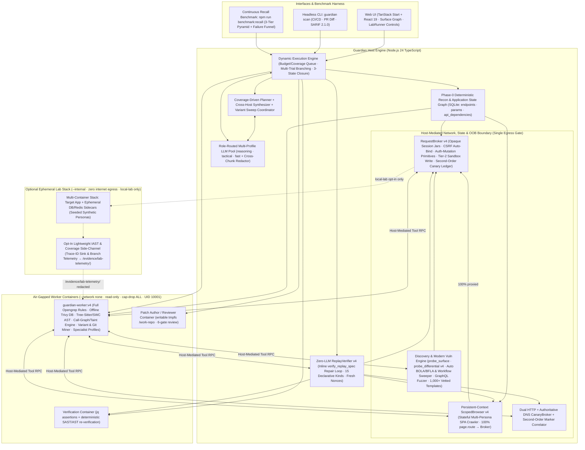

# Guardian v4 — 10x Vulnerability Recall Through Verifier Feedback, Stateful Modeling, Semantic Taint, and Coverage-Guided Lab Execution

**Status:** Draft Design Specification  
**Base Version:** Guardian v3 ([SPEC-v3.md](SPEC-v3.md), [VERIFICATION-v3.md](VERIFICATION-v3.md) — 56/56 automated boundary, protocol, browser, and E2E gates passing across all 7 zero-trust defensive invariants)  
**Design Goal:** Achieve a **10x leap in real-world High/Critical vulnerability recall** across black-box, grey-box, and white-box engagements—closing the gap with frontier autonomous security systems (XBOW, Strix, ARTEMIS, Team Atlanta Atlantis, IRIS, RepoAudit)—while **preserving all 7 non-negotiable zero-trust defensive invariants with 100% runtime confirmation precision**.

---

## 1. Executive Diagnosis: Why Guardian v3 Hits a Recall Ceiling (And Why Safety Isn't the Bottleneck)

Guardian v3 established an unusually strong zero-trust foundation: air-gapped `--network none` worker containers (`guardian-worker:local`), opaque `0600` Persona Vaults, 100%-brokered Playwright Chromium, 11 Zero-LLM `DeclarativeReplaySpec` kinds, 3-state closure discipline, air-gapped patch verification, and isolated `--internal` `LabRunner` target execution.

A deep audit of the v3 codebase—cross-referenced against empirical findings from peer-reviewed vulnerability discovery research (CyberGym, CVE-Bench, IRIS, RepoAudit, Witcher/Phuzz, RESTler, ARTEMIS, HPTSA, DARPA AIxCC SoK) and modern web security research—shows that **Guardian's defensive invariants are not what limit its recall**. The bottlenecks are **eight concrete implementation ceilings** across verification feedback, stateful interaction, discovery depth, semantic code analysis, lab observability, orchestration, and empirical measurement:

| # | Structural Ceiling in Guardian v3 | Concrete Codebase Bottleneck | Guardian v4 Zero-Trust Upgrade |
| :--- | :--- | :--- | :--- |
| **1** | **Zero-Feedback Verification Wall** | `propose_chain_finding` ([execution.ts](src/server/execution.ts#L3152-L3585)) only queues a spec as `pending`; `ReplayVerifier` runs in Phase 3 after every worker has exited. A minor `assertionsJq` typo, missed extraction path, CSRF quirk, or step index error silently kills a real bug as `dismissed`/`inconclusive`. | **Verifier-in-the-Loop Repair:** Synchronous `verify_replay_spec` / inline deterministic verification returning sanitized compiler-style failure diffs (`jq` error, `404` control, SPA similarity, missed canary) with bounded repair retries (max 2–3), keeping final confirmation 100% Zero-LLM. |
| **2** | **Stateless HTTP, Broken Multi-Step Browser Flows & Rigid POST Gating** | `RequestBroker` ([broker.ts](src/server/broker.ts#L285)) blocks caller `Cookie` and `ScopedBrowser` ([scoped-browser.ts](src/server/scoped-browser.ts#L401-L409)) strips `Set-Cookie` with no server-side session jar; `browser_chain` ([replay-verifier.ts](src/server/replay-verifier.ts#L655-L709)) spawns a fresh Playwright context per step (wiping DOM/state between `fill` and `click`); `broker.ts:1400-1420` blocks benign form/Server-Action/tRPC `POST` below Tier 3. | **Stateful Broker & Persistent Browser v4:** Opaque broker-managed Ephemeral Session Jars + automatic CSRF token binding; shared `PlaywrightContext`/`Page` across steps within a `browser_chain` group; broker-side Auth-Mutation Primitives (JWT/OAuth without exposing raw tokens); Tier-2 Sandbox Test-Account Write allowlist. |
| **3** | **Thin Surface Discovery, Static Wordlists & No Application State Graph** | Round-0 only fetches `GET /`; `surface-engine.ts:27-78` uses 7 tiny static wordlists (12–36 paths) and 60 params; `worker/analyzers.ts:15-72` extracts JS routes via 4 brittle regexes; `extractPersonaResourcesFromExchange` ([execution.ts](src/server/execution.ts#L442-L485)) scrapes shallow JSON (`depth <= 3, max 6`) passively; no structured Endpoint or API Dependency Graph exists in SQLite. | **Deterministic Phase-0 Recon + Stateful Application Graph:** Zero-LLM Phase-0 surface mapper populating first-class SQLite `endpoints`, `endpoint_params`, and `api_dependencies` tables; AST-based JS/source-map route & Server Action extractor; stateful multi-persona SPA explorer (`crawl_state_graph`); producer-consumer API dependency modeling. |
| **4** | **Shallow SAST Rulesets & Single-File White-Box Auditing** | `worker/rules/opengrep/` has 3 files (328 lines); `ast-grep` has 2 files (166 lines); `sca-advisories.json` is 137 lines; `trivy` has no pre-baked offline DB ([worker/Dockerfile](worker/Dockerfile#L43-L53)); `code-auditor` is capped at 30 turns and `convertCodeAuditSuspectsToChainSteps` ([execution.ts](src/server/execution.ts#L380)) caps suspects at 12. Real bugs cross helpers, custom auth middleware, and ORM wrappers. | **Semantic Interprocedural Taint, Full Offline Rulesets & Variant Analysis:** Bake full curated offline Opengrep community rules + offline Trivy DB + multi-language call-graph/CPG indexer into `guardian-worker:v4`; 3-stage IRIS/RepoAudit/Atlantis pipeline (project-specific invariant inference → sinkpoint-backward interprocedural taint → git-history mining & automated variant sweeps); lift the 12-suspect cap. |
| **5** | **Blind Single-Container `LabRunner` Disconnected From UI & Execution** | `LabRunner` ([lab-runner.ts](src/server/lab-runner.ts#L28)) declares `dockerComposeFile` without implementing multi-service stacks, is only wired into `scripts/cli.ts`, and probes the local app completely blind—ignoring code coverage, SQL/sink queries, and stack traces. | **Multi-Service `LabRunner` v4 + Lightweight Coverage-Guided IAST:** Full multi-container `--internal` stacks (app + Postgres/MySQL/Redis/Mongo seeded with test personas) wired into Execution & Web UI; opt-in `local-lab` runtime IAST hooks (coverage maps + SQL/template/fetch/exec sink traces + stack traces tagged with `X-Guardian-Trace-Id`) streamed redacted into `/evidence/lab-telemetry/`. |
| **6** | **Format Blind Spots, Missing Modern Bug Classes & Tiny Template Pack** | `injectParam` and `sql_boolean_diff` ([replay-spec.ts](src/replay-spec.ts#L232-L265)) only support `query` and `json` (missing `form`, `path`, `header`, `xml`, `graphql_var`); `sqli_boolean` tries only 3 rigid patterns; GraphQL only checks introspection/3-alias `__typename`; only 37 YAML templates exist; no probes for cache poisoning/deception, proxy parser diffs, XXE, mass assignment, OAuth/JWT protocol flaws, or second-order flows. | **Modern Vuln Engines & 1,000+ Vetted Templates:** Add `form`/`path`/`header`/`xml`/`graphql_var` encodings + expanded SQLi/bounded timing; automated multi-persona BOLA/BFLA & workflow-skip sweeper; full GraphQL schema-driven resolver fuzzer; safe cache-busted cache poisoning/deception; OAuth/OIDC/JWT fuzzer; XXE, XSS context, mass assignment; Second-Order Canary Ledger; build-time Nuclei-to-Guardian transpiler (37 → 1,000+ Zod-gated templates). |
| **7** | **Hard Step Caps & Monolithic Generalist Workers** | `maxChainStepsPerRun = 32` ([execution.ts](src/server/execution.ts#L105)) starves multi-host engagements and monorepos; one generic 150-turn worker prompt handles every bug class (causing context drift); every role uses the same model/thinking budget; single-pass trajectories miss high-value leads. | **Specialist Sub-Agents, Multi-Trial Branching & Dynamic Budgets:** Replace the 32-step cliff with budget-, coverage-, and diminishing-returns-driven queueing; spawn clean-context 25–40 turn specialist profiles (`bola-bfla`, `injection-parser`, `auth-oauth`, `client-browser`, `graphql-api`, `business-logic-race`, `protocol-cache`); run 2–3 diverse parallel trials on crown-jewel leads; route models by role affinity. |
| **8** | **No Live Recall Benchmark or Failure Attribution Flywheel** | [VERIFICATION-v3.md](VERIFICATION-v3.md#L131) notes that full recall benchmarking is still deferred—leaving recall engineering without empirical per-stage drop-off data. | **3-Tier Recall Benchmark & Failure-Taxonomy Flywheel (`npm run benchmark:recall`):** Instrumented funnel (`Target → Surface → Hypothesis → Signal → Spec → Zero-LLM Confirmed`) across XBEN (Tier 1), CVE-Bench/CWE-Bench-Java/crAPI/Juice Shop (Tier 2), and contamination-free Modern SaaS Labs (Tier 3) with automated failure bucketing. |

---

## 2. Preserved Non-Negotiable Defensive Invariants (All 7 Unchanged)

Every v4 capability is **rejected at design, schema, and CI boundary-test time** if it weakens any of Guardian's seven invariants:

1. **Zero-Network Workers:** All investigation, SAST/CPG/taint, variant-sweep, verification, and patch containers run strictly with `--network none`, `--read-only`, `--cap-drop ALL`, `--security-opt no-new-privileges`, UID `10001:10001`, and strict cgroup caps. Adding full Opengrep rules, offline Trivy DBs, Tree-Sitter/SWC, and Joern/call-graph indexers adds zero network attack surface.
2. **Opaque Credential Isolation:** Operator secrets and Persona credentials remain strictly in `0600` host files outside SQLite and outside containers. **v4 additions:**
   - Opaque Ephemeral Session Jars store `Set-Cookie` values exclusively inside host-side `RequestBroker` memory/encrypted ephemeral state; workers reference only opaque handles (e.g., `session: "jar-1"`), never raw cookie values.
   - Broker-Side Auth-Mutation Primitives mutate persona JWTs/tokens strictly inside `RequestBroker` egress; raw original or mutated token bytes are redacted before leaving the broker.
   - `local-lab` IAST telemetry runs through Guardian's secret scrubber before staging into `/evidence/lab-telemetry/`.
3. **Strict Non-Destructive Proof Standard:** Destructive commands, webshells, reverse shells, target disk persistence, bulk exfiltration, DoS floods, and WAF-evasion hammering remain structurally prohibited across every v4 engine. **v4 additions:**
   - Web cache poisoning/deception probes **require** a mandatory random per-probe cache-buster parameter (`?_gcb=<uuid>`) enforced at schema and broker level so cached probe responses are strictly isolated from real users.
   - Tier-2 Sandbox Test-Account Write allowlists require explicit operator configuration (`sandboxWriteAllowlist` / staging or test-account path patterns) and still enforce destructive-payload and webshell denylists.
   - Raw-socket protocol desync (`http_desync_diff`) and bounded timing SQLi (`sqli_time_diff`) are strictly gated to `local-lab` or explicit Tier-3 HITL approval.
4. **Zero-LLM Finding Confirmation & Strict Tier Separation:** LLM prose, SAST/CPG hits, Nuclei template hits, and **local-lab IAST telemetry** can **never** set `status: 'confirmed'`.
   - Inline `verify_replay_spec` repair feedback helps workers fix deterministic proof mechanics, but final `confirmed` promotion requires `ReplayVerifier` to execute a validated `DeclarativeReplaySpec` from scratch with fresh verifier-minted nonces/canaries, negative controls, SPA-catchall calibration, and `requireControlNonError`.
   - In `local-lab`, IAST telemetry accelerates discovery and coverage guidance only; final Zero-LLM verification runs against an uninstrumented confirmation pass (or ignores telemetry channels during assertion evaluation).
   - Static-only findings verified via `static_ast_proof` remain strictly in `status: 'static_verified'`.
5. **Hard Technical Scope & Live Transitive Revocation:** Every Phase-0 crawl step, stateful SPA click, session-jar cookie, GraphQL fuzzer query, transpiled template probe, and multi-trial branch flows 100% through `RequestBroker`, bound to `scopeRevision`, DNS-rebinding checked via `ipaddr.js`, and aborted + transitively tainted upon scope narrowing.
6. **Crash-Safe Explicit Resumability:** Phase-0 surface maps, Application State Graph tables, session-jar metadata, multi-trial queues, inline verification attempts, and benchmark checkpoints persist atomically in SQLite and recover cleanly into `paused` after `SIGKILL`.
7. **Isolated White-Box Target Execution (`local-lab`):** Multi-container Compose stacks (app + DB/Redis sidecars) and opt-in IAST instrumentation activate **only** when `project.environment === 'local-lab'` AND `GUARDIAN_ALLOW_LOCAL_LAB=1` AND explicit operator consent is granted. All stack containers share one per-run Docker `--internal` network (zero internet egress, zero host port publishing except Guardian's loopback broker forwarder, dropped capabilities, synthetic test secrets only).

---

## 3. System Architecture (Guardian v4)



---

## 4. Deep-Dive Specifications by Subsystem

### 4.1 Closing the "Zero-Feedback Verification Wall" (Verifier-in-the-Loop Repair)

**Current bottleneck:** In [src/server/execution.ts](src/server/execution.ts#L3152-L3585), `propose_chain_finding` validates the Zod schema and inserts a `pending` row; `ReplayVerifier` only runs later in Phase 3 after every investigation worker has exited. Empirical evaluations (CyberGym, CVE-Bench, MAPTA) show that giving agents deterministic execution-oracle feedback on failed proofs produces an immediate **2–3x lift in confirmed recall** on the exact same base model.

#### Design
1. **Inline Synchronous `verify_replay_spec` Tool (and Auto-Verify Option in `propose_chain_finding`):**
   - Workers gain a bounded `verify_replay_spec({ spec, findingId? })` tool (or `propose_chain_finding({ ..., verifyNow: true })`, enabled by default in v4).
   - The host executes `verifyReplaySpec` immediately through `RequestBroker` / `ScopedBrowser` / `CanaryBroker` + the `--network none` verification container, enforcing all Tier 0–3, scope, and budget rules.
2. **Sanitized Compiler-Style Failure Diff:**
   - When verification returns `dismissed` or `inconclusive`, Guardian returns a compact, secret-redacted diagnostic payload directly to the worker:
     ```ts
     export interface InlineVerifyFeedback {
       verdict: 'confirmed' | 'static_verified' | 'dismissed' | 'inconclusive'
       verificationTier?: VerificationTier
       failedStepId?: string
       controlPassed: boolean
       requireControlNonErrorTriggered?: boolean
       spaCatchallMatched?: boolean
       spaSimilarityScore?: number
       canaryTriggered?: boolean
       jqError?: string
       assertionSummary?: { observed: string; expected: string; reason?: string }
       stepStatuses: Array<{ id: string; role: string; status: number | null; mediaType?: string; bodyLen: number }>
       retriesRemaining: number
     }
     ```
   - Raw persona secrets, raw cookies, and unredacted sensitive fields are scrubbed before feedback enters the worker context.
3. **Bounded Refinement Budget:**
   - Maximum **3 verification attempts** per finding hypothesis (`maxInlineVerifyRetries = 2` repairs after initial attempt; tracked in `replay_specs.attempt_count`).
   - If a finding fails in Phase 3 final verification (e.g., transient flakiness or cross-host spec submitted late), Guardian can dispatch a single focused 8-turn **Refinement Turn** with the exact failure diff before closing the hypothesis as `ruled_out` or `needs_follow_up`.
4. **Zero-LLM Invariant Guarantee:**
   - Inline `verify_replay_spec` runs the exact same deterministic `ReplayVerifier` with fresh verifier-minted nonces/canaries. The LLM can only iterate on the *declarative spec*; it can never forge or override a `confirmed` verdict.

---

### 4.2 Stateful Protocol, Session & Browser Execution (`RequestBroker` v4 & `ScopedBrowser` v4)

Real web applications rely on double-submit CSRF cookies, multi-step wizard sessions, login/OAuth state cookies, persistent SPA DOM transitions, and non-GET form/RPC requests.

#### A. Opaque Broker-Managed Ephemeral Session Jars (`src/server/broker.ts`)
- Add optional `session?: string` (regex `/^[a-z0-9_-]{1,32}$/`) to `BrokerHttpRequest`, `replayStepSchema`, and `probe_differential`.
- **Server-Side Isolation:** `RequestBroker` maintains an ephemeral per-`(runId, assignmentId, session)` cookie jar in host memory (snapshotted encrypted/opaque for crash recovery only as metadata; raw cookie values are **never** written to SQLite `broker_exchanges`, `facts`, SSE streams, or worker tool results).
- **Precedence & Scoping Rules:**
  - Cookies received via `Set-Cookie` are stored scoped strictly by `(origin, path, secure, sameSite)` and sent **only** to matching in-scope origins.
  - Persona credentials from the `0600` Persona Vault remain authoritative for auth cookies/headers; ephemeral jar cookies merge non-conflicting session/CSRF/state cookies without overwriting vault-managed auth headers unless explicitly testing an unauthenticated flow (`persona` omitted).
  - `ReplayVerifier` automatically isolates session jars across `control` vs `probe` step groups unless a step explicitly shares a `setup` jar ID.
  - Scope revocation immediately purges all cookies for revoked origins.

#### B. Automatic CSRF Token Extraction & Binding
- Add `csrfBind?: boolean | { headerName?: string; fieldName?: string; cookieName?: string }` to `BrokerHttpRequest` and `replayStepSchema`.
- When enabled inside a session jar, `RequestBroker` inspects prior responses in that jar for standard CSRF tokens (`XSRF-TOKEN` / `csrf_token` / `_csrf` cookie, `<meta name="csrf-token" content="...">`, or `<input type="hidden" name="(_csrf|csrf_token|csrfmiddlewaretoken|__RequestVerificationToken|authenticity_token)">`) and automatically binds the token into the matching header (`X-CSRF-Token` / `X-XSRF-TOKEN`) or form/JSON field at egress.
- Eliminates silent `403 Forbidden (Invalid CSRF Token)` drops during form SQLi, BOLA, mass-assignment, and business-logic testing without leaking session cookies to the LLM.

#### C. Persistent `PlaywrightContext` / `Page` Across `browser_chain` Steps (`src/server/scoped-browser.ts`, `src/server/replay-verifier.ts`)
- **Fixes critical v3 bug:** In [src/server/replay-verifier.ts](src/server/replay-verifier.ts#L655-L709), `browser_chain` currently calls `scopedBrowser.visitPage()` fresh per step—destroying DOM state, navigation, `localStorage`, and SPA state between step 1 (`fill`) and step 2 (`click`).
- **v4 `ScopedBrowser.runBrowserSession(steps, grant, signal)`:**
  - Opens a single 100%-brokered `PlaywrightContext` + `Page` (with `page.route('**/*', ...)` → `RequestBroker` and an associated ephemeral broker session jar) for a contiguous group of steps sharing the same `(groupRole, persona)`.
  - Automatically resets to a clean fresh context/page when transitioning between `control` and `probe` groups or when `persona` changes (or when a step sets `resetContext: true`).
  - Steps after the first within a session may omit `pathAndQuery` (or set `reusePage: true`) to act directly on the live DOM produced by prior `fill`/`click`/`wait_for_xhr` steps.

#### D. Broker-Side Auth-Mutation Primitives (`src/server/broker.ts`, `src/replay-spec.ts`)
- Lets workers test JWT and bearer-token validation flaws **without ever seeing the raw token** (preserving Invariant #2).
- Add optional `authMutation` to `BrokerHttpRequest` and `replayStepSchema` (requires `persona` handle):
  ```ts
  type AuthMutation =
    | { kind: 'alg_none' }
    | { kind: 'strip_signature' }
    | { kind: 'expired_replay'; skewSeconds?: number }
    | { kind: 'rs256_to_hs256_jwks'; jwksUrl?: string } // signs using target's fetched public JWKS PEM
    | { kind: 'kid_inject'; value: string }             // benign SQLi/path-traversal marker in JWT header kid
    | { kind: 'jku_x5u_canary'; header: 'jku' | 'x5u' } // injects fresh CanaryBroker URL
    | { kind: 'claim_swap'; claims: Record<string, string | number | boolean> } // unsigned or local-lab only
  ```
- `RequestBroker` decodes the persona's JWT in host memory, applies the requested non-destructive transformation, injects it at egress, and redacts the mutated token from all logs and responses.

#### E. Tier-2 "Sandbox Test-Account Write" Scope
- Currently [src/server/broker.ts](src/server/broker.ts#L1400-L1420) blocks almost all `POST` requests below Tier 3, stalling benign search forms, Next.js Server Actions, tRPC queries, and test-account staging flows behind Tier-3 HITL cards.
- **v4 Extension:** Add project-level `sandboxWriteAllowlist: ApprovedEndpointPattern[]` (explicitly opt-in by the operator for staging/sandbox origins or dedicated test-account endpoints, and automatically enabled for `local-lab`).
- At **Tier 2**, `RequestBroker` allows non-destructive `POST` requests (JSON, `application/x-www-form-urlencoded`, GraphQL, tRPC, Next.js `Next-Action`) matching `sandboxWriteAllowlist` (still blocking `DELETE`, `multipart` uploads, destructive payloads, and cross-tenant production writes, which remain strictly Tier-3 HITL gated).

---

### 4.3 Deterministic Phase-0 Recon, Application State Graph & Producer-Consumer API Modeling

**Current bottleneck:** Guardian v3 starts investigation with a single `GET /` per origin, shallow regex JS harvesting, and unstructured `facts` that compact into prose digests—causing planners and workers to lose track of endpoints, parameters, and object lifecycles.

#### A. Zero-LLM Phase-0 Surface Mapper (`src/server/phase0-recon.ts`)
Runs deterministically *before* the first LLM turn (bounded by a dedicated Phase-0 request budget, default 15% of `budgetRequests`, max 250 reqs/origin):
1. **Black-Box / Grey-Box Pass (100% through `RequestBroker` & `ScopedBrowser`):**
   - Fetches `/`, `robots.txt`, `sitemap.xml`, `/.well-known/openid-configuration`, `/.well-known/jwks.json`, `/.well-known/security.txt`, OpenAPI/Swagger specs, and GraphQL introspection endpoints.
   - Runs **Stateful Multi-Persona SPA Exploration (`crawl_state_graph`)** via `ScopedBrowser` v4 across anonymous + each approved persona (`maxPages: 25` per persona, `maxDepth: 3`): follows links, discovers HTML `<form>` actions + hidden/visible input names + CSRF fields, intercepts all XHR/`fetch`/WebSocket/GraphQL/Next.js Server Action (`Next-Action`) traffic, records `postMessage` listeners and `localStorage`/`sessionStorage` keys.
   - Recursively fetches same-origin JS chunks and `.map` source maps (within size caps) and dispatches them to the `--network none` AST harvester.
   - Executes tech-matched `run_safe_templates` (Tier 1/2 read-only) based on detected stack fingerprints.
2. **White-Box Pass (`/repos` mounted, `--network none`):**
   - Runs deterministic Tree-Sitter / `ast-grep` framework route extractors across Next.js (App Router, Pages Router, `"use server"` actions), Express, Fastify, NestJS, Django/DRF, FastAPI, Flask, Spring Boot, Rails, and Go (`net/http`, `gin`, `echo`, `chi`).
   - Emits the complete **Route × HTTP Method × Auth Middleware × Ownership Guard × Dangerous Sink** inventory and automatically correlates static routes to live origins in SQLite.
3. **Dynamic Target-Specific Wordlists:**
   - Automatically synthesizes target-specific path segments, API resource nouns, and parameter names from harvested JS ASTs, OpenAPI/GraphQL schemas, HTML forms, and `/repos` models—feeding `probe_surface` with high-signal domain vocabulary instead of 30-item static lists.

#### B. First-Class SQLite Application State & Producer-Consumer API Graph
Replace prose-only endpoint tracking with structured relational tables (`endpoints`, `endpoint_params`, `api_dependencies` — see §5):
- Every discovered route is normalized into a parameterized template (e.g., `GET /api/orgs/{orgId}/invoices/{invoiceId}`), recording its `source` (`spa_crawl`, `js_ast`, `openapi`, `graphql`, `repo_ast`, `surface_probe`), `authRequirement`, `ownershipGuard`, `testedClasses[]`, and (in `local-lab`) `coveragePct`.
- **Producer-Consumer Dependency Inference (RESTler / Schemathesis-inspired):**
  - Upgrades `extractPersonaResourcesFromExchange` ([src/server/execution.ts](src/server/execution.ts#L442)) to walk full JSON responses (up to depth 8), HTML links/forms, GraphQL payloads, and `Location` headers across personas.
  - Infers directed producer → consumer edges (`POST /api/orders` produces `orderId` → consumed by `GET|PATCH|DELETE /api/orders/{orderId}` and `POST /api/orders/{orderId}/refund`) and observed state transitions (`draft → submitted → paid → refunded`).
  - Feeds `threat-model`, `chain-planner`, and specialist workers with exact structured queries instead of lossy prose summaries.

#### C. AST-Based JS/TS & Source-Map Harvester (`worker/analyzers.ts`)
- Upgrades `js-harvest` inside `guardian-worker:v4` from 4 regexes to **SWC / Tree-Sitter AST parsing** over minified Webpack, Vite, Rollup, and Next.js chunks + source maps.
- Deterministically extracts: client router tables (`react-router`, Next.js manifest, Vue/Svelte routes), hidden admin paths, feature-flag names, embedded GraphQL `gql` documents/fragments, Next.js Server Action hash IDs, `fetch`/`axios`/`tRPC` client calls with HTTP methods and body keys, and DOM sinks (`dangerouslySetInnerHTML`, `innerHTML`, `postMessage` handlers lacking `event.origin` checks).

---

### 4.4 Deep White-Box Semantic Auditing, Offline Toolchain Depth & Automated Variant Analysis

**Current bottleneck:** Guardian v3's worker image runs on an almost empty rule tank (3 Opengrep files / 328 lines, 2 `ast-grep` files / 166 lines, 137-line SCA JSON, no pre-baked Trivy DB) and performs shallow single-file pattern matching capped at 30 turns and 12 suspects.

#### A. Full Offline Ruleset & Toolchain Depth (`guardian-worker:v4`)
Baked directly into the `--network none` Docker image with pinned SHA-256 digests and build-time smoke assertions:
- **Curated Full Offline Opengrep/Semgrep Security + Taint Ruleset:** Multi-language security & intraprocedural/interprocedural taint packs covering TypeScript/JavaScript, Python, Go, Java, PHP, Ruby, Terraform/Kubernetes/Docker IaC, and GitHub Actions (scaling from 3 files to ~1,500+ curated high-signal rules, deduplicated and pre-tested at image build time).
- **Pre-Baked Offline Trivy Vulnerability DB:** Download and freeze `trivy-db` + `trivy-java-db` into `/opt/trivy-cache` at image build time so `trivy fs --offline-scan --skip-db-update` resolves real CVEs across npm, pip, Go, Maven/Gradle, Cargo, Composer, and Bundler lockfiles completely offline.
- **Expanded AST & Call-Graph Engine:** Bake `tree-sitter` language grammars + a lightweight offline **Symbol & Call-Graph / Interprocedural Data-Flow Indexer** (with optional Joern CPG profile `guardian-worker:v4-cpg` for deep Java/C/C++/Go/JS/Python audits inside `--network none`).

#### B. 3-Stage Offline Semantic Audit Pipeline (IRIS / RepoAudit / Atlantis-Inspired)
Replaces the monolithic 30-turn grep loop in `code-auditor` with three structured offline stages:

1. **Stage 1 — Project Spec & Security Invariant Extractor (IRIS-style):**
   - Inspects `/repos` framework config, middleware chains, auth libraries (NextAuth, Clerk, Passport, Spring Security, Django auth, custom JWT middleware), ORM wrappers (Prisma, Drizzle, TypeORM, SQLAlchemy, Hibernate), and custom sanitizers.
   - Outputs a structured `ProjectSecuritySpec` JSON (project-specific **Sources**, **Auth/Tenant Guards**, **Sanitizers**, **Dangerous Sinks**, and **Explicit Business Invariants** such as "every `Invoice` query must filter by `orgId === session.orgId`").
   - Dynamically generates project-specific `opengrep` / `ast-grep` taint rules tailored to the repository's own wrappers (proven in IRIS ICLR 2025 to more than double CVE recall while reducing false discovery rate).

2. **Stage 2 — Sinkpoint-Backward & Demand-Driven Interprocedural Traversal (Atlantis / RepoAudit-style):**
   - Maps every dangerous sink (SQL/ORM raw query, template render, command exec, file read/write, outbound HTTP/SSRF, state-changing DB write, privilege mutation, webhook handler) and traces **backward** along the call graph to every HTTP/RPC/Server-Action/GraphQL/webhook entrypoint.
   - Evaluates path dominance: flags any entrypoint → sink path where an auth middleware, ownership/tenant guard, or sanitizer fails to dominate all callers.
   - **Removes the hardcoded 12-suspect cap** in `convertCodeAuditSuspectsToChainSteps` ([execution.ts](src/server/execution.ts#L380)); converts all deduplicated high-confidence suspects ranked by sink severity and missing-guard score, bounded only by dynamic run budget.

3. **Stage 3 — Git-History Security Miner & Automated Variant Analysis (Big Sleep / Aardvark-style):**
   - **Git-History Miner:** Runs offline `git log` over mounted `/repos` (e.g., last 200 commits or `--diff-base` window) matching security-fix commit patterns (`fix|auth|perm|idor|bola|csrf|xss|sqli|ssrf|bypass|sanitize|tenant`) to identify incomplete patches or sibling routes that missed the fix.
   - **Automated Variant Sweep:** The instant any finding reaches `confirmed` or `static_verified` with a `codeLocations` mapping, the Coordinator spawns a fast offline Variant Sweep: synthesizes a targeted `opengrep` / `ast-grep` structural query capturing the exact root cause and sweeps the entire repository (and sibling mounted `/repos`) for every unpatched variant, feeding matches straight into verification.

---

### 4.5 `LabRunner` v4: Multi-Container `--internal` Stacks + Coverage-Guided Lightweight IAST

**Current bottleneck:** `LabRunner` ([src/server/lab-runner.ts](src/server/lab-runner.ts)) declares `dockerComposeFile` without implementing multi-container stacks, is not wired into `Execution` or the Web UI, and runs target containers as completely blind black boxes.

#### A. Multi-Container `--internal` Lab Stacks (`src/server/lab-runner.ts`, `src/server/execution.ts`)
- **Compose / Multi-Service Support:** Implement `dockerComposeFile` and declarative `labConfig.services` inside `LabRunner`:
  - Parses and sanitizes the compose topology (rejecting `privileged: true`, `network_mode: host`, host bind mounts outside sanitized `/repos`, host port publications, and dangerous capabilities).
  - Launches all services (e.g., `app`, `postgres`, `redis`, `minio`) on a single per-run Docker **`--internal`** bridge network (`guardian-lab-<runId>`, zero internet egress).
  - Runs optional deterministic seed hooks (`labConfig.seedCommand`) inside the `--internal` network to provision synthetic multi-tenant test personas (`persona_a`, `persona_b`, `admin`, `viewer`) and automatically wires their credentials into the run's `0600` Persona Vault.
- **Full Execution & Web UI Integration:** Wire `LabRunner` lifecycle (`start → health-check → expose to RequestBroker → rebuildWithPatch → teardown`) directly into `ExecutionEngine` and the TanStack Start Web UI (Project Settings + Run Overview) alongside `scripts/cli.ts`, enabling one-click white-box → dynamic proof → rebuilt-container `reproduced → fixed` verification.

#### B. Opt-In Lightweight IAST & Coverage Telemetry Side-Channel (Witcher / Phuzz / AIxCC-Inspired)
Strictly gated to `project.environment === 'local-lab'` AND `GUARDIAN_ALLOW_LOCAL_LAB=1` AND `labConfig.iastEnabled === true`:
- **Zero-Egress Runtime Hooks:**
  - **Node.js / TS:** `NODE_OPTIONS=--import /opt/guardian-iast/node-hook.mjs` + `NODE_V8_COVERAGE` delta snapshots.
  - **Python:** `PYTHONPATH=/opt/guardian-iast/python` (`sitecustomize.py`) + `sys.monitoring` / `coverage.py` hooks.
  - **JVM / Generic:** Optional lightweight JVM bytecode agent + container stdout/stderr error & DB query log tailer for any language/framework (Go, PHP, Ruby, Rust).
- **Request-Correlated Telemetry:** `RequestBroker` injects `X-Guardian-Trace-Id: <exchangeId>` on `local-lab` requests. The in-container hook emits redacted JSONL telemetry over a dedicated read-only-to-worker host pipe into `/evidence/lab-telemetry/<exchangeId>.json`:
  - `routesHit` & per-file line/branch coverage deltas (updating `endpoints.coverage_pct`).
  - `sinkEvents`: sanitized invocations of SQL drivers (`pg`, `mysql2`, `sqlite`, `prisma`, `sqlalchemy`), template engines (`jinja2`, `ejs`, `pug`, `handlebars`), `child_process`/`subprocess`, `fs`, and outbound `fetch`/`http` showing whether user-controlled request tokens reached the sink and any DB/parser syntax errors.
  - `exceptions`: uncaught exceptions and stack traces (redacted of secrets).
- **High-Leverage Impact:**
  - Turns blind `500 Internal Server Error` or silent `200 OK` responses into 1-turn deterministic diagnosis (e.g., `"param q reached pg.query at src/db/search.ts:44 with syntax error near '''"`).
  - Feeds `coverage_pct = 0` routes and uncovered branches back to the Coordinator Planner to generate targeted inputs reaching dead zones.
- **Zero-LLM Confirmation Preserved (Invariant #4):** Telemetry is strictly an *investigation & coverage signal*. `ReplayVerifier` never reads `/evidence/lab-telemetry/` as a confirmation oracle; final `confirmed` status still requires an independent deterministic HTTP/Browser/SQL-diff/Canary replay.

---

### 4.6 Next-Generation Discovery Engines, Modern Vulnerability Classes & 1,000+ Vetted Templates

#### A. Universal Parameter Encodings & Expanded SQLi Probing (`src/server/surface-engine.ts`, `src/replay-spec.ts`)
- Extend `injectParam` (`surface-engine.ts:687-706`) and `sql_boolean_diff` (`replay-spec.ts:232-265`) from `query`/`json` to **all 6 real-world locations**:
  - `query`, `json`, `form` (`application/x-www-form-urlencoded`), `path` (template segment substitution `/items/{{val}}`), `header`, `xml` (element/attribute substitution), and `graphql_var`.
- Expand `sqli_boolean` beyond 3 rigid patterns to test:
  - Numeric (`AND k=k`), single-quoted (`' AND k=k-- -`), double-quoted (`" AND k=k-- -`), parenthesized (`') AND k=k-- -`, `')) AND k=k-- -`), `OR` branch predicates, `LIKE` wildcard breakouts (`%' AND k=k-- -`), `ORDER BY` expression differentials, and safe `UNION SELECT NULL` column-count probes.
- Add **`sqli_time_diff`** (both in `probe_differential` and as a new `DeclarativeReplaySpec` kind, strictly gated to `local-lab` or Tier-3 approved staging):
  - Interleaved 3-round statistical timing check comparing 0ms baseline vs verifier-chosen bounded delay (`delayMs ∈ [1500, 3000]`, max 3s, never > 5s), requiring `median(delayProbe) - median(baseline) >= 0.85 * delayMs` AND zero overlap between min(delayProbe) and max(baseline) across all 3 rounds with clean control response.

#### B. Automated Deterministic BOLA/BFLA, Producer-Consumer & Workflow-Skip Sweeper
- When 2+ personas exist at Tier ≥ 2, Guardian no longer waits passively for an LLM worker to remember to test `bolaTestQueue`:
  1. **Read-Only BOLA/BFLA Matrix Sweep (Tier 2):** Automatically runs `authz_matrix` (`owner`, `other_persona`, `lower_role`, `anonymous`, plus proxy bypass headers `X-Original-URL`/`X-Rewrite-URL`) across every authenticated endpoint in `endpoints` paired with harvested object IDs from `api_dependencies`.
  2. **Producer-Consumer Lifecycle Sweep (Tier 3 / `local-lab`):** Uses `api_dependencies` to create a synthetic test object as `persona_a` → automatically tests `GET`/`PUT`/`PATCH`/`DELETE` + nested sub-resources as `persona_b` and `anonymous` → auto-cleans up the test object.
  3. **Business-Logic Invariant Sweep (`workflow_invariant`):** Tests state-machine step-skipping (calling terminal step `POST /orders/{id}/confirm` directly from `draft`), negative/zero/overflow numeric quantities, duplicate parameter pollution, and concurrent double-spend via `race_burst`.

#### C. Full GraphQL Schema-Driven Operation & Resolver Fuzzer
- Upgrade `diffGraphqlSurface` ([src/server/surface-engine.ts](src/server/surface-engine.ts#L978-L1024)) from introspection/3-alias `__typename` checks to a full **Schema-Driven GraphQL Auditor**:
  - Ingests GraphQL SDL from introspection, uploaded `project_specs`, `/repos` schema files, or JS-harvested `gql` documents.
  - Synthesizes valid typed queries (Tier 1/2) and test mutations (Tier 2 sandbox-allowlisted / Tier 3 / `local-lab`) per root field and tests **nested-edge resolver BOLA/BFLA** (e.g., querying `user(id: A) { org { billingInvoices { total } } }` as `persona_b`, where root resolvers enforce auth but nested field resolvers do not), batching/depth limits, and injection into scalar arguments.

#### D. High-Yield Modern Vulnerability Probe Classes & Replay Kinds
Add **5 new probe classes** to `probe_differential` and **4 new `DeclarativeReplaySpec` kinds** (bringing Guardian from 11 → **15 Zero-LLM Replay Kinds**):

| New Probe Class | Replay Kind | Tier / Safety Gate | What It Tests Deterministically |
| :--- | :--- | :--- | :--- |
| **`xss_context`** | Escalates to `browser_chain` (`dom_xss_sink_hook`) | Tier 1/2 (GET) / Tier 2 Sandbox or Tier 3 (POST) | Sends benign unique canary + minimal syntax chars `"'<>` to classify exact reflection context (HTML body, quoted/unquoted attribute, JS string, `href` URL) and auto-dispatches `ScopedBrowser` sink-hook confirmation. |
| **`auth_protocol_audit`** | `auth_protocol_proof` (**New #12**) | Tier 1/2 (read) / Tier 2+ (broker auth mutations) | Tests broker-side JWT mutations (`alg: none`, stripped sig, RS256→HS256 via fetched JWKS, `kid` injection, `jku`/`x5u` canary SSRF), OAuth/OIDC `redirect_uri` parser differentials (`@` userinfo, backslash, subdomain prefix, open-redirect chaining), PKCE `code_challenge` downgrade, `state` CSRF omission, and Host-header password-reset poisoning via `CanaryBroker`. |
| **`xxe_canary`** | `http_chain` + `CanaryBroker` | Tier 2 Sandbox / Tier 3 / `local-lab` | Sends benign XML/SVG DTD entity probes (`<!DOCTYPE x [<!ENTITY % d SYSTEM "{{canary_url}}"> %d;]>`) into XML, SOAP, SAML, and SVG endpoints wired to dual HTTP + Authoritative DNS `CanaryBroker`. Never reads `/etc/passwd` or local files on production targets. |
| **`cache_poison_deception`** | `cache_differential` (**New #13**) | Tier 1/2 (mandatory cache-buster) | Appends mandatory unique per-probe cache-buster (`?_gcb=<uuid>`) so real users are **never** impacted. Tests unkeyed header poisoning (`X-Forwarded-Host`, `X-Forwarded-Scheme`, `X-Original-URL`, `X-Host`), Web Cache Deception path confusion (`/account/profile/nonexistent.css`, `;.js`, `%2f`), and reverse-proxy ↔ origin path normalization mismatches. Confirmed only when a second clean unauthenticated request to the exact cache-busted URL serves the poisoned/private cached response (`Age > 0` / `X-Cache: HIT`). |
| **`mass_assignment`** | `http_chain` | Tier 2 Sandbox / Tier 3 / `local-lab` | Extracts privileged model fields from `/repos` schemas or `GET` responses (`role`, `isAdmin`, `orgId`, `tenantId`, `plan`, `verified`, `price`, `balance`), submits a benign update on a test account, and checks whether the subsequent `GET` persists the privileged field change (with cleanup). |
| **`sqli_time_diff`** | `sql_time_diff` (**New #14**) | `local-lab` / Tier-3 staging only | Interleaved 3-round bounded statistical timing differential (1.5s–3.0s verifier-chosen delay) with strict non-overlapping latency distributions. |
| **`http_desync_diff`** (opt-in) | `http_desync_proof` (**New #15**) | `local-lab` / Tier-3 explicit HITL only | Raw TLS socket framing probe inside `RequestBroker` testing non-destructive `CL.TE` / `TE.CL` / `H2.CL` parser differentials via isolated self-response timing/prefix checks (zero cross-user request poisoning). |

#### E. Second-Order Canary Ledger (`src/server/canary-broker.ts`, `src/server/broker.ts`)
Many real-world Stored XSS, Second-Order SSRF, Second-Order SQLi, and Cross-Tenant Data Leaks never trigger in the immediate response.
- Workers (and `probe_differential`) inject traceable, benign markers (`gn2o_<8hex>`) into profile fields, comments, filenames, webhook configs, and search inputs—registering `(marker, injectedEndpoint, injectedParam, injectedPersona)` in `second_order_canaries`.
- `RequestBroker`, `ScopedBrowser` DOM snapshots, and `CanaryBroker` passively scan all subsequent responses across the entire run (including across different personas and admin/export/PDF routes).
- Whenever a marker surfaces on a **different endpoint** or under a **different persona**, Guardian automatically records a high-priority `second_order_surface` fact and notifies the Coordinator to dispatch immediate verification (e.g., cross-tenant leak or Stored XSS confirmation).

#### F. Build-Time Safe Nuclei-to-Guardian Template Transpiler (37 → 1,000+ Vetted Templates)
- Add `scripts/transpile-nuclei-templates.ts` (run offline at build/release time, output committed/packaged into `src/templates/compiled/`):
  - Ingests curated high-signal Nuclei HTTP/CVE/misconfiguration/exposure YAML templates.
  - **Hard Safety Filter (Rejects Automatically):** Any template with raw `network`/`code`/`headless`/`javascript` protocols, mutating methods (`POST`/`PUT`/`PATCH`/`DELETE`) not explicitly audited and tagged `requiresTier3: true`, destructive payloads (`containsDestructivePayload`), webshell patterns, internal metadata IPs (`169.254.169.254`), or hard-coded third-party OAST domains.
  - **Automatic Normalization:** Rewrites `{{interactsh-url}}` → `{{guardian_canary_http}}` / `{{guardian_canary_dns}}`, maps Nuclei `tags` to Guardian `tech` fingerprints, attaches mandatory SPA-catchall control metadata, and validates 100% of transpiled output through Guardian's existing Zod `TemplateValidationError` gate in CI.
  - Scales Guardian's vetted template library from **37 → 1,000+ templates**, auto-filtered per origin by detected tech stack so only relevant checks execute.

---

### 4.7 Dynamic Orchestration: Specialist Sub-Agents, Multi-Trial Branching & Tiered Model Routing

#### A. Replace Fixed Ceilings With Dynamic Budget- & Coverage-Driven Queueing
- Remove the hardcoded `maxChainStepsPerRun = 32` cliff ([src/server/execution.ts](src/server/execution.ts#L105)) and 12-suspect conversion cap ([execution.ts](src/server/execution.ts#L380)).
- Govern execution dynamically by:
  1. **Crown-Jewel Surface Scale:** Soft target step budget computed from discovered crown-jewel endpoints (`clamp(24, crownJewelEndpoints * 2 + codeAuditSuspects, 200)`).
  2. **Hard Resource Ceilings:** `run.budgetUsd`, `run.budgetRequests`, and per-run wall-clock timeout remain strictly enforced.
  3. **Diminishing-Returns Stopping:** Coordinator halts planning automatically when the last `K` completed steps (default `K = 6`) produced zero new endpoints, zero new anomalies, zero coverage gains, and zero `needs_follow_up` closures.
- **Coverage-Driven Planning:** `chain-planner` receives structured SQL queries over `endpoints` (`WHERE tested_classes NOT CONTAINS ...`, `ORDER BY risk_score DESC, coverage_pct ASC`) plus `coverage_entries` (`WHERE status = 'needs_follow_up'`) instead of relying solely on compacted prose digests.

#### B. Clean-Context Specialist Worker Profiles (ARTEMIS / HPTSA-Inspired)
Instead of one 150-turn generalist worker suffering context drift across recon, auth, SQLi, and DOM XSS, dispatch focused **25–40 turn specialist sub-agents** with tailored prompts, tool subsets, and pre-loaded skills:

| Specialist Profile | Primary Ownership | Default Tool & Skill Subset |
| :--- | :--- | :--- |
| **`bola-bfla-specialist`** | Cross-tenant IDOR, BFLA, GraphQL nested resolver authz, mass assignment | `probe_differential(authz_matrix, mass_assignment)`, `request_http`, `verify_replay_spec`; skills: `access-control-bola-bfla`, `bola-idor-race`, `mass-assignment-overposting` |
| **`injection-parser-specialist`** | SQLi (boolean/time/error), NoSQLi, SSTI, XXE, SSRF, path traversal, upload pipelines | `probe_differential(sqli_*, ssti_math, nosqli_type, ssrf_canary, xxe_canary)`, `run_offline_script`, `verify_replay_spec`, `/evidence/lab-telemetry/` |
| **`auth-session-oauth-specialist`** | JWT/JWKS flaws, OAuth/OIDC `redirect_uri`/PKCE/state, CSRF, session fixation, password reset poisoning | `probe_differential(auth_protocol_audit)`, broker `authMutation` + session jars, `CanaryBroker`, `verify_replay_spec` |
| **`client-browser-dom-specialist`** | DOM/Stored XSS, `postMessage`, CSWSH WebSockets, CORS chains, SPA auth leaks | `ScopedBrowser` v4 (`fill`, `click`, `dom_xss_sink_hook`), `probe_websocket`, `probe_differential(xss_context)`, `verify_replay_spec` |
| **`graphql-api-specialist`** | GraphQL schema fuzzing, resolver BOLA, batching/alias abuse, tRPC/Next.js Server Actions | `probe_differential(graphql_audit)`, `api_dependencies`, `verify_replay_spec` |
| **`business-logic-race-specialist`** | Multi-step workflow skips, negative amounts, coupon/credit double-spend, state races | `request_http_race`, stateful session jars, `api_dependencies`, `verify_replay_spec(race_burst)` |
| **`protocol-cache-edge-specialist`** | Cache poisoning/deception, reverse-proxy path normalization, smuggling (`local-lab`/Tier 3), DNS/TLS | `probe_differential(cache_poison_deception, http_desync_diff)`, `run_safe_templates`, `verify_replay_spec` |

#### C. Multi-Trial Parallel Branching on Crown-Jewel Leads (CyberGym / CVE-Bench-Inspired)
- For high-priority crown-jewel leads (`priority >= 88`, `code_audit_suspect`, `cve_hypothesis`, or `needs_follow_up` with runtime signal):
  - Dispatch **2–3 parallel diverse trials** (`trialGroupId`, `trialIndex`) using distinct attack strategies (e.g., Trial 1: form/JSON injection + IAST feedback; Trial 2: browser interactive flow + CSRF jar) or distinct `model_profiles` (ensembled reasoning + fast tactical models).
  - **Early Stopping:** The moment any trial achieves Zero-LLM `confirmed` status via `verify_replay_spec`, sibling trials in the same `trialGroupId` are canceled cleanly to preserve budget.

#### D. Role-Based Tiered Model Routing (`src/server/model-settings.ts`)
Extend `model_profiles` with `roleAffinity: 'reasoning' | 'tactical' | 'fast' | 'any'`:
- **`reasoning` (strongest model, high thinking):** Source-First Semantic Code Audit (Stage 1–2), Business-Logic & Cross-Host Synthesis, Replay Spec Repair after failed verification, Patch Authoring & Independent 6-Gate Patch Review.
- **`tactical` (balanced fast/capable model, medium thinking):** Specialist investigation workers (`bola-bfla`, `injection-parser`, `client-browser`, `auth-session`, `graphql-api`), Coordinator `chain-planner`.
- **`fast` (low-latency/low-cost model, low thinking):** Bulk SAST/template triage, surface anomaly filtering, semantic deduplication judge, cold-graph compaction.
- Graceful fallback: if only one model profile is configured, all roles route transparently to it.

---

### 4.8 Continuous 3-Tier Recall Benchmark & Failure-Taxonomy Flywheel (`npm run benchmark:recall`)

**Highest Meta-ROI:** As established in DARPA AIxCC SoK (USENIX Security 2026) and XBOW's engineering postmortems, 60–80% of real-world recall gains come from systematic funnel attribution and harness engineering rather than blind model swaps.

#### A. 3-Tier Contamination-Resistant Benchmark Pyramid (`local-lab` Mode)

| Benchmark Tier | Pinned Corpus | Cadence | What It Measures |
| :--- | :--- | :--- | :--- |
| **Tier 1: Web Mechanics** | **XBEN-25** (stratified fast slice: SQLi, IDOR, SSTI, SSRF, XSS, XXE, Auth/JWT, Path Traversal, RCE) + full **XBEN-104** | PR/nightly (`XBEN-25`), release (`XBEN-104`) | Core web exploitation mechanics; direct apples-to-apples tracking vs. Strix (96%) & MAPTA (76.9%). |
| **Tier 2: Real-World CVEs & Multi-File Apps** | Pinned slices of **CVE-Bench**, **CWE-Bench-Java (IRIS)**, **OWASP crAPI** (BOLA, mass assignment, SSRF, JWT, NoSQLi), and **OWASP Juice Shop** | Nightly / release | Multi-file white-box semantic taint, framework middleware traversal, variant analysis, and API dependency exploitation. |
| **Tier 3: Held-Out Modern SaaS Labs** | Custom contamination-free multi-container labs: **Next.js App Router + Prisma/Postgres + Redis + OIDC/JWT + GraphQL + Stripe webhooks + S3/MinIO uploads + WebSockets** (20 planted vulns + 6 hard decoys) | Every sprint / release | Real-world modern SaaS business logic, multi-tenant BOLA, workflow skips, race conditions, second-order XSS/SSRF, cache deception, and zero-FP decoy rejection. |

#### B. Per-Stage Funnel & Automated Failure-Mode Attribution
Every `npm run benchmark:recall` run records both the per-stage conversion funnel and deterministic root-cause classification for every missed ground-truth vulnerability:

```text
Target Vulns ──▶ Surface Discovered ──▶ Hypothesis Formed ──▶ Signal Observed ──▶ Spec Submitted ──▶ Zero-LLM Confirmed
```

**Automated Failure Taxonomy (Deterministic Attribution Rules):**
- `surface_miss`: Target route/parameter/sink never appeared in `endpoints` or `facts`.
- `hypothesis_miss`: Target endpoint was discovered, but no `chain_step` or suspect targeted the vulnerability class.
- `form_encoding_missing`: Worker probed the right endpoint/param using mismatched content-type (e.g., JSON instead of `form`/XML).
- `csrf_blocked`: Probes hit `403` with CSRF error patterns without active session-jar CSRF binding.
- `context_reset`: Multi-step browser or wizard flow lost DOM/session state between steps.
- `tier_blocked`: Probe blocked by capability tier or missing sandbox write allowlist.
- `trigger_miss`: Worker targeted the right endpoint and bug class, but never observed a differential/canary/IAST anomaly.
- `jq_assertion_bug`: Signal observed and spec submitted, but `ReplayVerifier` failed due to `jq` syntax/path error.
- `spa_catchall_fp`: Replay marked `dismissed`/`inconclusive` due to SPA catch-all similarity or unexpected `404`/`5xx`.
- `replay_spec_miss`: Trigger observed in worker exchanges, but no valid spec passed Zero-LLM verification within retry cap.
- `budget_exhausted`: Run stopped on `budgetUsd`, `budgetRequests`, or step/turn cap before reaching the target lead.

Results persist to SQLite (`benchmark_runs`) and export machine-readable JSON + Markdown diff tables comparing recall, precision, cost-per-confirmed-vuln, and top drop-off buckets across git commits.

---

## 5. Data Model & Drizzle Schema Deltas (`v3 → v4`)

Extending [src/server/schema.ts](src/server/schema.ts) with lossless v3 → v4 auto-migration in `src/server/store.ts`:

| Table | Action | New Columns / Structure |
| :--- | :--- | :--- |
| **`model_profiles`** | Extend | Add `roleAffinity`: `'reasoning' | 'tactical' | 'fast' | 'any'` (default `'any'`). |
| **`projects`** | Extend | Extend `labConfig` JSON (`services?`, `seedCommand?`, `iastEnabled?`, `iastRuntime?`); add `sandboxWriteAllowlist` JSON (`ApprovedEndpointPattern[]`, default `[]`). |
| **`runs`** | Extend | Add `dynamicStepBudget` (integer, nullable), `multiTrialEnabled` (boolean, default `true`), `phase0CompletedAt` (integer, nullable). |
| **`chain_steps`** | Extend | Add `specialistProfile` (text, nullable), `trialGroupId` (text, nullable), `trialIndex` (integer, default `0`). |
| **`replay_specs`** | Extend | Add `attemptCount` (integer, default `1`), `verifiedInline` (boolean, default `false`), `lastVerificationDiff` JSON (`InlineVerifyFeedback | null`). |
| **`endpoints`** | **New** | First-class Application State Graph inventory: `id`, `runId`, `scopeRevision`, `origin`, `method`, `pathTemplate`, `source` (`'spa_crawl' | 'js_ast' | 'openapi' | 'graphql' | 'repo_ast' | 'surface_probe'`), `framework`, `authRequirement`, `ownershipGuard`, `sinkKinds` JSON, `testedClasses` JSON, `coveragePct` (real, nullable), `riskScore` (integer), `codeLocation` JSON, `createdAt`, `updatedAt`. Unique index on `(runId, origin, method, pathTemplate)`. |
| **`endpoint_params`** | **New** | Normalized parameter inventory: `id`, `runId`, `endpointId`, `name`, `location` (`'query' | 'json' | 'form' | 'path' | 'header' | 'xml' | 'graphql_var' | 'cookie'`), `inferredType`, `isCsrf` (boolean), `isObjectId` (boolean), `source`, `createdAt`. |
| **`api_dependencies`** | **New** | Producer-consumer API graph: `id`, `runId`, `producerEndpointId`, `consumerEndpointId`, `resourceKey`, `sampleResourceIdHash` (non-secret identifier or redacted handle), `personaHandle`, `observedTransitions` JSON, `testedBola` (boolean), `createdAt`. |
| **`second_order_canaries`** | **New** | Second-order correlation ledger: `id`, `runId`, `assignmentId`, `marker` (unique `gn2o_<hex>`), `injectedOrigin`, `injectedEndpoint`, `injectedParam`, `injectedPersona`, `surfacedOrigin`, `surfacedEndpoint`, `surfacedPersona`, `surfacedExchangeId`, `status` (`'planted' | 'surfaced' | 'verified'`), `createdAt`, `surfacedAt`. |
| **`lab_telemetry`** | **New** | Redacted `local-lab` IAST & coverage index: `id`, `runId`, `exchangeId`, `traceId`, `routesHit` JSON, `newLinesCovered` (integer), `sinkEventsCount` (integer), `hasUnhandledException` (boolean), `artifactId` (points to `/evidence/lab-telemetry/<exchangeId>.json`), `createdAt`. |
| **`benchmark_runs`** | **New** | Empirical recall flywheel tracking: `id`, `suite`, `gitSha`, `modelRoutingConfig` JSON, `targetsTotal`, `confirmedCount`, `falsePositiveCount`, `funnelCounts` JSON, `failureTaxonomy` JSON, `totalCostUsd` (real), `durationMs` (integer), `createdAt`. |

---

## 6. Limit Audit & Budget Governance (`v3 → v4`)

| Parameter | Guardian v3 | Guardian v4 Default | v4 Ceiling | Safety Justification |
| :--- | :--- | :--- | :--- | :--- |
| Inline `verify_replay_spec` attempts / hypothesis | `0` (Phase 3 only) | **3 attempts** (initial + 2 repairs) | 4 attempts | Counts against `run.budgetRequests` & RPS; prevents infinite verification loops; final confirmation stays Zero-LLM. |
| Ephemeral Session Jars / assignment | N/A | **4 jars**, max **32 cookies/jar** | 8 jars / 64 cookies | Host-side memory only; never serialized to LLM or exports; auto-purged on scope revoke or group reset. |
| Phase-0 `crawl_state_graph` pages / persona | N/A | **25 pages** (depth 3) | 60 pages (depth 4) | 100% `page.route` → `RequestBroker`; capped at 15% of `budgetRequests`; stops on circuit open. |
| Dynamic Chain Step Budget | Hard `32` cap | **`clamp(24, crownJewels*2 + suspects, 200)`** | 300 steps | Governed by `budgetUsd`, `budgetRequests`, and diminishing-returns stopping (`K=6` dry steps). |
| Code-Audit Suspect Conversion Cap | Hard `12` cap | **Dynamic (budget-ranked)** | 80 suspects | Ranked by missing-guard + sink severity; deduplicated by structural fingerprint before queueing. |
| Multi-Trial Parallel Fanout (Crown Jewels) | `1` (single-pass) | **2 trials** (3 for Critical leads) | 3 trials | Early-cancels sibling trials on first Zero-LLM confirmation; respects `workerConcurrency` & `budgetUsd`. |
| Specialist Worker Turn Cap | `150` (generalist) | **35 turns** (specialist) | 60 turns | Prevents context bloat and lowers per-lead token cost while increasing precision. |
| `run_safe_templates` (Transpiled Pack) | 37 total | **150 tech-matched / origin** | 400 / origin | Build-time Zod-gated non-destructive YAML only; SPA-calibrated; stops on `5xx`/`429` circuit open. |
| `sqli_time_diff` bounded delay | N/A | **2,000 ms** × 3 interleaved rounds | 3,000 ms | Strictly gated to `local-lab` or Tier-3 approved staging; never causes connection-pool exhaustion. |
| Worker Container RAM / CPU / PIDs | `1024m` / `2.0` / `192` | **`1536m` / `2.0` / `256`** (`2048m` CPG) | `4096m` / `4.0` / `384` | Still `--network none`, `--read-only`, `--cap-drop ALL`, UID `10001`. |
| `local-lab` Stack Containers / Run | 1 container | **Up to 4 containers** (app + DB/cache) | 6 containers | All on one `--internal` network (zero internet egress), aggregate memory/CPU caps enforced. |

---

## 7. v4 Threat Model Additions (Preserving Zero-Trust Under 10x Discovery Power)

| Priority | New v4 Risk | Hard Technical Control |
| :--- | :--- | :--- |
| **Critical** | Opaque Ephemeral Session Jar or Auth-Mutation Primitive leaks raw persona cookies/JWTs into worker output, SQLite, or replay feedback. | Session jars and JWT mutation execute strictly inside host `RequestBroker`; raw cookie values and mutated token strings are registered dynamically with `redact()` and scrubbed across `broker_exchanges`, `InlineVerifyFeedback`, SSE streams, SARIF, and Markdown exports. |
| **Critical** | Cache poisoning probe (`cache_poison_deception`) poisons a shared CDN cache entry served to real production users. | `RequestBroker` and `cache_differential` schema structurally require a unique per-probe random cache-buster query parameter (`?_gcb=<16-hex>`) on every probe and control request; probes without a broker-verified cache-buster are rejected (`BrokerDenied`). |
| **Critical** | Tier-2 `sandboxWriteAllowlist` accidentally permits destructive mutations on production endpoints. | Default `sandboxWriteAllowlist` is `[]` (empty) on `public` projects; requires explicit operator opt-in patterns, remains restricted to `POST` (never `DELETE` or multipart uploads), and enforces `containsDestructivePayload` + `5xx`/`429` circuit breakers. |
| **Critical** | `local-lab` multi-container Compose file escalates privileges, mounts host files, publishes host ports, or exfiltrates via internet. | `LabRunner` parses and re-emits a sanitized container spec rejecting `privileged`, `network_mode: host`, `cap_add`, arbitrary bind mounts, and `ports`; attaches all services exclusively to a Docker `--internal` network; enforces `project.environment === 'local-lab'` AND `GUARDIAN_ALLOW_LOCAL_LAB=1`. |
| **High** | `local-lab` IAST telemetry allows an LLM to "cheat" confirmation or leaks synthetic/app secrets into worker prompts. | `ReplayVerifier` never consumes `/evidence/lab-telemetry/` (Invariant #4); IAST output passes through bridge secret masking + size caps (64 KiB/exchange) before staging into `--network none` workers. |
| **High** | Build-time Nuclei transpiler imports a destructive, mutating, or third-party OAST template into `src/templates/compiled/`. | Transpiler rejects non-HTTP protocols, third-party OAST hosts, metadata IPs, destructive patterns, and unreviewed mutating methods; CI runs Guardian's strict Zod `TemplateValidationError` test over every compiled YAML file on every build. |
| **High** | `http_desync_diff` raw TLS socket probe desynchronizes a live production load balancer and corrupts another user's session. | `http_desync_diff` is hard-blocked on Tiers 0–2 and disabled by default on `public` projects; requires `local-lab` or an explicit high-risk Tier-3 HITL approval card and uses self-contained single-connection timing/prefix probes only. |
| **Medium** | Multi-trial parallel branching + removing the 32-step cap causes runaway LLM spend or request flooding. | Hard `run.budgetUsd`, `run.budgetRequests`, `maxRpsPerOrigin`, early-stop cancellation on first confirmation, and diminishing-returns stopping (`K=6`) bound total cost and traffic strictly. |

---

## 8. Objective Release Gates & Recall Targets

Every v4 release must pass **both** Guardian's complete zero-trust safety suite and empirical recall benchmarks:

| Gate | Requirement | Target |
| :--- | :--- | :--- |
| **Zero-Trust Boundary & E2E Suite** | All v2/v3 + new v4 boundary tests (`session-jar` isolation, `authMutation` redaction, `cache-buster` enforcement, `LabRunner` multi-service `--internal` isolation, IAST secret masking, Nuclei transpiler Zod rejection, inline verify Zero-LLM integrity) | **100% PASS** (0 out-of-scope requests, 0 secret leaks, 0 destructive payloads, 0 orphan containers) |
| **Suite A: XBEN-104 (`local-lab`)** | Full 104-challenge XBOW benchmark with funnel attribution | **>= 88%** recall at Sprint 2 exit; **>= 94%** recall at Sprint 4 exit; **100% precision** (0 false positives) |
| **Suite B: Real-World Multi-File Repos (`local-lab`)** | Pinned CVE-Bench + CWE-Bench-Java slice + OWASP crAPI + OWASP Juice Shop | **>= 2.5x recall improvement** over v3 baseline; **>= 80%** recall on crAPI API/BOLA/JWT/mass-assignment suite; **100% runtime precision** |
| **Suite C: Held-Out Modern SaaS Labs (`local-lab`)** | 20 planted High/Critical vulns (Next.js Server Actions, multi-tenant BOLA, GraphQL nested resolver BOLA, workflow skip, coupon race, second-order XSS/SSRF, cache deception, OAuth/JWT flaws, XXE, blind SQLi) + **6 hard decoys** | **>= 18/20 confirmed** (`runtime_confirmed`), **0/6 decoy false positives**, **>= 14/20 verified patches** passing 6-gate review + Zero-LLM `reproduced → fixed` retest |
| **Suite D: Live Defensive Smoke (`dyad.sh` Tier 1/2)** | Approved production subdomains + mounted `/repos` | **0** duplicate findings, **0** error-page false confirmations, **0** out-of-scope requests, **0** secret leaks, valid OASIS SARIF 2.1.0 |

---

## 9. Prioritized Implementation Roadmap (Highest Recall ROI First)

### Sprint 0 (Foundation First) — Empirical Recall Benchmark & Failure-Taxonomy Harness
- Build `npm run benchmark:recall` (`scripts/benchmark-recall.ts`), SQLite `benchmark_runs`, per-stage funnel telemetry, and deterministic failure-mode attribution taxonomy.
- Stand up **XBEN-25** stratified slice + **Tier-3 Held-Out Modern SaaS Lab v1** in `local-lab` mode and capture the **Guardian v3 empirical baseline scorecard** so every subsequent sprint is driven by measured funnel drop-offs.
- **Exit Gate:** Baseline v3 scorecard recorded with per-stage funnel and top-5 failure buckets.

### Sprint 1 (Fastest 2–4x Recall Jump) — Verification Feedback, Stateful Sessions/Browser, Universal Encodings & Dynamic Budgets
- Implement synchronous `verify_replay_spec` + inline repair loop in `propose_chain_finding` with sanitized `InlineVerifyFeedback` (max 2 repair retries) (§4.1).
- Implement Opaque Ephemeral Session Jars, automatic CSRF token binding, broker-side `authMutation` primitives, and Tier-2 `sandboxWriteAllowlist` in `RequestBroker` v4 (§4.2).
- Fix `browser_chain` to use a persistent 100%-brokered `PlaywrightContext`/`Page` across steps within each group (§4.2C).
- Extend `injectParam` and `sql_boolean_diff` to support `form`, `path`, `header`, `xml`, and `graphql_var`; expand `sqli_boolean` syntax matrix (§4.6A).
- Remove `maxChainStepsPerRun = 32` and the 12-suspect cap in favor of budget- and diminishing-returns-driven dynamic queueing (§4.7A).
- **Exit Gate:** Zero `context_reset`, `form_encoding_missing`, `csrf_blocked`, or `jq_assertion_bug` misses in XBEN-25; >= 2x confirmed recall jump over Sprint 0 baseline with 100% precision.

### Sprint 2 (Surface Depth, Automation & Template Scale) — Phase-0 Graph, Stateful Crawler, Auto BOLA/GraphQL & Full Offline Rules/Templates
- Build Phase-0 Deterministic Surface Mapper + first-class SQLite `endpoints`, `endpoint_params`, and `api_dependencies` tables (§4.3).
- Upgrade `worker/analyzers.ts` (`js-harvest`) to Tree-Sitter/SWC AST parsing + dynamic target-specific wordlist generation (§4.3C).
- Ship `crawl_state_graph` stateful multi-persona SPA explorer, automated multi-persona BOLA/BFLA & producer-consumer sweeper, and schema-driven GraphQL resolver fuzzer (§4.3B, §4.6B–C).
- Rebuild `guardian-worker:v4` with full curated offline Opengrep community rules + pre-baked offline Trivy DB (§4.4A).
- Build and run `scripts/transpile-nuclei-templates.ts` scaling vetted templates from 37 → 1,000+ under CI Zod safety gates (§4.6F).
- **Exit Gate:** `surface_miss` drops by >= 70% on Tier-1/Tier-2/Tier-3 benchmarks; **>= 88% recall on XBEN-104**; **>= 80% on crAPI**.

### Sprint 3 (White-Box Depth & Lab Observability) — Multi-Container `LabRunner`, Lightweight IAST & Semantic Interprocedural Taint
- Complete multi-container `--internal` Compose stack support in `LabRunner` with synthetic persona seeding, wired into `ExecutionEngine` and Web UI (§4.5A).
- Ship opt-in `local-lab` lightweight IAST & coverage telemetry side-channel (Node/Python/JVM + container error/SQL log tailer → `/evidence/lab-telemetry/`) feeding coverage gaps back to `chain-planner` (§4.5B).
- Ship the 3-stage offline Semantic White-Box Pipeline (IRIS-style `ProjectSecuritySpec` inference → Atlantis/RepoAudit-style sinkpoint-backward interprocedural taint → git-history security miner & automated post-confirmation Variant Sweep) (§4.4B).
- **Exit Gate:** >= 2.5x recall lift on CWE-Bench-Java / CVE-Bench white-box repos; zero internet/host escape from multi-service `--internal` lab stacks; Zero-LLM `ReplayVerifier` confirmed independent of IAST telemetry.

### Sprint 4 (Specialist Swarms & Modern High-Impact Vuln Classes) — Specialist Routing, Multi-Trial Branching & Modern Protocol Engines
- Ship clean-context 25–40 turn Specialist Worker Profiles, crown-jewel Multi-Trial Parallel Branching with early stopping, and Role-Based Tiered Model Routing (`reasoning` / `tactical` / `fast`) (§4.7B–D).
- Ship `xss_context`, `auth_protocol_audit` (`auth_protocol_proof`), `xxe_canary`, `cache_poison_deception` (`cache_differential` with mandatory cache-buster), `mass_assignment`, `sqli_time_diff` (`sql_time_diff`), opt-in `http_desync_diff` (`http_desync_proof`), and the run-wide **Second-Order Canary Ledger** (§4.6D–E).
- Run full 3-tier benchmark pyramid + live `dyad.sh` smoke and publish `VERIFICATION-v4.md`.
- **Exit Gate:** **>= 94% XBEN-104 recall**, **>= 18/20 Held-Out Modern SaaS Lab recall (0/6 decoy FPs)**, **100% runtime precision**, and 100% pass across all v2/v3/v4 zero-trust boundary & E2E suites.
