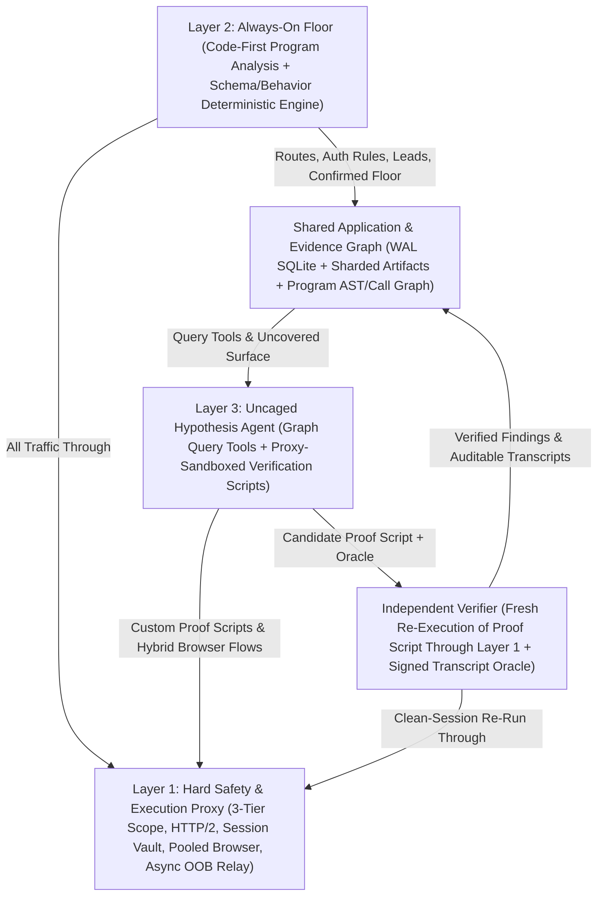

# Kovo Hunter v6 Architecture: From Local-Benchmark Cage to Real-World Security Engine

> **Date:** 2026-11-22
> **Status:** Strategic Architecture Blueprint
> **Scope:** First-principles diagnosis of Kovo Hunter v5 (`src/server/`, `worker/`, `src/templates/`, `src/replay-spec.ts`) and a concrete 3-layer redesign targeting high-signal vulnerability discovery on real-world enterprise and production-grade web applications.
> **Framing:** Defensive QA & authorized security verification architecture.

---

## 1. Executive Thesis: Why Incremental Patches Are Not Enough

Kovo Hunter v5 achieves strong recall on local benchmark harnesses (~65–67% on `realistic-bench` dev and salted held-out suites), yet faces a dramatic drop-off on real-world web applications. An end-to-end audit of the codebase shows this gap is **not** primarily caused by missing probe signatures. It is caused by **six interlocking paradigm mistakes** baked into v5's architecture:

1. **The Maximum-Friction Agent Cage:** Kovo Hunter tries to be an autonomous multi-agent researcher while wrapping the LLM in a rigid DAST bureaucracy (7 regex-stripped tool silos, forbidden headers, air-gapped scripts with no network bridge, closed proof schemas, synchronous keyword approval popups). The result is the worst of both worlds: the deterministic engine does almost all the real work (66.9% in harness), while the LLM adds minimal lift (+3 findings over `--no-llm`, 1/6 on chains, 34/52 misses `budget_exhausted`) at 100× the cost and latency—yet the two lanes are mutually exclusive in `src/server/execution.ts:3922-3928`.
2. **Conflating "Reproducible Evidence" with a Closed Declarative DSL:** Over **70% of misses are `replay_spec_miss`** (`VERIFICATION-v5.md:143-145`). By forcing every vulnerability proof into a closed TypeScript union (`DeclarativeReplaySpec`) interpreted by a 3,415-line custom VM (`replay-verifier.ts`), Kovo Hunter enforces safety by *crippling expressiveness* instead of enforcing safety at the *network boundary*. Open-ended real-world bugs (complex auth/OIDC flaws, multi-step business logic, hybrid API→UI flows, non-JSON/HTML/binary responses, noisy WAN timing) cannot fit through the keyhole.
3. **Black-Box-First Discovery Instead of Code-First Runtime Fusion:** Even when source code is provided, Kovo Hunter clones with `--depth 1` and deletes `.git` (making Stage-3 git-history mining permanently dead at `github-connector.ts:810-829`), feeds 16 × 900B snippets to rule synthesis, extracts routes with prefix-blind regexes, stops at 1 reverse call-graph hop (`semantic-audit.ts:1353-1391`), and spends 90% of runtime guessing endpoints blindly over HTTP.
4. **Benchmark-Driven Overfitting to a Toy World:** Local-lab benchmarks are loopback (`127.0.0.1`), single-origin, HTTP/1.1, disposable-state, English-named REST apps with zero WAN latency, zero WAF, zero CDN-hosted SPAs, zero external OIDC IdPs, instant (<1.5s) callbacks, and `local-lab` auto-approval. Optimizing against that world caused two pipelines to drift apart (harness vs. shipped `Execution`), leaked benchmark regexes into core engine code (`rb[cst]_`, `?reveal=0`, English path regexes in `deterministic-engine.ts:162-193, 1557, 1659`), and left real-world blockers invisible to the fitness function.
5. **Solving Production Safety with Per-Request Regex Popups:** `approval-judge.ts:94-99, 649-715` scans request paths/bodies for common words (`role`, `admin`, `delete`, `invoice`, `webhook`, `password`, `reset`) and blocks worker coroutines waiting for single-use, 60s exact-body-hash human approvals. This provides *false safety* (a dangerous endpoint without those words passes; benign staging tests deadlock worker pools and expire leases) instead of enforcing safety via clear environment contracts.
6. **40,000+ LOC of Monolithic Orchestration Overhead:** `execution.ts` (9.5K LOC), `store.ts` (4.8K LOC), `agent-session.ts` (3.8K LOC), `phase0-recon.ts` (3.6K LOC), `broker.ts` (3.5K LOC), `replay-verifier.ts` (3.4K LOC), `semantic-audit.ts` (2.3K LOC), `scoped-browser.ts` (2.3K LOC), `lab-runner.ts` (2.0K LOC), and `persona-auth.ts` (1.9K LOC) form an opaque funnel where genuine findings silently die at any of ~10 overlapping gates (circuit breaker, approval storm, dropped board wake, dry-step halt, planner snapshot truncation, `replay_spec_miss`, `assessBflaImpact`, first-key dedupe collision, `writeReport` exact-origin drop).

### What We Keep vs. What We Invert

| Keep (Core Kovo Hunter Strengths) | Invert / Retire in v6 |
|---|---|
| Hard, non-bypassable scope & rate enforcement at the proxy boundary | Closed-world `DeclarativeReplaySpec` as the sole confirmation mechanism |
| Zero-hallucination standard: every confirmed finding requires independent re-execution & recorded evidence | Mutually exclusive deterministic vs. agentic lanes |
| Multi-persona differential authorization testing (BOLA/BFLA/tenant isolation) | Per-request keyword HITL popups blocking worker coroutines |
| Defense-in-depth worker sandboxing & secret redaction | Regex-stripped specialist tool silos & stateless truncated planning |
| Curated verification skills & safe template catalog | Benchmark-shaped English REST regex gates & black-box-first white-box truncation |

---

## 2. The v6 Target Architecture: Three Sharp Layers

Instead of a 40K-LOC monolithic state machine, Kovo Hunter v6 separates concerns into **three clean, composable layers** with explicit contracts between them.

---

### Layer 1 — The Hard Boundary: Scope Proxy, Auth Vault, SPA Runtime & Async OOB

**Principle:** *All safety, scope, credential custody, rate control, and transcript logging live in Layer 1. Because Layer 1 is unbypassable, Layers 2 and 3 can be dramatically simpler and far more expressive.*

#### 1.1 Three-Tier Origin Scope Model
Replace v5's binary `approvedOrigins` check (`store.ts:3394-3533, 3727-3800`) with three explicit origin roles:
- **`targetOrigins`** — Active probing, mutation (when environment mode permits), and verification are allowed.
- **`authOrigins`** — External SSO/IdP origins (Okta, Auth0, Entra ID, Cognito, Google/GitHub OAuth) permitted strictly for persona authentication redirects and token exchange. Active probing is forbidden.
- **`assetOrigins`** — CDN/static hosts (`cdn.*`, `*.cloudfront.net`, `assets.*`) permitted strictly for passive `GET` asset hydration inside Playwright. Active probing is forbidden.
- **Provenance rule:** `writeReport()` and transitive revocation treat hops through `authOrigins` and `assetOrigins` as benign infrastructure, never dropping valid findings on `targetOrigins`.

#### 1.2 Environment Safety Contracts (Replacing Per-Request Regex HITL)
Retire `approval-judge.ts`'s blocking keyword escalation storms (`approval-judge.ts:94-99, 649-715`, `execution.ts:2441-2483`). Replace them with **three explicit engagement modes**:
1. **`prod_readonly` (Live Production):** Strictly non-mutating requests (`GET`, `HEAD`, `OPTIONS`, verified read-only GraphQL `query` operations), passive/config/header/auth-read/read-BOLA checks, and full white-box code analysis. **Zero mutations, zero HITL popups.**
2. **`staging_isolated` (Staging / Dedicated Test Tenant):** Pre-authorized synthetic test tenants with mandatory run-scoped entity tagging (`kovo-qa-<runId>-`), first-class `setup`/`cleanup` teardown hooks, and optional route denylist (e.g., `/billing/charge`, `/email/broadcast`). Autonomous stateful testing runs freely without approval deadlocks.
3. **`ephemeral_lab` (Disposable Local / CI PR Preview):** Full autonomous testing including high-impact active verification, backed by disposable containers/databases.

If an operator still opts into explicit human gates for a specific sensitive route pattern, waiting **parks the task in SQLite (`awaiting_approval`) and releases the worker slot and container immediately**, and approval grants a **durable route-scoped lease** (valid across probe iterations and independent replay) instead of a 60s exact-body-hash token.

#### 1.3 Composite Per-Worker Session Vault & Enterprise Identity
Redesign `persona-vault.ts` and `persona-auth.ts` around real-world identity topologies:
- **Composite credential bundle:** A session stores *simultaneously* `cookies[]` (including `HttpOnly`), `headers` (`Authorization`, `X-Tenant-Id`, `X-Org-Id`, custom CSRF headers), `storage` (`localStorage`, `sessionStorage`), and per-origin attachment rules (so `app.example.com` and sibling `api.example.com` both receive the right credentials).
- **Enterprise login flows:** Support interactive Playwright-driven OIDC/OAuth2/SAML flows traversing `authOrigins`, optional TOTP seed generation, and operator session-state import (`storageState` / HAR) for passkey/hardware-MFA apps. Treat CAPTCHA as blocking *only* if login submission actually fails a challenge, never merely because a script tag exists in DOM.
- **Per-worker session isolation:** Give concurrent workers independent session clones with coordinated single-flight refresh (removing the 60s global lockout at `persona-auth.ts:888-916` and preventing one logout/token-rotation probe from cascading `401`s across sibling workers).

#### 1.4 Modern Transport & Error-Safe Circuit Breakers
Upgrade `broker.ts`:
- **HTTP/2 & realistic egress:** Move `defaultTransport` to `undici` / `node:http2` with connection pooling, **HTTP/2 single-packet / last-byte TCP synchronization** for `executeRaceBurst`, optional corporate HTTP/SOCKS egress proxy, mTLS client certs, and configurable authorized `User-Agent`/header profiles (removing hardcoded `KovoHunter/2...` + stripped `sec-fetch-*` fingerprints where authorized).
- **Stateful WebSockets & opt-in raw framing:** Turn-aware WebSocket sessions (awaiting server frames, continuation reassembly, session cookie attachment) and an opt-in Tier-3 raw-framing transport for authorized Host-header / HTTP desync verification.
- **Error-aware circuit breakers:** Separate target `5xx` responses triggered during active injection/parser probes from transport failures/429s so error-inducing probes do not self-block their own verification (`broker.ts:1966-1997`). Replace permanent run pauses (`execution.ts:1282-1314`) with per-origin exponential backoff and automatic recovery.

#### 1.5 Pooled Interactive SPA Crawler & Multi-Persona Discovery
Upgrade `scoped-browser.ts` and `phase0-recon.ts`:
- **Pooled Playwright contexts** per persona (no cold Chromium boot per page), seeded with `HttpOnly` cookies + `localStorage`/`sessionStorage`, allowing `assetOrigins` JS bundles to hydrate cleanly and forwarding persona auth to sibling `targetOrigins` APIs.
- **Interactive state traversal:** Wait on network-idle/DOM-stability instead of `120ms`, safely exercise non-destructive SPA navigation (tabs, drawers, pagination, filters), capture WebSockets via CDP `Network.webSocket*` events, and allow read-only GraphQL/RPC `POST` queries below Tier 3.
- **Multi-persona union discovery:** Run discovery across *all* configured role personas (not just `personas[0]` as in `phase0-recon.ts:2160, 2427`), tagging endpoints with `visibleToPersonas` to surface admin/privileged routes immediately. Remove the `/` skip and root-only soft-404 calibration in `surface-engine.ts:145-147, 243-287`.

#### 1.6 Externally Routable Async OOB Relay
Upgrade `canary-broker.ts`:
- Support a deployable/managed public OOB relay profile (**HTTP + ACME HTTPS + authoritative UDP/TCP DNS**, extensible to SMTP) alongside loopback mode.
- Replace the synchronous `10 × 150ms = 1.5s` poll (`replay-verifier.ts:1193-1196`) with **two-stage async OOB correlation**: a short 3s immediate check followed by a durable `pending_oob` subscription active for the rest of the run (or configurable window, e.g., 15–30 minutes) that automatically promotes late callbacks (background jobs, PDF/email/webhook workers) into verified findings.

---

### Layer 2 — Always-On Floor: Code-First Graph + Schema/Behavior Deterministic Engine

**Principle:** *Never guess over blind HTTP what source code, OpenAPI/GraphQL schemas, HAR traces, or runtime responses already tell you. Run the fast deterministic floor unconditionally before/alongside agentic work.*

#### 2.1 Code-First Program Graph (When Source Is Mounted/Synced)
Promote white-box analysis from a truncated Phase-0 sidecar into a first-class **Program Graph** stored in the shared graph:
- **Preserve git history:** Clone with bounded history (e.g., `--depth 100`) without deleting `.git` (or extract security-relevant commit diffs before cleanup), reviving Stage-3 regression/patch mining (`github-connector.ts:810-829`, `semantic-audit.ts:1656-1661`).
- **AST & router-mount-aware route graph:** Replace single-file regex route extraction (`phase0-recon.ts:368-618`) with framework-aware AST parsing (Express/Fastify/Next/Nest, FastAPI/Django/Flask, Spring, Go/Gin/Chi, Rails) that resolves full mounted path prefixes (`app.use('/v2', router)`, `APIRouter(prefix=...)`, `include()`), exact HTTP methods, input schemas, and **attached auth/RBAC middleware chains**.
- **Multi-hop reverse call-graph binding:** Extend `resolveSuspectEntrypoint` (`semantic-audit.ts:1353-1391`) from 1 hop to depth 6–8 across `route -> controller -> service -> repository/ORM`, and map monorepo services to their exact `targetOrigin` via ingress/Dockerfile/service config instead of defaulting to `origins[0]`.
- **Direct Code-to-Runtime Hypotheses:** Automatically emit high-precision hypotheses directly from structural diffs in the program graph (e.g., *route in `/admin/*` missing `requireAdmin` middleware*, *mutation handler reading `:id` without tenant scope check*, *new/modified route in recent git diff touching raw SQL/outbound fetch/template sink*).

#### 2.2 Schema- & Behavior-Driven Deterministic Engine (Always-On)
Make `deterministic-engine.ts` run **unconditionally** as the fast floor of every `Execution` run (feeding confirmed findings and prioritized leads directly into Layer 3):
- **Eliminate benchmark overfitting:** Strip `rb[cst]_` token regexes (`deterministic-engine.ts:1557`), `?reveal=0` assumptions (`1659`), and mandatory English URL regex gates (`pathHasUrlHint`, `pathHasXmlHint`, `strongSqlName`, `actionVerb` at `162-193, 547, 711`).
- **Drive hypotheses from observed types & runtime behavior:** Trigger SSRF/XXE/traversal/injection/authz probes whenever an endpoint's OpenAPI/GraphQL/AST schema or live runtime traffic carries URL-shaped, path-shaped, XML/content-type, object-ID, or query-filter inputs—or exhibits parser/DB error differentials—using path names only as a soft priority tie-breaker.
- **Dynamic CVE-to-template correlation:** Index all compiled templates by CVE ID dynamically instead of the 1-entry `CVE_TEMPLATE_IDS` map (`cve-broker.ts:449-453`), and fix `pom.xml` parsing (`514-516`) to parse per-`<dependency>` blocks.

#### 2.3 Scalable Graph & Persistence Foundation
Fix `store.ts` and `schema.ts` so large real-world targets (2,000–10,000 endpoints, multi-hour scans) do not stall or silently truncate:
- **Fix `resource_samples` clobbering:** Change uniqueness from `UNIQUE(run_id, owner_persona, resource_key, origin)` (`store.ts:816, 4384`) to `UNIQUE(run_id, owner_persona, origin, collection_path, resource_key)` so `/invoices`, `/orders`, and `/tickets` preserve distinct entity IDs.
- **Remove truncation & write amplification:** Enable `PRAGMA journal_mode = WAL; PRAGMA synchronous = NORMAL;`, batch exchange writes asynchronously off the hot HTTP path, shard `artifacts/<runId>/<bucket>/`, make full-body FTS5 trigram indexing bounded/opt-in with retention GC, and paginate `listEndpoints()`, `listFacts()`, and `runDetail()` (eliminating the 500/2,000 cap at `store.ts:4209-4234`).
- **Complete crash recovery:** Persist refinement queues, board wakeups, `LabRunner` container IDs, and scoped approval leases in SQLite; fix `Store.recover()` (`961-973`) to reset stuck `board_members`, reap orphaned containers, and avoid re-queuing permanently failed assignments.

---

### Layer 3 — Uncaged Hypothesis Agent & Executable Script Verification

**Principle:** *Give the LLM full read/query access to the code + runtime graph and let it write short, deterministic verification scripts executed through Layer 1. Replace declarative-DSL gymnastics with independent script re-execution + proxy-signed transcript verification.*

#### 3.1 Proxy-Sandboxed Executable Verification Scripts (Replacing the `DeclarativeReplaySpec` Bottleneck)
Instead of forcing every novel bug into a closed `DeclarativeReplaySpec` union:
- **How it works:**
  1. Kovo Hunter provides a tiny, ergonomic verification SDK (`kovo_verify` in Python and TypeScript) inside the `--network none` worker sandbox.
  2. Every HTTP, HTTP/2, WebSocket, Playwright browser, and OOB canary call made by the SDK crosses a local Unix-socket RPC bridge into **Layer 1 (`Broker`)**. Layer 1 injects persona credentials (workers never see raw secrets), enforces 3-tier origin scope, environment mode (`prod_readonly` vs `staging_isolated`), rate limits, and records a **tamper-evident, proxy-signed transcript** of every exchange.
  3. A candidate verification script implements a standard 3-hook contract:
     - `setup(ctx)` — optional synthetic entity creation (tagged with `kovo-qa-<runId>-`)
     - `verify(ctx) -> ProofResult` — executes control vs. variant requests (HTTP, HTTP/2 race, browser DOM, or hybrid HTTP→browser), evaluates an explicit oracle (JSONPath, HTML/CSS selector, header/status diff, DOM execution sentinel, OOB callback ID, or statistical jitter-tolerant timing helper), and returns structured assertions referencing proxy-recorded `exchangeIds`
     - `cleanup(ctx)` — optional teardown of created entities
  4. **Independent Confirmation (`Verifier`):** To confirm a finding, Kovo Hunter runs the **submitted verification script twice from scratch in a clean sandbox** (with freshly minted control/variant nonces and clean sessions) through Layer 1, validates that every claimed assertion matches the **proxy's independent transcript** (not just script stdout—preventing LLM-fabricated passes), and confirms the oracle passes deterministically.
- **Why this is strictly better:**
  - **Zero reduction in safety or anti-hallucination guarantees:** Scope, credentials, non-destructive mode, and ground-truth HTTP/DOM evidence remain 100% enforced by Layer 1 outside the agent's control.
  - **Eliminates the 70% `replay_spec_miss` ceiling:** Hybrid API-write → Playwright-render stored XSS, non-JSON/HTML/binary IDORs, HMAC/protobuf/gRPC request signing, multi-step business-logic state machines, cross-subdomain OAuth/SSO chains, and custom race conditions are all natively expressible in ~25–60 lines of clean Python/TS.
  - **Reusable primitives:** Existing fast deterministic probes (from Layer 2) can still emit lightweight built-in proof recipes for common classes, while Layer 3 uses executable scripts for everything else.

#### 3.2 Statistical & Noise-Tolerant Verification Helpers
Built directly into the `kovo_verify` SDK and verified against Layer-1 transcripts:
- **Jitter-tolerant timing oracle:** Replaces 3-round `minProbe > maxBaseline` (`replay-verifier.ts:2737-2745`) with 5–7 interleaved control/probe pairs evaluated via Mann-Whitney U + median/MAD separation.
- **Structural boolean/content diffing:** Strips dynamic tokens (CSRF nonces, UUIDs, timestamps, request IDs) before computing structural DOM/JSON/token similarity (`replay-verifier.ts:2008-2010`), so small differentials inside large HTML shells verify reliably.
- **Hybrid HTTP + Browser verification:** Native `ctx.http(...)` followed by `ctx.browser(persona=...)` (with full `HttpOnly` cookie and `localStorage` hydration) inside one proof script—closing the stored/DOM XSS and second-order admin-UI verification gap.

#### 3.3 Tool-Equipped Graph Coordinator & Fluid Investigator Sessions
Replace `execution.ts`'s stateless single-shot `runChainPlanner` + 7 regex-stripped specialist silos:
- **Stateful Graph Coordinator:** Equip the coordinator with paginated read tools (`query_endpoints`, `query_code_graph`, `query_facts`, `query_findings`, `expand_digest`) so large apps (>25 uncovered endpoints / >80 facts) are never truncated out of planning, and early low-severity primitives remain retrievable for late-round multi-step chains.
- **Fluid Capability Bundles:** Stop regex-stripping tools (`agent-session.ts:658-939`). Every investigator has access to code/graph search, batched HTTP, and the `kovo_verify` script runner, dynamically attaching Playwright or OOB capabilities when a hypothesis involves client-side sinks or blind callbacks.
- **Chunked IPC & Non-Fatal Timeouts:** Pass tool outputs >64 KiB via mounted tmpfs file pointers instead of terminating the container over NDJSON (`worker-backend.ts:315-378, 724-728`), cancel timed-out commands without `process.exit(124)`, and allow parallel execution of pure read-only tools.
- **Accurate Deduplication (`dedupe.ts`):** Key deduplication on the **explicitly mutated input/header/GraphQL operation/RPC procedure + verified endpoint/handler** reported by the proof script and confirmed in the Layer-1 transcript—eliminating `Object.keys(jsonBody)[0]` collisions (`dedupe.ts:302-314`) and reverse-proxy microservice over-merging.

---

## 3. What We Explicitly Retire (Complexity Reduction)

A strategic redesign should make the codebase **smaller and easier to reason about**, not layer v6 on top of v5. The following v5 machinery is explicitly targeted for retirement once replaced:

| v5 Component / Pattern | Locations | Why Retire | Replaced By |
|---|---|---|---|
| Mutually exclusive `!profiles.length` lane gate | `execution.ts:3921-3928` | Starves agentic runs of deterministic floor | Always-on Layer-2 floor streaming into Layer 3 |
| Per-request keyword HITL escalation & synchronous worker blocking | `approval-judge.ts:94-99, 649-715`; `execution.ts:2441-2483` | Approval storms + false safety | Layer-1 environment modes + non-blocking durable leases |
| Closed `DeclarativeReplaySpec` compiler proliferation (4 JSON-only compilers + 3.4K LOC VM) | `proof-tools.ts`; `replay-verifier.ts` | >70% `replay_spec_miss`; blocks novel bugs | Layer-3 `kovo_verify` scripts + Layer-1 transcript oracle |
| Regex-stripped 7-specialist tool silos & in-memory dropped board wakes | `agent-session.ts:658-939`; `execution.ts:1658-1748` | Breaks cross-channel exploit chains | Fluid capability bundles + durable SQLite wake queue |
| Tool-less single-shot `runChainPlanner` + 6-dry-step global kill switch | `execution.ts:192-223, 5572-5894` | Blind beyond 25 routes / 80 facts; premature halts | Stateful tool-equipped Graph Coordinator |
| Benchmark regexes & English path-name gates in core engine | `deterministic-engine.ts:162-193, 1557, 1659` | Overfit to local-lab naming; misses real apps | Schema-, AST-, and behavior-driven hypothesis planning |
| Custom regex Compose parser & per-TCP `docker exec` proxy | `lab-runner.ts:331-464, 1310-1407` | Breaks DBs, Go/Java/distroless stacks, race load | Proper YAML Compose parser + shared Docker-network proxy |
| Per-exchange sync `fsync` + full-table `runDetail` hydration | `store.ts:492-493, 1435-1528, 1603-1740` | Stalls & OOMs on large targets | WAL + async batched writes + paginated queries |

---

## 4. Strangler-Fig Migration Roadmap & Realism Gates

Do **not** execute a multi-month dark rewrite. Migrate incrementally in four phases, measuring every phase on **shipped `Execution`** (never standalone harnesses) against both existing regression suites and a new **Real-World Realism Suite**.

### The New North Star: Real-World Realism Suite
Before optimizing recall further, build a compact, deterministic integration suite (`benchmarks/realism-suite/`) that encodes the real-world conditions v5's benchmarks hid:
1. **Modern Enterprise SPA Fixture:** CDN-hosted JS chunks (`assets.local` → `app.local` → `api.local`), external OIDC IdP redirect (`idp.local`), hybrid `HttpOnly` cookie + Bearer + `X-Tenant-Id`, GraphQL with introspection disabled, interactive tab/modal routes, and a stored XSS rendered only in an authenticated admin browser view.
2. **WAN & Async-OOB Fixture:** Proxy injecting 50–300ms random WAN latency jitter + dynamic HTML nonces, plus a background worker triggering SSRF/XXE/webhook callbacks 15–30 seconds *after* HTTP response.
3. **Staging-Safety & Concurrency Fixture:** Shared stateful DB under `staging_isolated` mode testing write-BOLA, HTTP/2 single-packet race condition, and multi-step checkout workflow with assertion that zero orphan test records remain after cleanup.
4. **Enterprise Monorepo White-Box Fixture:** Multi-service repo with preserved `.git` history, nested router mounts (`app.use('/v2', ...)`), 4-hop `route -> controller -> service -> repo` authz/SQLi sinks, and 2,500+ routes to validate scale and store latency.

### Phased Rollout

| Phase | Deliverables | Key Files | Concrete Exit Gate |
|---|---|---|---|
| **Phase 1: Unify Floor, Fix Scale & Data Integrity** | Always-on Layer-2 deterministic floor feeding `Execution` agentic lane; fix `resource_samples` collection key; SQLite WAL + async batched exchange writes + paginated `listEndpoints`/`runDetail`; fix `Store.recover()`; mutated-param dedupe; remove benchmark regex leakage from `deterministic-engine.ts`. | `execution.ts`, `deterministic-engine.ts`, `store.ts`, `schema.ts`, `dedupe.ts` | Shipped `Execution` agentic recall >= `Execution --no-llm` on dev & salted held-out; 2,500-endpoint run has zero endpoint truncation and <50ms p99 main-thread store stall; zero `resource_samples` clobbering across multi-resource apps. |
| **Phase 2: Layer-1 Boundary — 3-Tier Scope, Enterprise Auth, SPA & Environment Modes** | Implement `targetOrigins` / `authOrigins` / `assetOrigins`; composite per-worker session vault + OIDC/SAML/TOTP interactive login; pooled interactive multi-persona Playwright crawler with CDP WebSocket capture; replace per-request keyword HITL blocking with `prod_readonly` / `staging_isolated` / `ephemeral_lab` + non-blocking durable leases. | `schema.ts`, `broker.ts`, `persona-auth.ts`, `persona-vault.ts`, `scoped-browser.ts`, `phase0-recon.ts`, `approval-judge.ts`, `store.ts` | Realism Fixture #1 (CDN SPA + split `app.`/`api.` + external OIDC + hybrid auth + `HttpOnly` admin view) reaches >=80% route discovery and confirms cross-origin authz + browser-executed stored XSS; `staging_isolated` runs zero approval deadlocks. |
| **Phase 3: Layer-3 Paradigm Shift — Executable Proof Scripts, HTTP/2 & Async Public OOB** | Ship `kovo_verify` SDK + Unix-socket Layer-1 RPC bridge inside worker sandbox; independent clean-session script re-runner + proxy-signed transcript oracle; jitter-tolerant timing & structural boolean helpers; HTTP/2 transport + single-packet race sync + proxy/mTLS + error-safe circuit breakers; public HTTPS/DNS OOB relay with durable `pending_oob` late promotion; chunked IPC removing 64 KiB container kills. | `worker-backend.ts`, `worker/bridge.ts`, `broker.ts`, `canary-broker.ts`, `replay-verifier.ts`, `agent-session.ts` | `replay_spec_miss` drops by >=60% on realistic-bench; Realism Fixture #2 (WAN jitter + 15–30s async callbacks) confirms blind SQLi + async SSRF/XXE with <5% false negatives; Realism Fixture #3 confirms HTTP/2 race & stateful write-BOLA with zero leaked test entities. |
| **Phase 4: Code-First Program Graph, Tool-Equipped Coordinator & `LabRunner` Cleanup** | Preserve `.git` history in repo sync; AST/mount-aware route + middleware + multi-hop (depth 6–8) sink call graph + monorepo origin mapping; dynamic CVE-to-template indexing + fixed `pom.xml` parser; replace stateless `runChainPlanner` & regex tool silos with tool-equipped Graph Coordinator + fluid investigators; replace `LabRunner` regex Compose parser & `docker exec` TCP proxy. | `github-connector.ts`, `semantic-audit.ts`, `cve-broker.ts`, `execution.ts`, `compactor.ts`, `board-tools.ts`, `lab-runner.ts` | Realism Fixture #4 (4-hop monorepo + `.git` regression + nested mounts) links >=85% of SAST suspects to live endpoints and confirms via Layer-3 scripts; multi-step chain recall rises from 1/6 to >=4/6 on realistic-bench; `execution.ts` LOC reduced by >=30% via retired v5 gates. |

---

## 5. Traceability Matrix: Audited v5 Gaps → v6 Resolution

| v5 Audited Limitation | Severity | Primary v5 Code Locations | v6 Resolution | Phase |
|---|---|---|---|---|
| 1. Mutually exclusive deterministic vs. agentic lanes; unwired handoff | Critical | `execution.ts:3333-3357, 3921-3928`; `assignment-brief.ts:345-452` | Always-on Layer-2 floor streaming leads & confirmed set to Layer 3 | Phase 1 |
| 2. Enterprise SSO/OIDC/MFA blocked; single-header sessions; 60s re-auth cascade | Critical | `persona-auth.ts:121-130, 622-637, 806-916, 1696-1823`; `persona-vault.ts:33-47` | `authOrigins` + composite per-worker Session Vault + OIDC/TOTP capture | Phase 2 |
| 3. `ScopedBrowser` CDN starvation, stripped `HttpOnly`/split-origin auth, shallow non-interactive crawl | Critical | `scoped-browser.ts:254, 742-841`; `phase0-recon.ts:2022-2427, 3100-3446` | `assetOrigins` + pooled interactive multi-persona Playwright crawler + CDP WS | Phase 2 |
| 4. HTTP/1.1-only normalized transport; naive race bursts; loopback 1.5s OOB canaries | Critical | `broker.ts:346, 1012-1481, 3208-3216`; `canary-broker.ts:642-809`; `replay-verifier.ts:1191-1197` | `undici`/HTTP/2 + single-packet race + public HTTPS/DNS relay + async `pending_oob` | Phase 3 |
| 5. `DeclarativeReplaySpec` >70% `replay_spec_miss`; noise-intolerant stats; JSON-only/siloed proofs; first-key dedupe collisions | Critical | `replay-verifier.ts:184-254, 626-633, 1980-2025, 2737-2745`; `proof-tools.ts:176, 452, 1174`; `dedupe.ts:142-172, 302-350` | `kovo_verify` scripts + Layer-1 transcript oracle + jitter-tolerant/hybrid helpers + mutated-param dedupe | Phases 1 & 3 |
| 6. Blocking keyword HITL approval storms vs. no staging entity isolation/cleanup | Critical | `approval-judge.ts:94-99, 343-395, 649-715`; `execution.ts:2441-2483` | Environment contracts (`prod_readonly` / `staging_isolated` / `ephemeral_lab`) + setup/cleanup + non-blocking leases | Phase 2 |
| 7. Stateless truncated planner; English-REST/benchmark detection gates; sync SQLite & 500-endpoint cap; `resource_samples` clobbering | Critical | `execution.ts:192-223, 5572-5894`; `deterministic-engine.ts:33-37, 162-193, 1557, 1659`; `store.ts:477-494, 816, 1655-1740, 4209-4234` | Tool-equipped Graph Coordinator; schema/AST/behavior hypotheses; WAL + pagination + collection-scoped `resource_samples` | Phases 1 & 4 |
| 8. Regex-stripped specialist silos & dropped board wakeups | High | `agent-session.ts:658-939`; `execution.ts:1658-1748`; `board-tools.ts:44-47` | Fluid capability bundles + durable SQLite wake queue | Phase 4 |
| 9. Air-gapped scripting with no broker bridge; 64 KiB NDJSON container crashes; sequential tools | High | `worker-backend.ts:315-378, 720-809`; `worker/bridge.ts:1442-1527`; `agent-session.ts:3602` | Layer-1 Unix-socket RPC SDK + tmpfs chunked IPC + parallel read tools | Phase 3 |
| 10. Dead git-history stage; prefix-blind route regexes; 1-hop SAST binding; 1-entry CVE template map | High | `github-connector.ts:810-829`; `semantic-audit.ts:1353-1391, 1656-1661`; `cve-broker.ts:449-453, 514-516` | Preserved shallow `.git` + AST mount-aware multi-hop Program Graph + dynamic CVE template index | Phase 4 |
| 11. Brittle `LabRunner` regex Compose parser, read-only DB breakage & `docker exec` TCP proxy | High | `lab-runner.ts:162, 331-464, 1054-1077, 1310-1407` | Real YAML Compose parser + writable DB overlays + native Docker-network proxy | Phase 4 |
| 12. Exact-origin provenance drops IdP/CDN findings; 5xx probe self-circuit-trips & permanent pauses | High | `store.ts:3727-3800`; `broker.ts:1966-1997`; `execution.ts:1282-1314` | 3-tier origin provenance + probe-aware circuit breakers with exponential cooldown | Phases 2 & 3 |
| 13. Incomplete `Store.recover()` (stuck board members, orphaned labs, lost refinement/approval state) | High | `store.ts:961-973, 3351-3363`; `execution.ts:956-999`; `lab-runner.ts:1523` | Persisted runtime queues/leases/container IDs + clean recovery state machine | Phase 1 |
