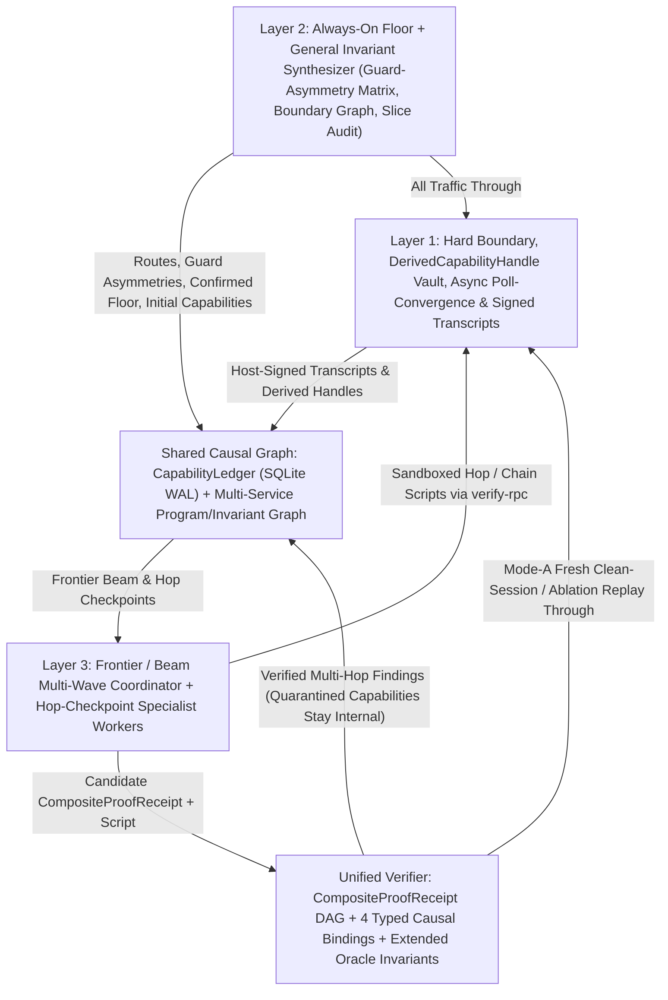

# Kovo Hunter v8 — Deep Multi-Hop Causal Vulnerability Identification on Realistic SaaS Applications

Status: draft (planning), 2026-11-24, anchored to `main` @ `4010d05`. v7 remains the shipped baseline until v8 M0 passes its gates. **Nothing in this plan is a measured v8 result.**

## Thesis & Explicit Non-Goals

v6 established Kovo Hunter's three-layer architecture (Layer 1 unbypassable safety/session/transcript boundary, Layer 2 always-on code-first + deterministic floor, Layer 3 uncaged agentic verification). v7 unified confirmation onto host-signed `ProofReceipt` + `oracle-invariants`, decoupled Phase A/B budgets, wired white-box dataflow slices, and proved single-hop realism conversion and production safety controls.

**v8 adds no fourth layer.** Instead, v8 upgrades Layers 1–3 to solve **deep multi-hop causal vulnerability identification (3–6 hops) across realistic multi-service SaaS applications** — defects where every individual endpoint appears valid in isolation and security impact emerges only by composing identities, state transitions, services, and surfaces across multiple waves.

### Explicit Non-Goals (Hard Cut from v8)

Per the v8 mandate — explicitly overriding the "v8 candidate" notes in [v7.md §Deferred decisions](v7.md#deferred-decisions) — the following are **OUT OF SCOPE** for v8 and must not be started:

- **No continuous org asset/code graph or scheduled scanning**
- **No PR-diff / deploy blast-radius scanning**
- **No multi-tenant SaaS platformization, billing, or heavy triage UI**
- **No plugin/SDK ecosystem or cross-run ML priors**
- **No unverified or heuristic-only chain claims** (100% worst-run precision remains a hard release gate)

---

## Where v7 Stands at v8 Planning Time (`main` @ `4010d05`)

| Dimension | Current v7 Code Reality (`4010d05`) | Why It Blocks 3–6 Hop SaaS Chains |
|---|---|---|
| Chaining planner (`src/server/graph-coordinator.ts:620-878`) | 6 flat `ChainPrimitiveKind` tags (`leaked_token`, `discovered_id`, `ssrf_internal_reach`, `stored_write`, `weak_jwt`, `admin_route`); `planChainRound()` hard-capped at `maxHops <= 3` with static 11-entry `PAIR_WEIGHTS` and 5-entry `THREE_HOP_SETS`. | Cannot express typed causal preconditions/postconditions, artifact transformations, tenant/role transitions, temporal state changes, or async service pivots beyond 2–3 flat tags. |
| Confirmation primitive (`src/server/proof-receipt.ts:33-62`, `src/server/oracle-invariants.ts`) | Single-finding `ProofReceipt` over flat `exchangeIds[]` (max 32); 4 linear single-tenant roles (`viewer < member < admin < owner`). | Cannot cryptographically bind Hop `i`'s host-signed output to Hop `j`'s host-signed input; misses dual-org ABAC, temporal revocation/demotion, ledger conservation, scope-omitting crypto replay, and parser/cache differentials. |
| Credential custody (`src/server/persona-vault.ts`, `src/server/verify-rpc.ts`) | Static pre-seeded personas (`PersonaCredentialBundle`). | Dynamically discovered tokens, downgraded invites, OIDC assertions, HMAC salts, or hijacked sessions from Hop 1 have no Layer-1 custody handle to feed Hop 2+ without leaking secrets or losing provenance. |
| White-box graph (`src/server/program-graph.ts:29-139`, `src/server/semantic-audit.ts`) | 7 syntactic sinks (`db_query`, `outbound_fetch`, `template`, `file`, `command`, `redirect`, `other`) and 4 single-hop `CodeHypothesisKind` leads. | Does not diff authorization/revocation guards across sibling surfaces (REST vs GraphQL vs batch vs SSE vs async worker), nor model entity lifecycles or cross-service trust boundaries. |
| Wave scheduler (`src/server/exec-dispatch.ts:325-363, 1027-1128`) | Round-robin lanes with `DRY_ROUND_LIMIT = 2`, 3-min chain assignment cap, no partial-chain frontier or hop checkpointing. | Kills long-horizon exploration when partial chains advance without immediate terminal confirmation; workers rediscover Hop 1 from scratch instead of branching from verified hop checkpoints. |
| Existing benchmarks (`realistic-bench`, `reason-bench`, `realism-suite`, `held-out-saas`, `xben-25`) | `xben` (25/25) & `held-out-saas` (20/20) are 100% `--no-llm` single-hop; `reason-bench` has only 4/28 chains (all 2-hop, single-process, single static `artifact` string in `chain-oracle.ts:75`). | Does not exercise 3–6 hop cross-service SaaS chains, artifact transformations, partial-hop hardened twins, or two-side proof verification. |

---

## Target Engine Architecture (Three Layers, Zero New Layers)

v8 preserves the v6/v7 three-layer boundary and enforces strict LOC discipline by **retiring** v7's flat pairwise chainer (`PAIR_WEIGHTS` / `THREE_HOP_SETS`) and unifying single-hop and multi-hop verification onto one `CompositeProofReceipt` confirmation path (a single-hop finding is a 1-node DAG).

### 1. Layer 1 — Derived Capability Custody & Async Poll-Convergence

- **`DerivedCapabilityHandle` Custody (`src/server/persona-vault.ts`, `src/server/verify-rpc.ts`):**
  - When a host-signed Hop `k` exchange, browser trace, or OOB/async-job readback yields a reusable credential, bearer/PAT token, signed URL, OIDC assertion, session cookie, or signing salt, Layer 1 seals the raw secret in `PersonaVault` (0600 host custody) and returns an opaque handle (`cap:hop_<receiptId>:<slot>`) to the worker and `CapabilityLedger`.
  - Raw secret values are scrubbed from LLM context, prompts, and transcripts.
  - Hop `k+1` verification scripts invoke Layer-1 RPCs using handles:
    - `http.send({ capability: 'cap:...' })` / `browser.hydrate({ capability: 'cap:...' })` — Layer 1 injects the sealed header/cookie/URL host-side and stamps `consumedCapabilityId` into the signed transcript.
    - `crypto.hmacSign({ secretHandle: 'cap:...', payload, alg })` and `crypto.jwtSign({ secretHandle: 'cap:...', claims, alg })` — Layer 1 computes derived cryptographic artifacts host-side and stamps `derivedFromCapabilityId` into the signed transcript, preserving 100% causal lineage without ever exposing raw key material to the agent.
- **Bounded Async Poll-Convergence (`src/server/verify-rpc.ts`, `src/server/canary-broker.ts`):**
  - Extend Layer 1 beyond Kovo Hunter-collector OOB callbacks (`pending_oob`) to support **bounded async poll-convergence** (`async.awaitResult({ pollRequest, matchPredicate, timeoutMs })`) for internal-service async hops (PDF workers, webhook delivery logs, batch exports, headless victim-bot triggers) where the pivot target is an internal service (e.g., `vault.internal`, `registry.internal`) rather than Kovo Hunter's external OOB collector.
  - Default poll budget: `1–5 s` in fast-lab mode, configurable up to `15–30 s` in WAN/endurance profiles, recorded cleanly in the host-signed transcript with monotonic timestamps (`t_trigger <= t_observed`).

### 2. Shared Graph — Stateful Causal Attack Graph & `CapabilityLedger`

- **New Module: `src/server/capability-ledger.ts` (backed by SQLite WAL tables in `src/server/store.ts`, target `<= 900 LOC`):**
  - Replaces `graph-coordinator.ts`'s flat 6-tag `ChainPrimitive` array with a typed, versioned **Causal Attack Graph**.
  - **Capability Nodes:** `{ capId, kind, promotionStatus, provenance, tenantScope, actorPersona, serviceOrigin, surface, temporalState, validityTtlMs, parentHopReceiptIds[], artifactDigest }`.
    - `surface`: `http | graphql | ws | sse | browser | webhook | async_job | idp | cdn | storage`.
    - `temporalState`: `active | pending | revoked | demoted | expired | primed_cache`.
    - Domain-neutral `kind` taxonomy: `identity_session`, `scoped_token`, `signing_material`, `signed_artifact_or_url`, `opaque_object_ref`, `state_handle`, `write_sink_handle`, `internal_reach_handle`, `parser_or_cache_primitive`, `policy_asymmetry`.
  - **Strict `capability_only` Quarantine (Zero-FP Defense):**
    - Intermediate nodes (`opaque_object_ref`, `policy_asymmetry`, `write_sink_handle`, low-impact count/existence signals, non-privileged diagnostic tokens) are permanently tagged `promotionStatus: 'capability_only'`.
    - They are **never** promotable to standalone findings unless either (a) composed into a verified terminal `CompositeProofReceipt` demonstrating real security impact, or (b) independently satisfying a strict terminal impact oracle that hardened twins reject. This prevents partial-hop hardened twins from generating `CWE-200` / low-info false positives.
  - **Causal & Negative Edges:**
    - Positive edges: `(preconditionCapIds[], actorContext) --[hopReceiptId, edgeBindingKind]--> (postconditionCapId | terminalImpact)`.
    - Negative/pruned edges: `(preconditionCapIds[], targetRoute/Surface, hypothesisClass) --[falsifiedByExchangeIds[], reason: 'invariant_enforced_hardened' | 'control_blocked_cleanly' | 'decoy_guard_verified']--> PRUNED`. Sibling workers query negative edges before dispatching so dead ends are never re-probed.

### 3. Unified Confirmation — `CompositeProofReceipt` DAG & Extended `oracle-invariants`

- **Extend `src/server/proof-receipt.ts` (single confirmation path; single-hop `ProofReceipt` becomes a 1-hop DAG):**
  - Schema: `{ chainId, terminalVulnClass, hops: HopReceipt[1..8], causalEdges: CausalEdgeBinding[], terminalImpact, replayMode }`.
  - **Four Typed Causal Edge Bindings (Verified Strictly Over Host-Signed Transcripts):**
    1. **`value_binding`:** Verbatim `DerivedCapabilityHandle` ID or `sha256(extractedValue)` observed in Hop `i`'s host-signed response/DOM/OOB record matches the handle/value injected into Hop `j`'s host-signed request (`t_i <= t_j`).
    2. **`derived_crypto_binding`:** Hop `j`'s request carries a Layer-1 host-signed `derivedFromCapabilityId` attestation (from `crypto.hmacSign` / `crypto.jwtSign` or host-tracked OIDC code/token exchange) proving the signature/token in Hop `j` was derived from material leaked/minted in Hop `i`.
    3. **`state_transition_binding`:** Hop `i` and Hop `j` operate on a shared `entityId`, tenant resource, or cache key where Hop `i` mutates server state without emitting a new token (e.g., cache priming, `createdBy` overwrite, draft rebinding, reopen flag retention). Verified via **ablation control replay**: executing Hop `j` *without* Hop `i` in a clean session fails cleanly (`403` / invariant preserved), whereas `Hop i -> Hop j` succeeds and violates the terminal invariant.
    4. **`async_pivot_binding`:** Links Hop `i`'s trigger (stored write, webhook registration, export job creation, share-link trigger) to Hop `j`'s downstream artifact or impact via Layer-1 poll-convergence, browser trace, or OOB relay with monotonic ordering (`t_i <= t_j`) and run-scoped canary/entity correlation.
  - **Attacker-Origin Provenance Invariant (Anti-Shortcutting):**
    - `verifyCompositeReceipt()` verifies from host-signed `actorRoleLabel` / `DerivedCapabilityHandle` lineage that the chain begins strictly from an **attacker-eligible persona** and that terminal impact is executed using either that attacker persona or a capability cryptographically derived within the DAG — **never** a pre-seeded privileged persona (`owner_a` may appear only in control/setup/victim arms).
  - **Two-Mode Replay Verification (Precision-Safe for Destructive / One-Shot States):**
    - **Mode A (`fresh_clean_replay`, mandatory default):** Re-executes the full DAG (plus ablation controls for any `state_transition_binding`) in a fresh isolated session with fresh nonces and `X-Kovo-Run-Id`-tagged entities. All renewable SaaS flows and all v8 benchmark apps MUST pass Mode A.
    - **Mode B (`one_shot_transcript`, strict fail-closed fallback for irreversible production/seeded states):** Permitted **only** when Mode A replay explicitly hits a verified consumed-state conflict (`409`/`410`/consumed-token error, never generic `403`/`500`) **and** the original host-signed transcript already contains (a) a pre-chain denied control on the terminal target, (b) 100% unbroken host-signed causal edge bindings across all hops, and (c) post-chain readback proving persisted impact. Mode B is tagged in the receipt and **disallowed on Mode-A-capable benchmarks** so it can never mask flaky proofs.
- **Extended `src/server/oracle-invariants.ts` (v8 Impact Rule Families):**
  1. `dual_tenant_abac`: Per-tenant role matrix `actor.rolesByTenant[tenantId]` (replacing flat single-tenant `parseRoleLabel`) supporting cross-org transfers, dual-org cache bleed, and batch partial-authz (`[ownId, foreignId]`).
  2. `temporal_revocation`: Requires host-recorded proof that the token/role/invite was revoked or demoted (verified by control `401/403` on the primary surface) before succeeding on a secondary surface (SSE, async export download, stale signed invite).
  3. `economic_conservation`: Host-computed conservation equations across baseline → action sequence → final readback (`sum(refunded) > paid`, `sum(balances_after) > sum(balances_before) + deposits`, `fulfilled_value > paid`, ineligible discount applied below threshold).
  4. `cryptographic_scope_replay`: Requires three host-signed proofs — invalid/tampered signature is rejected (`401/403`), valid signature is obtained under `(tenantB, scopeB)`, and the same valid signature is accepted under `(tenantA, scopeA)` (immune to signature-skip decoys).
  5. `parser_cache_differential`: Requires clean control request denied (`403`/isolated), followed by parser-differential (duplicate JSON key, path/header normalization) or cache-primed sequence achieving unauthorized read/mutation.
  6. `cross_surface_pivot`: Validates multi-surface terminal impact combining HTTP/GraphQL writes, browser DOM/admin-bot traces, PDF/webhook internal SSRF, or OIDC redirects within a single `CompositeProofReceipt`.

### 4. Layer 2 — General Invariant Synthesizer (White-Box + Runtime Parity)

- **Upgrade `src/server/program-graph.ts` + new `src/server/invariant-synthesizer.ts` (target `<= 1,100 LOC`):**
  - **Anti-Goodhart Design Rule:** Do **not** hardcode benchmark-shaped defect checklists (e.g., literal rules for `startsWith` or specific header names). Build **three general structural analyzers** that generalize to unseen SaaS topologies and multi-language OSS repositories:
    1. **Entity × Surface Guard-Asymmetry Matrix:** Group all discovered routes, GraphQL resolvers, batch endpoints, SSE/WebSocket handlers, and async workers by the domain entity/table they read or mutate; diff their effective auth, tenant-scope, role, and revocation guards across surfaces to emit ranked `policy_asymmetry` capabilities.
    2. **Cross-Service Trust-Boundary & Token/Header Propagation Graph:** Map ingress/edge/CDN → app/API → IdP/OAuth → async workers/internal services from router mounts, service configs, and outbound client calls; identify every boundary where identity headers, tenant scopes, path prefixes, or request bodies are re-parsed, forwarded, cached, or signed.
    3. **Bounded LLM Semantic Slice Audit (State Machines & Conservation Laws):** Feed bounded, dependency-resolved slices (`<= 1,600 B` per entity lifecycle cluster) of entity status transitions, creator/approver mutations, and numeric ledger/billing handlers to a single budgeted Layer-2 semantic pass that emits testable multi-step invariant hypotheses into the `CapabilityLedger`.
  - **Grey-Box / Black-Box Parity (Runtime Invariant Inference):** When source is not mounted, populate the exact same `CapabilityLedger` schema from multi-persona discovery diffs, OpenAPI/GraphQL schemas, client SPA bundle route/state extraction, and Phase A floor responses so Layer 3 operates identically across `black-box`, `grey-box`, and `white-box` modes.

### 5. Layer 3 — Frontier / Beam Multi-Wave Orchestration

- **Upgrade `src/server/graph-coordinator.ts` + `src/server/exec-dispatch.ts` + new `src/server/frontier-scheduler.ts` (target `<= 800 LOC`):**
  - **Retire v7 flat chainer:** Delete `PAIR_WEIGHTS`, `THREE_HOP_SETS`, and `maxHops <= 3` combinatorial pair enumeration in `graph-coordinator.ts`.
  - **Bounded Chain Frontier (Beam Search):**
    - Track active partial chains (depth `1..6`, beam width `B = 8..16`, configurable by budget tier) ordered by:
      `EVI(branch) = P(next_hop_feasible | evidence) × TerminalImpactWeight × SurfaceNovelty / (1 + AttemptsOnBranch)`
    - Dedicate explicit wave capacity quotas so high-EVI partial chains (`depth >= 2`) are never starved by low-value route-sweep chatter, while reserving a small discovery slice for newly unlocked services/surfaces.
  - **Hop-Checkpoint Branching:**
    - When Hop `k` verifies and commits a `HopReceipt` + `DerivedCapabilityHandle`s / `state_handle`s to `CapabilityLedger`, follow-on specialist assignments receive the pre-hydrated checkpoint brief (`<= 2 KB` structured JSON + handles) and spend their turns strictly proving Hop `k+1` or fusing two verified sub-chains — eliminating redundant Hop-1 rediscovery.
  - **Progress-Aware Termination & Dead-End Pruning:**
    - Replace v7's flat `DRY_ROUND_LIMIT = 2` stop with **frontier-progress accounting**: a round is productive if it produces either a confirmed `CompositeProofReceipt` **or** a host-verified new `HopReceipt` expanding tenant/role/service/surface reach.
    - Per-branch stagnation cap: **2 consecutive failed pivot attempts** on a `(branch, targetSurface)` pair prunes the branch and writes a negative edge to `CapabilityLedger`, guaranteeing dead-end re-probing waste stays `<= 5%` even on 60-minute runs.
    - Hard outer bounds (`budgetUsd`, `maxDurationMs`, `agentRequestBudget`) and explicit coverage settlement (`record_coverage(proofGapReason="invariant_enforced_hardened" | ...)` on hardened twins) remain strictly enforced.

---

## v8 Realistic SaaS Multi-Hop Benchmark Suite (`benchmarks/multihop-saas/`)

### Architecture & Inherited Safety Invariants

Extends `benchmarks/realistic-bench/` and `benchmarks/reason-bench/` safety contracts without compromise:
- Node 24+ native TypeScript, zero npm dependencies (`node:*` only), `KOVO_ALLOW_LOCAL_LAB=1` gate, strict `127.0.0.1:0` loopback binding, bounded `lib/egress.ts` + `lib/vfs.ts`, pure-JS bounded simulators (zero `eval`/`vm`/`child_process`), synthetic secrets only.
- **Multi-service realism:** Every archetype runs **4–5 isolated loopback services** (`edge/cdn`, `app/spa`, `api`, `idp/oauth`, `worker/runner`, `*.internal`), **80–150 active routes** (plus optional 500-route noise flag) with realistic benign workflows, **7 actors across 3 tenants** (`owner_a`, `member_a`, `viewer_a`, `dual_member` [admin Org A / viewer Org B], `member_b` [prefix-overlapping tenant slug], `revoked_or_demoted`, plus archetype-specific victim `admin_bot` or `partner_dev`), and per-seed semantic randomization (`domain-variant.ts` + salted held-out `KOVO_RB_HELDOUT_SALT`).
- **Victim bot isolation:** Simulated headless `admin_bot` actors live strictly inside the benchmark runtime as victims; Kovo Hunter never receives `admin_bot` credentials and can only trigger them via realistic app workflows (moderation queues, share links).
- **Renewable lifecycle hooks:** Every archetype exposes standard API lifecycle operations (creating/downgrading/revoking fresh invites/PATs/jobs) + `staging_isolated` `X-Kovo-Run-Id` entity tagging + clean-room reset hooks so Kovo Hunter's Mode-A clean-session replay runs deterministically.
- **Async latency profiles:** `1–5 s` in fast-lab mode; `15–30 s` in WAN/endurance mode.

### Four Multi-Service SaaS Archetypes (16 Chains of 3–6 Hops + 12 Partial-Hop Hardened Twins)

| Archetype | Services | Split | Chains (3–6 Hops) | Hardened Twins (0-FP Traps) |
|---|---|---|---|---|
| **`paygrid`** (B2B Fintech, Billing, Ledger & Payouts) | `edge`, `api` (REST+GQL), `worker` (payout/webhook/PDF), `idp` (OIDC), `vault.internal` | Dev + Salted Held-Out | **`PG-C1`** (4-hop): org slug leak → `pendingEmail`/NFKC collision across `api`+`idp` → Org A finance session → maker-checker edit overwrites `createdBy` → self-approved payout. **`PG-C2`** (4-hop): template metadata → escaped-in-UI / raw-in-PDF invoice footer → async PDF worker SSRF to `vault.internal` leaking signing salt in error log → scope-valid forged settlement webhook. **`PG-C3`** (5-hop): `dual_member` primes Org A perm cache → Org B async export passes via `cache_tenant_bleed` → signed URL without trailing `/` → sibling-tenant (`acme`/`acme-corp`) treasury download. **`PG-C4`** (3-hop): edge/backend duplicate JSON key bypasses payout cap → draft order rebinding before capture → h2c concurrent settlement race mints excess balance. | **`PG-D1..D3`**: Hops 1–2 genuinely exist; Hop 3/4 enforces strict OIDC `tid` + verified email, escaped PDF + per-request service JWT, and `(userId, tenantId)` cache key + trailing-slash VFS check. |
| **`shipforge`** (Multi-Tenant DevOps, CI/CD, Runners & Secrets) | `edge`, `api`, `runner` (builds/SSE/artifacts), `scm` (Git/webhook/OAuth), `registry.internal` | Dev + Salted Held-Out | **`SF-C1`** (5-hop): SCM preview build → GraphQL `ciRun.envPreview` leaks `dev` runner token → `/deployments/promote` omits env-scope check minting prod automation SA → `/secrets/batch` `[ownId, victimId]` partial authz mutates/reads prod signing key → unauthorized prod release. **`SF-C2`** (4-hop): revoked admin PAT (`401` REST) stays valid on `runner` SSE stream → leaks artifact handle & Org B project UUID → `dual_member` triggers `POST /projects/:id/transfer` (dest admin, source viewer) → steals Org B repo + secrets. **`SF-C3`** (4-hop): benign multi-filter query (`?state=archived&visibility=shared`) hits unparenthesized `OR` leaking Org B webhook template → webhook SSRF to `registry.internal` leaks internal bearer token in delivery log → internal sync dumps Org B secrets. **`SF-C4`** (3-hop): `team:manage` creates automation inheriting `org:admin` template → schedules auto-release → disputes/reopens deployment (keeps `autoReleaseScheduled`) → unapproved prod release. | **`SF-D1..D3`**: Diagnostic token rejected on promote + full batch ownership check; SSE revocation check on connect & heartbeat + dual-admin transfer; parenthesized ORM + redacted webhook delivery logs. |
| **`nexusiam`** (Enterprise Collab, IAM, SSO/SCIM & File Pipelines) | `cdn`, `app` (SPA + `admin_bot`), `api` (IAM/SCIM/docs), `idp`, `docs-worker` | Dev + Salted Held-Out | **`NX-C1`** (5-hop): comment sanitized in member UI, rendered raw in admin moderation queue → triggers `admin_bot` browser visit → same-origin fetch mints SCIM token → SCIM `PATCH` promotes `member_a` to `org_owner` → reads Org A audit vault. **`NX-C2`** (4-hop): `idp/authorize` subpath open redirect → `admin_bot`/share-link click captures delegated code → queries pending invites revealing downgraded admin invite token → redeems stale signed invite (`stale_privilege_use`). **`NX-C3`** (4-hop): `cdn` caches `/public/profile/:slug.css` ignoring `Authorization` → caches `owner_a` delegation header → `member_b` reads cached key → sends empty `X-Workspace-Id: ""` fallback to Org A default workspace → reads private docs. **`NX-C4`** (4-hop): `/search/facets` cross-tenant count oracle enumerates private folder name → share-link metadata handle → `revoked_or_demoted` uses pre-demotion async export job with discovered handle → exfils Org A canary. | **`NX-D1..D3`**: Escaped admin view + rotating CSP nonce; exact OIDC redirect allowlist + live-role invite check; `Vary: Authorization, Cookie` + fail-closed empty workspace header. |
| **`connecthub`** (Marketplace, OAuth Apps, Delegated Perms & Partner Billing) | `portal`, `api`, `oauth`, `webhook-relay` (seeded jitter), `billing.internal` | **SEALED** (Milestone gates only — never hill-climbed in dev) | **`CH-C1..C4`** (4–5 hops): OAuth consent-vs-token scope widening → delegated billing rebate loop; scope-omitting HMAC webhook replay → GraphQL nested app secret resolver; `portal` case/hop-by-hop `X-Internal-Actor` smuggling → split-refund ledger break; uninstalled app stale webhook callback token → signed storage prefix escape. | **`CH-D1..D3`**: Intersected OAuth scopes + capped rebate; canonical scope-bound HMAC + per-node GQL authz; case-insensitive internal header stripping. |

### `ChainOracle v2` & Two-Side Grading Contract

- **Causal Lineage DAG (`artifact_in -> transform -> artifact_out`):** Upgrades `reason-bench`'s single-string `chain-oracle.ts` to verify all 4 causal edge types (verbatim handoff, server-logged cryptographic derivation, shared-entity/cache state transition, and async job/bot correlation) with monotonic timestamps.
- **Two-Side Confirmation:** A chain counts as a **TP** if and only if **both** `ChainOracle v2` observed the full ordered DAG from an allowed `attackerPersonaSet` (zero `forbiddenShortcutPersonas` violations) **and** Kovo Hunter emitted a host-verified `CompositeProofReceipt` proving causal linkage.
- **Hop-Depth Funnel Diagnostics:** Every run reports `H1 -> H2 -> H3 -> H4+ -> FinalOracle -> CompositeReceiptConfirmed` alongside per-hop drop reasons (`capability_not_extracted`, `pivot_not_discovered`, `edge_binding_rejected`, `replay_failed`, `budget_exhausted`).
- **Hardened-Twin FP Rule:** Reporting a standalone finding on benign/low-impact Hops 1–2 of a hardened twin counts as a **strict Decoy FP**, failing the 100% worst-run precision gate.
- **Anti-Heuristic Ceiling:** `Execution --no-llm` MUST score **`<= 5%`** across all 16 chains (target `0/16`, max `1/16`). Any chain solved deterministically without LLM reasoning is redesigned or moved to `realistic-bench`.

### Modes, Persona Exposure & Real-World OSS Anchor Corpus

- **Three Evaluation Modes:**
  - `black-box`: Public entry origins + 2–3 low-privilege attacker personas; no schemas, no internal service URLs, no source code.
  - `grey-box`: All non-bot personas + OpenAPI/GraphQL catalogs + public service topology; no internal URLs or source code.
  - `white-box`: `grey-box` + leakage-scanned materialized multi-service monorepo (zero `truth/`, `solver.ts`, or marker strings matching `/vulnerab|hardened|decoy|oracle|solver|CWE-|ground.?truth/i`).
- **Real-World OSS / CVE Multi-Hop Anchor Corpus (`benchmarks/oss-multihop/`):**
  - **8 pinned multi-language OSS targets (4 Dev + 4 Sealed Held-Out)** + **2 patched clean OSS repos (0-FP negative controls)** running in Docker `--internal` lab networks with pinned vulnerable + official patched commits and external DB/log/OOB impact oracles:
    - *Dev anchors (4):* Gitea (webhook/SSRF or OAuth/runner pivot), Directus/Strapi (multi-tenant RBAC/filter/hook chain), Ghost (admin/preview/session pivot), Mattermost (collab/IAM webhook/SSO chain).
    - *Sealed anchors (4 + 2 clean controls):* Pinned in a sealed manifest outside dev hill-climbing (Keycloak/Authentik IAM federation, GitLab/Woodpecker CI runner chain, Metabase/Superset BI worker chain, Saleor/Medusa commerce workflow chain, plus 2 clean patched OSS repos).

---

## Smoke Battery & Budget/Duration Scaling Protocol

Iterate with Tier 0 / Tier 1 between tweaks; spend Tier 2 only at milestone boundaries.

| Tier | Budget | Contents & Gate |
|---|---|---|
| **Tier 0** | `< 90 s`, `$0` | `scripts/worker-gate.sh` + `CompositeProofReceipt` unit/chaos tests (all 4 edge bindings, persona-shortcut rejection, Mode-A/B bounds, `capability_only` quarantine) + CI contamination lint (0 benchmark literals in `src/`). |
| **Tier 1** | `~10 min`, `~$2`, 4 parallel cells | 1 rotating dev archetype slice (`$2 / 10m`, grey-box or white-box) + **1 hardened-twin precision trap cell (must confirm 0)** + 1 async-pivot/derived-crypto micro-slice. Gate: **100% precision (0 twin FPs)**, 0 worker failures/orphans, hop-funnel non-regression. |
| **Tier 2** | `30–60 min`, `$5–$15` / cell | Full Dev 3-archetype matrix (`12` chains + `9` twins, n=3), Salted Held-Out (`>= 1_000_000`, n=3), scaling matrix (`$2/10m`, `$5/30m`, `$15/60m`), Sealed `connecthub` (milestone gates only), OSS Multi-Hop Corpus (M4 only), and v7 regression floor. |

---

## Milestones (M0–M4) & Hard Acceptance Gates

Order is strict: **each milestone gate must pass before promoting the next milestone.** Every gate requires **100% worst-run precision** (0 decoy/hardened-twin/unmatched FPs) and **`--no-llm <= 5%`** on `multihop-saas`.

### M0 — Causal Ledger, Derived Custody, `CompositeProofReceipt` & Benchmark Runtime Foundation
- **Engine deliverables:**
  - `src/server/capability-ledger.ts` + SQLite WAL persistence + `capability_only` quarantine + negative-edge memoization.
  - `DerivedCapabilityHandle` custody (`persona-vault.ts`, `verify-rpc.ts`) including `crypto.hmacSign`/`jwtSign` host helpers and bounded async poll-convergence.
  - `CompositeProofReceipt` DAG + all 4 typed causal edge bindings + attacker-origin provenance check + Mode-A/Mode-B replay in `proof-receipt.ts`.
  - Retire v7's flat `PAIR_WEIGHTS` / `THREE_HOP_SETS` pairwise chainer in `graph-coordinator.ts`.
- **Benchmark deliverables (parallel track):**
  - `benchmarks/multihop-saas/` core runtime (`ChainOracle v2`, multi-service loopback harness, `domain-variant` v2, `lib/`, `generator/`, `grader/`, `CONTRACTS.md`, anti-shortcut & `safety.test.ts`, `causal-dag.test.ts`) + Pilot Archetype 1 (`paygrid`, `4` chains + `3` hardened twins).
- **Hard Gates:**
  - `tsc --noEmit` 0 errors; `CompositeProofReceipt` chaos suite 100% PASS (zero raw secret leakage in transcripts/LLM context, 100% rejection of spoofed/out-of-order/persona-shortcutted/ablation-failing chains).
  - `paygrid` 4/4 vulnerable solvers pass `ChainOracle v2` + `CompositeProofReceipt`; 3/3 hardened twins & benign traffic emit 0 oracle events; `Execution --no-llm` scores **`0/4`** (`<= 5%`).
  - Full v7 regression floor preserved (`xben 25/25`, `held-out-saas 20/20 + 20/20 patches`, `realistic-bench` floor 0 spread).

### M1 — Extended `oracle-invariants` & Complete 3-Archetype Dev Suite (`paygrid`, `shipforge`, `nexusiam`)
- **Engine deliverables:**
  - All 6 v8 `oracle-invariants.ts` families (`dual_tenant_abac`, `temporal_revocation`, `economic_conservation`, `cryptographic_scope_replay`, `parser_cache_differential`, `cross_surface_pivot`).
  - Multi-service `verify-rpc` execution support across HTTP/2 races, SSE/WS streams, pooled browser + victim-bot traces, and async job pollers.
- **Benchmark deliverables:**
  - Complete `shipforge` (`4` chains + `3` twins) and `nexusiam` (`4` chains + `3` twins) + 30-seed dev & salted held-out soundness sweep + leakage scan CI check.
- **Hard Gates:**
  - All 12 dev chains fire on vulnerable builds; all 9 hardened twins & 12 hardened counterparts stay strictly silent across seeds 1–30; leakage scan 0 hits.
  - `Execution --no-llm` scores **`<= 1/12`** (target `0/12`, `<= 5%` overall) on `multihop-saas` and remains `<= 10%` on `reason-bench`.
  - All 6 new oracle families pass hardened-twin soundness tests at **100% precision**.

### M2 — General Invariant Synthesizer (`program-graph` v8 + `invariant-synthesizer.ts`)
- **Engine deliverables:**
  - `src/server/invariant-synthesizer.ts`: Entity × Surface Guard-Asymmetry Matrix, Cross-Service Trust-Boundary & Token/Header Propagation Graph, and Bounded LLM Semantic Slice Audit, plus grey-box/black-box runtime parity adapter feeding `CapabilityLedger`.
- **Benchmark deliverables (parallel track):**
  - `benchmarks/oss-multihop/` 4 Dev OSS anchors running in `--internal` Docker lab networks with external impact oracles and paired official patches.
- **Hard Gates (Dev 12 chains + 9 twins, `30m / $5` budget):**
  - Grey-box chain recall **`>= 33%` (`>= 4/12`)** at **100% precision** (0/9 twin FPs).
  - White-box chain recall **`>= 50%` (`>= 6/12`)** at **100% precision**, with **`>= +15 pp`** white-box lift over grey-box.
  - CI contamination lint confirms **0 benchmark literals** in `src/server/`.

### M3 — Frontier / Beam Multi-Wave Orchestrator & Hop-Checkpoint Branching
- **Engine deliverables:**
  - `src/server/frontier-scheduler.ts` wired into `graph-coordinator.ts` and `exec-dispatch.ts`: EVI-ranked beam frontier (`B=8..16`, depth `<= 6`), hop-checkpoint pre-hydrated worker briefs, frontier-progress termination, and per-branch negative-edge pruning (2-strike stagnation cap).
- **Benchmark deliverables (parallel track):**
  - Sealed Archetype 4 (`connecthub`, `4` chains + `3` hardened twins) built and self-tested in isolation (sealed from engine streams) + v8 Tier-1 smoke battery calibration (multi-hop hardened-twin precision trap).
- **Hard Gates (Dev 12 chains + 9 twins, n=3 runs across scaling matrix `$2/10m`, `$5/30m`, `$15/60m`):**
  - **Strict monotonic budget/duration scaling:** median recall `$2/10m < $5/30m < $15/60m`, with `$15/60m` beating `$2/10m` by **`>= +20 pp`**.
  - Depth breakdown (`$15/60m` white-box): **3–4 hop chains `>= 60%`**, **5–6 hop chains `>= 35%`**.
  - Dead-end re-probing waste **`<= 5%`** of Phase B assignments; **worst-run precision 100%** across all n=3 repeats (0 twin/unmatched FPs).

### M4 — Full v8 Certification (Dev + Salted Held-Out + Sealed `connecthub` + OSS Multi-Hop Anchors)
- **Deliverables:**
  - Sealed 4 OSS multi-hop anchors + 2 clean patched OSS negative controls finalized; full n=3 certification runs + `CALIBRATION-v8.md` scorecard publishing `TP/$`, `TP/10m`, Hop-Depth Funnel, and mode ablations.
- **Hard Certification Gates (`$15 / 60m`, n=3 independent runs unless noted; worst-run precision MUST be 100% on every cell):**
  - **Dev (`paygrid` + `shipforge` + `nexusiam`, 12 chains + 9 twins):** median **`>= 65%` white-box** / **`>= 45%` grey-box**, `0` twin FPs.
  - **Salted Held-Out (seeds `>= 1_000_000`, 12 chains + 9 twins):** median **`>= 55%` white-box** / **`>= 40%` grey-box**, `<= 10 pp` dev→held-out gap, `0` twin FPs.
  - **Sealed `connecthub` (4 chains + 3 twins, blind first run):** **`>= 50%` (`>= 2/4`) white-box**, **`0/3` twin FPs**.
  - **OSS Multi-Hop Corpus (8 targets + 2 clean patched controls):** **`>= 50%`** sealed recall at **100% precision**, **`>= 80%`** patch-retest closure, **`0` FPs** on both clean patched OSS controls.
  - **Efficiency Floor:** **`>= 0.50` confirmed chains / `$1`** (at `$5` tier) and **`>= 1.0` confirmed chain / 10 min** (at `30m` tier).
  - **Anti-Heuristic & Regression Floor:** `multihop-saas --no-llm <= 5%`; `reason-bench --no-llm <= 10%` and agentic **`>= 50%`**; `xben 25/25`; `held-out-saas 20/20 + 20/20 patches`; `realistic-bench` floor 0 spread.

---

## Anti-Goodhart, Anti-Contamination & LOC Discipline Rules

1. **Zero Benchmark Leakage in `src/`:** CI lint forbids v8 archetype names (`paygrid`, `shipforge`, `nexusiam`, `connecthub`), chain IDs (`PG-C*`, `SF-C*`, `NX-C*`, `CH-C*`), internal service hostnames (`vault.internal`, `registry.internal`, `billing.internal`), and synthetic canary prefixes anywhere in `src/server/` or `src/skills/`.
2. **Sealed Blind Generalization Gate:** `connecthub` and the 4 sealed OSS targets may be run **only** at M4 certification (never during dev iteration); if blind recall drops `> 20 pp` below dev, stop and remove overfitted heuristics before proceeding.
3. **Two-Side Proof & No Persona Shortcutting:** Neither `ChainOracle v2` alone nor a narrative LLM report alone counts; only a host-verified `CompositeProofReceipt` matching `ChainOracle v2` from an attacker persona counts.
4. **Honest Reporting:** Always report `--no-llm` floor alongside agentic recall across `black-box` / `grey-box` / `white-box`, dev vs salted held-out vs sealed, `TP/$`, `TP/10m`, and the Hop-Depth Funnel. Never quote a single-app or best-of-n score as an aggregate gate.
5. **LOC & Single-Path Discipline:** Keep new v8 modules bounded (`capability-ledger.ts <= 900`, `invariant-synthesizer.ts <= 1,100`, `frontier-scheduler.ts <= 800`), delete v7's flat `PAIR_WEIGHTS`/`THREE_HOP_SETS` chainer in M0, and keep `verifyCompositeReceipt()` as the sole confirmation path (no parallel single-hop vs multi-hop verifier stacks).

---

## Cut List (Do Not Build in v8)

- Continuous scheduled scanning and persistent org-wide asset/code graphs.
- PR-diff / CI deploy blast-radius scanning.
- Multi-tenant SaaS control plane, customer billing, or heavy triage UI.
- Plugin/SDK marketplace or cross-run ML training priors.
- Custom speculative exploit DSLs (keep sandboxed scripts over Layer-1 `verify-rpc` + `CompositeProofReceipt`).

---

## Open Decisions (Resolve Before Starting Each Milestone)

1. **M0 — `verifyReceipt()` compatibility shim:** Keep `verifyReceipt(singleReceipt, transcript)` as a thin wrapper constructing a 1-hop `CompositeProofReceipt` so existing v7 tests pass without rewrite, then deprecate the wrapper once all floor recipes emit 1-hop DAGs directly.
2. **M0 — Derived crypto primitive surface in `verify-rpc.ts`:** Start with `crypto.hmacSign`, `crypto.jwtSign`, and `oauth.exchangeCode` host helpers; decide in M1 whether SAML/XML-DSig signing helpers are needed for OSS IAM anchors (Keycloak/Authentik).
3. **M1 — Patch retest on multi-hop chains:** Decide whether patch-retest replays the full `CompositeProofReceipt` DAG (verifying the terminal impact disappears even if Hops 1–2 remain benign) vs per-hop pinpoint retest; default recommendation is **full DAG replay reporting `patchBrokeHopId`**.
4. **M2 — Bounded LLM Semantic Slice Audit budget cap:** Cap Layer-2 semantic invariant synthesis at `<= 10%` of run USD budget (e.g., `<= $0.50` on a `$5` run) so Layer 2 never starves Layer 3 frontier exploration.
5. **M3 — Beam width & concurrency tuning:** Validate `B = 8` vs `B = 16` on the `$5 / 30m` dev matrix to ensure worker concurrency (`3–4` parallel specialists) maximizes confirmed chains per dollar rather than thrashing low-probability branches.
